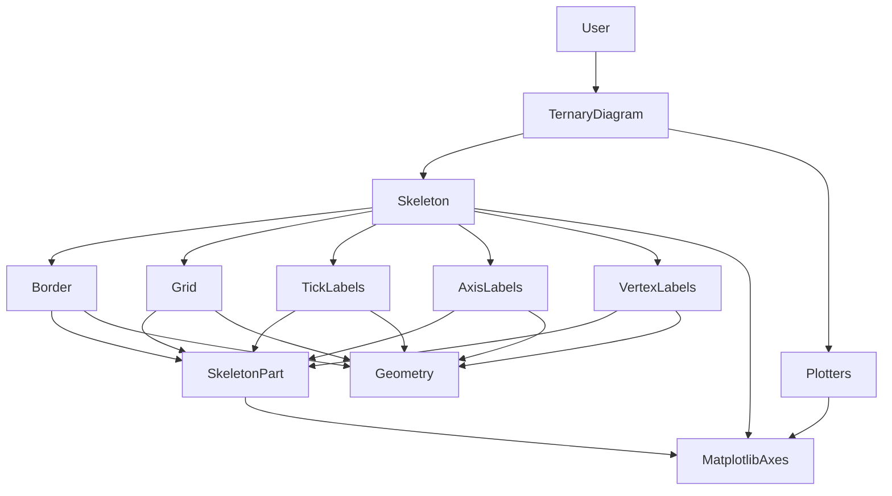
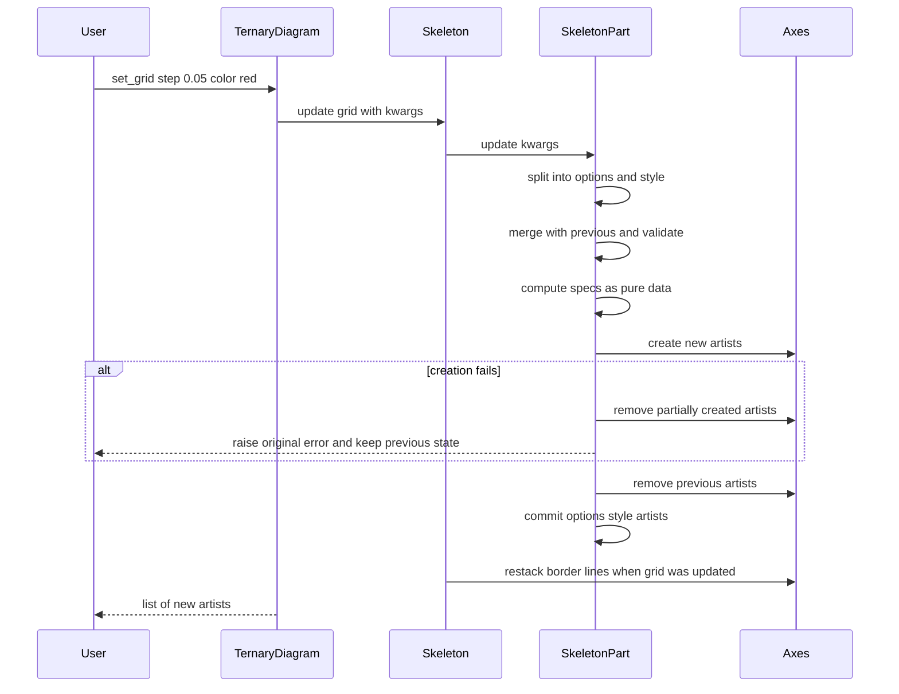

# Design Document

## Overview
**Purpose**: 三角図の土台（外枠・グリッド・目盛りラベル・軸タイトル・頂点ラベル）を部品に分け、作成時の `*_kw` 引数と作成後の `set_*` メソッドで見た目を指定・変更できるようにする。論文用の図を作る材料・化学の研究者が、目盛りの細かさ・書式・文字の大きさ・軸タイトルを雑誌の規定に合わせられるようにする。

**Users**: `TernaryDiagram` で組成マップを描く研究者。既存の利用者は何も変えずに同じ図を得て、新しい利用者は `TernaryDiagram(..., grid_kw={"step": 0.05})` や `td.set_axis_labels([...])` で仕上げる。

**Impact**: `TernaryDiagram.__init__` に直書きされた描画を、新しいプライベートモジュール `_skeleton.py` の部品クラスへ移す。各部品は自分の artist を保持し、描き直すときは古い artist を取り除く。配置の計算は `utils.py` の純粋関数にする。Plotter（`scatter` などの描画メソッド）には手を入れない。

### Goals
- 何も指定しないとき、artist の数・座標・スタイル・zorder・部品間の追加順が v3 と一致する
- 5 つの部品すべてを、作成時と作成後に同じ名前・同じ意味で変更できる
- 描き直しても古い artist が残らず、重なり順と表示範囲が変わらない
- 配置の計算を図なしで検証できる

### Non-Goals
- 描画メソッドの見た目と描画後の処理（`tight_layout`、カラーバーの自動追加）。`plot-side-effects` が持つ
- 目盛り線（短い刻み線）の描画、目盛りを付ける辺の切り替え、辺ごとの書式
- 三角形の部分拡大・回転・projection 化、rcParams やスタイルオブジェクトによる全体の既定値
- 使い方ページ（`user-guide-docs` が持つ）

## Boundary Commitments

### This Spec Owns
- `TernaryDiagram.__init__` が描く土台の 5 部品（外枠・グリッド・目盛りラベル・軸タイトル・頂点ラベル）の描画、保持、描き直し
- 作成時の引数 `border_kw` / `grid_kw` / `tick_kw` / `axis_label_kw` / `vertex_label_kw` と、作成後のメソッド `set_border` / `set_grid` / `set_ticks` / `set_axis_labels` / `set_vertex_labels`、artist の取り出し口 `border_lines_` / `grid_lines_` / `tick_labels_` / `axis_labels_` / `vertex_labels_`
- 土台の既定の見た目（v3 と同一）と、土台の部品間の重なり順（外枠はグリッドより手前）
- 土台を描く前に三角形の頂点を Axes のデータ範囲へ登録すること
- `utils.py` に追加する配置の純粋関数（`get_tick_values`、`get_edge_points`、`get_grid_segments`、`get_axis_label_position`、`get_tick_formatter`）と型別名 `TickFormat`
- 上記の docstring（`set_*` と取り出し口、`utils` の 5 関数の docstring 全体、クラスの docstring の Notes、`TernaryDiagram.__init__` の docstring のうち 5 つの `*_kw` の Parameters の項目だけ）、テスト、CHANGELOG の New features と Bug fixes の該当項目

### Out of Boundary
- `_BasePlotter` とそのサブクラス、`TernaryDiagram` の描画メソッド（`scatter` / `contour` / `plot` / `annotate` / `colorbar`）
- `fig.tight_layout()` などの描画後の処理、レイアウトエンジンの判定、カラーバーの方針、FutureWarning / 非推奨の共通ヘルパー（`plot-side-effects`）
- `TernaryDiagram.__init__` の `tight_layout` 引数、その検証と `PostDrawContext` の作成、その docstring 項目（`plot-side-effects`）
- `TernaryDiagram.__init__` の docstring の Examples 節（`user-guide-docs` だけが持つ。本 spec は変更しない）
- `utils.check_bool` / `utils.check_optional_bool`、共通 doctest ランナー `tests/test_doctests.py`、`tests/conftest.py` の `td` fixture、CHANGELOG の `Unreleased` の見出しの組（`plot-side-effects`。本 spec は使うだけで変更しない）
- zorder 定数（`DEFAULT_ZORDER_*`）の値の変更と、新しい描画の重なり順（`region-plots`、`heatmaps`）
- `utils.get_label` の判定規則の変更（direct implementation 候補の annotate-plain-text）
- 使い方ページと README（`user-guide-docs`）

### Allowed Dependencies
- `matplotlib` の公開 API: `Axes.plot`、`Axes.text`、`Axes.add_line`、`Axes.update_datalim`、`Axes.autoscale_view`、`Artist.remove`、`matplotlib.cbook.normalize_kwargs`
- `numpy`
- `plot-side-effects` が用意するもの（本 spec の実装時にはマージ済み）: `utils.check_bool(value, name)`（真偽値の検証）、`TernaryDiagram.__init__` の `tight_layout` 引数とその検証、`tests/conftest.py` の `td` fixture（`tight_layout=True` で作る）、共通 doctest ランナー `tests/test_doctests.py`、CHANGELOG の `Unreleased` の見出しの組（Breaking changes / New features / Deprecations / Bug fixes / Other changes）
- パッケージ内の依存方向は `utils` → `_skeleton` → `_api` の一方向。`_skeleton` は `_api` を import しない（zorder は `_api` から引数で受け取る）。`utils` はパッケージ内の他モジュールを import しない
- 新しいランタイム依存は追加しない

### Revalidation Triggers
- `*_kw` 引数・`set_*` メソッド・取り出し口の名前、引数、戻り値、merge の意味を変えたとき → `user-guide-docs` の見た目の変え方ページを見直す
- 土台の部品の zorder の値、または部品間の積み直し規則を変えたとき → `region-plots`、`heatmaps` の重なり順を見直す
- 目盛りの配置規約（成分と辺の対応、値の向き）を変えたとき → docstring と使い方ページ、利用者の図
- `TernaryDiagram.__init__` のシグネチャや検証の順を変えたとき → roadmap の「横断の取り決め」（最終形と検証の順）と `plot-side-effects` の `__init__` を見直す。本 spec の側から変えない
- `utils` の追加関数のシグネチャを変えたとき → それを使う独自の注記や他 spec
- `user-guide-docs` が Sphinx の `autoclass_content="both"` を設定したとき、またはその設定を変えたとき → クラスの docstring と `__init__` の docstring の連結のされ方が変わり、クラスの docstring の Notes（目盛りの配置規約、merge の意味、両端の目盛りの近接、同じ zorder の利用者の artist との前後関係）が `__init__` の Parameters に対してどこに表示されるかが変わる。本 spec のクラスの docstring の Notes の位置と内容を見直す
- `plot-side-effects` が `utils.check_bool` のシグネチャやメッセージ、`td` fixture の作り方、`tests/test_doctests.py` の対象や実行条件を変えたとき → 本 spec の検証・テスト・docstring の Examples を見直す

## Architecture

### Existing Architecture Analysis
- 公開ファサード `TernaryDiagram` → 描画種別ごとの Plotter → 状態を持たない `utils` の 3 層構造。土台の描画だけは Plotter を経由せず `__init__` に直書きされ、artist への参照を持たない
- 線の zorder は `DEFAULT_ZORDER_GRIDS`（1）、文字は matplotlib の既定（3）。外枠とグリッドは同じ zorder で、外枠が手前に見えるのは後から追加したため
- `_api.py` は `plot-side-effects` も編集する。roadmap の Implementation Order により `plot-side-effects` が先にマージされ、`__init__` に `tight_layout` を足した状態から本 spec を実装する。本 spec は `__init__` の本体（`materials` の検証、`*_kw` の検証、土台の描画の委譲）と docstring の `*_kw` の項目、新しいメソッド・プロパティだけに差分を限り、Plotter のコードと `tight_layout` の扱いには触れない

### Architecture Pattern & Boundary Map



- `Plotters` は本 spec の境界外（変更しない）。`Geometry` は `utils.py` の純粋関数群
- **Selected pattern**: 部品クラス + 集約。基底 `_SkeletonPart` が「統合 → 検証 → 図形の仕様の計算 → 生成 → 古い artist の削除」の手順を持ち、部品は既定値・検証・仕様の計算だけを持つ
- **Dependency direction**: `utils`（純粋関数）→ `_skeleton`（部品と集約）→ `_api`（公開ファサード）。逆向きの import は禁止
- **Existing patterns preserved**: ユーザー指定優先の既定値注入、`DEFAULT_*` 定数、読み取り専用の派生属性（末尾 `_` + setter で `AttributeError`）、`utils` の doctest（共通ランナーで実行）、入力検証の `TypeError` / `ValueError`（真偽値は `utils.check_bool`）
- **Steering compliance**: 公開 API は `TernaryDiagram` に集約し、戻り値は matplotlib のネイティブオブジェクト。ランタイム依存は numpy と matplotlib のみ

### Technology Stack

| Layer | Choice / Version | Role in Feature | Notes |
|-------|------------------|-----------------|-------|
| Library runtime | Python >= 3.9 | 実装言語 | 既存の `_api.py` / `utils.py` はファイルの書き方に合わせ `typing.Tuple` / `List` / `Dict` / `Optional` / `Union` を使う。新規の `_skeleton.py` は tech.md の規約どおり `from __future__ import annotations` を付け、注釈には組み込みジェネリクス（`list[...]`、`dict[...]`、`type[...]`）と `X \| None` を使う（Implementation Notes） |
| Drawing | matplotlib（上限なし） | artist の生成・削除・積み直し、kwargs の別名統合 | 公開 API のみ使う。`normalize_kwargs` の Artist クラス指定は古い版で要確認（Implementation Notes） |
| Numerics | numpy >= 1.20 | 目盛りの値・座標の計算 | doctest の出力は numpy 1.x / 2.x で同じ表記になる形（配列か Python の float）にする |

## File Structure Plan

### Directory Structure
```
src/ternary_diagram/
├── _skeleton.py   # 新規: 土台の部品と集約。_LineSpec / _TextSpec（図形の仕様）、_SkeletonPart（基底）、
│                  #       _Border / _Grid / _TickLabels / _AxisLabels / _VertexLabels（5 部品）、_Skeleton（集約）、
│                  #       PartName、部品の既定値定数（DEFAULT_*）。from __future__ import annotations
├── _api.py        # 変更: TernaryDiagram の __init__ を _Skeleton へ委譲、*_kw 引数、set_* メソッド、取り出し口
└── utils.py       # 変更: TickFormat、get_tick_values、get_edge_points、get_grid_segments、
                   #       get_axis_label_position、get_tick_formatter を追加
tests/
├── _skeleton_expected.py    # 新規: v3 の描画式から既定の土台の期待値を計算するテスト用の補助（収集対象外の名前）
├── test_skeleton_parts.py   # 新規: _SkeletonPart・5 部品・_Skeleton の単体テスト
├── test_skeleton.py         # 新規: 公開 API 経由の set_* / *_kw / 取り出し口 / 重なり順 / 表示範囲 / 検証と巻き戻し
├── test_ternary_diagram.py  # 変更: 既定の土台の特性テスト、__init__ の引数検証と検証の順
└── test_utils.py            # 変更: 追加した純粋関数のテスト（doctest のランナーは置かない）
CHANGELOG.md                 # 変更: Unreleased の New features と Bug fixes に追記
```

変更しないが本 spec が使うファイル（`plot-side-effects` が持つ）: `tests/conftest.py`（`td` fixture）、`tests/test_doctests.py`（共通 doctest ランナー。本 spec の `set_*` と `utils` の 5 関数の Examples もここで実行される）

### Modified Files
- `src/ternary_diagram/_api.py` — `TernaryDiagram.__init__` の描画コード（外枠・グリッド・頂点ラベル・目盛りラベル）を `_Skeleton` の構築に置き換える。`plot-side-effects` が足した `tight_layout` の後ろにキーワード専用引数 5 つを足し、`__init__` の docstring の Parameters にその 5 項目だけを足す（Examples 節は変更しない）。`set_*` メソッド 5 つ（Examples 付きの docstring）、取り出し口のプロパティ 5 つ、クラスの docstring の Notes（目盛りの配置規約）を足す。Plotter、描画メソッド、`tight_layout` の扱いは変更しない
- `src/ternary_diagram/utils.py` — 純粋関数 5 つと型別名 `TickFormat` を追加する。既存関数（`plot-side-effects` が足した `check_bool` / `check_optional_bool` を含む）は変更しない
- `tests/test_ternary_diagram.py` — リファクタ前に既定の土台の特性テストを足す。`__init__` の引数検証と検証の順のテストを足す。既存のテストは変更せずに通ること
- `tests/test_utils.py` — 純粋関数のテストを足す。doctest は共通ランナー `tests/test_doctests.py` が実行するので、ここに `doctest.testmod` は置かない
- `CHANGELOG.md` — `plot-side-effects` がそろえた `Unreleased` の見出しの組のうち、New features（`*_kw` 引数、`set_*` メソッド、取り出し口、`utils` の配置の関数）と Bug fixes（`materials` の要素不足が `IndexError` ではなく `ValueError` になる。既存の「Malformed inputs raise `ValueError`」の項目と同じ見出し）に追記する。見出しは新しく作らない

## System Flows

### 部品の変更（`set_*` 共通）



- 検証と仕様の計算は artist を作る前に終わるので、そこで失敗しても `Axes` は何も変わらない。artist の生成中に失敗したときは、作りかけの artist を取り除いてから元の例外を送出する（要件 10.8）
- 新しい artist を作ってから古い artist を消すため、最終的な追加順は「消してから作る」と同じになる
- 積み直しは「グリッドを更新したら外枠を末尾へ移す」の 1 規則だけ。文字の部品は互いに重ならないので積み直さない

### 構築（`__init__`）
1. 検証は roadmap の「横断の取り決め」の順（`ax` → `materials` → `tight_layout` → `*_kw`）で、Axes の設定や土台の描画より前に行う
   1. `check_ax(ax)`（現行どおり）
   2. `materials` を検証する（本 spec が足す。3 要素未満は `ValueError`、4 要素以上は先頭 3 要素を使う現行の挙動を保つ）
   3. `tight_layout` の検証と `PostDrawContext` の作成（`plot-side-effects` がマージ済み。本 spec は変更しない）
   4. `*_kw` が `None` か `Mapping` であること（それ以外は `TypeError`）と、`vertex_label_kw` に `labels` がないこと（あれば `ValueError`）を確かめる（本 spec が足す。5 つを `border_kw` → `grid_kw` → `tick_kw` → `axis_label_kw` → `vertex_label_kw` の順に確かめる）
2. `set_aspect("equal", adjustable="datalim")`、目盛りと spines の非表示（現行どおり）
3. `_Skeleton` を構築: 三角形の頂点をデータ範囲へ登録して `autoscale_view()` を呼び、部品をグリッド → 外枠 → 頂点ラベル → 目盛りラベル → 軸タイトルの順に、それぞれの `*_kw` を初期設定として 1 回だけ描く。途中の部品が検証や生成で失敗したら、それまでに描いた部品の artist を取り除いてから例外を送出する（2. の Axes の設定は戻さない）
4. `x_` / `y_` の初期化（現行どおり）

## Requirements Traceability

| Requirement | Summary | Components | Interfaces | Flows |
|-------------|---------|------------|------------|-------|
| 1.1 | 既定の見た目が v3 と同一 | `_Skeleton`、5 部品の既定値定数 | `_Skeleton.__init__` | 構築 |
| 1.2 | 既定では軸タイトルなし | `_AxisLabels` | `labels` 既定 `(None, None, None)` | 構築 |
| 1.3 | 現行の作成時引数を同じ並びで受け付ける | `TernaryDiagram` | `__init__`（新引数はキーワード専用） | 構築 |
| 1.4 | `auto_latex_notation` の意味を保つ | `_VertexLabels` | `get_label` の適用 | 構築 |
| 2.1 | 5 部品の作成時指定と作成後変更 | `TernaryDiagram`、`_Skeleton` | `*_kw`、`set_*` | 構築、部品の変更 |
| 2.2 | 作成時と作成後で同じ名前・意味 | `TernaryDiagram` | `<part>_kw` = `set_<part>(**kw)` | 構築 |
| 2.3 | 変更前の図形を取り除き描き直す | `_SkeletonPart` | `update` | 部品の変更 |
| 2.4 | 未指定の項目は直前の設定を引き継ぐ | `_SkeletonPart` | `update`（merge） | 部品の変更 |
| 2.5 | 他の部品と利用者の図形に触れない | `_SkeletonPart` | 自分の `_artists` だけを remove | 部品の変更 |
| 2.6 | 非表示 → 表示で直前の設定に戻る | `_SkeletonPart` | `visible` と保持した設定 | 部品の変更 |
| 2.7 | matplotlib のプロパティを全図形に適用し優先 | `_SkeletonPart` | `normalize_kwargs` で統合した style | 部品の変更 |
| 2.8 | レイアウトを変えない | `_Skeleton`、`_SkeletonPart` | `tight_layout` などを呼ばない | 構築、部品の変更 |
| 3.1 | 部品ごとに図形を取り出せる | `TernaryDiagram` | `*_lines_` / `*_labels_` | — |
| 3.2 | 変更時に新しい図形を返す | `TernaryDiagram`、`_SkeletonPart` | `set_*` の戻り値 | 部品の変更 |
| 3.3 | 非表示中は空 | `_SkeletonPart` | `artists` | 部品の変更 |
| 3.4 | 描き直し後のものに置き換わる | `_SkeletonPart` | `artists`（コピーを返す） | 部品の変更 |
| 3.5 | 取り出し口は読み取り専用 | `TernaryDiagram` | setter で `AttributeError` | — |
| 4.1 | 外枠の線種・色・線幅 | `_Border` | `set_border(**kwargs)` | 部品の変更 |
| 4.2 | 外枠の非表示 | `_Border` | `set_border(visible=False)` | 部品の変更 |
| 5.1 | グリッドの間隔 | `_Grid`、`get_tick_values`、`get_grid_segments` | `set_grid(step=)` | 部品の変更 |
| 5.2 | グリッドの線の見た目 | `_Grid` | `set_grid(**kwargs)` | 部品の変更 |
| 5.3 | グリッドの非表示 | `_Grid` | `set_grid(visible=False)` | 部品の変更 |
| 5.4 | グリッドと目盛りの間隔は独立 | `_Grid`、`_TickLabels` | 別々の `step` | — |
| 6.1 | 目盛りの配置規約を保つ | `_TickLabels`、`get_edge_points` | 成分 k → 成分 (k+1) mod 3 = 0 の辺 | 構築 |
| 6.2 | 目盛りの間隔 | `_TickLabels`、`get_tick_values` | `set_ticks(step=)` | 部品の変更 |
| 6.3 | 既定はパーセント表示 | `get_tick_formatter` | `fmt="percent"` | 構築 |
| 6.4 | 割合表示 | `get_tick_formatter` | `fmt="fraction"` | 部品の変更 |
| 6.5 | 独自の書式 | `get_tick_formatter` | `fmt` に書式文字列または関数 | 部品の変更 |
| 6.6 | 両端（0 と 100）の表示 | `get_tick_values` | `set_ticks(endpoints=True)` | 部品の変更 |
| 6.7 | 目盛りの文字の見た目 | `_TickLabels` | `set_ticks(**kwargs)` | 部品の変更 |
| 6.8 | 目盛りの非表示 | `_TickLabels` | `set_ticks(visible=False)` | 部品の変更 |
| 7.1 | 軸タイトルを辺の外側中央に辺と平行に | `_AxisLabels`、`get_axis_label_position` | `set_axis_labels(labels)` | 部品の変更 |
| 7.2 | 一部だけ指定 | `_AxisLabels` | `labels` の `None` / `""` は描かない | 部品の変更 |
| 7.3 | 軸タイトルは自動整形しない | `_AxisLabels` | `get_label` を使わない | 部品の変更 |
| 7.4 | 辺からの距離 | `_AxisLabels`、`get_axis_label_position` | `set_axis_labels(pad=)` | 部品の変更 |
| 7.5 | 軸タイトルの文字の見た目 | `_AxisLabels` | `set_axis_labels(**kwargs)` | 部品の変更 |
| 7.6 | 軸タイトルの非表示 | `_AxisLabels` | `set_axis_labels(visible=False)` | 部品の変更 |
| 8.1 | 頂点ラベルの文字列の変更 | `_VertexLabels` | `set_vertex_labels(labels)` | 部品の変更 |
| 8.2 | 頂点ラベルの文字の見た目 | `_VertexLabels` | `set_vertex_labels(**kwargs)` | 部品の変更 |
| 8.3 | 頂点ラベルの位置 | `_VertexLabels` | `set_vertex_labels(offsets=)` | 部品の変更 |
| 8.4 | 頂点ラベルの非表示 | `_VertexLabels` | `set_vertex_labels(visible=False)` | 部品の変更 |
| 9.1 | 描き直しても同じ zorder | `_Skeleton`、`_SkeletonPart` | 線は `DEFAULT_ZORDER_GRIDS`、文字は既定 | 部品の変更 |
| 9.2 | 外枠は常にグリッドより手前 | `_Skeleton` | `_Border.restack` | 部品の変更 |
| 9.3 | 利用者の zorder 指定を優先 | `_SkeletonPart` | style の `zorder` 上書き | 部品の変更 |
| 9.4 | 非表示でも表示範囲を保つ | `_Skeleton` | `update_datalim` + `autoscale_view` | 構築 |
| 10.1 | 間隔の範囲外 | `get_tick_values` | `ValueError` / `TypeError` | 部品の変更 |
| 10.2 | 3 つ以外の個数 | `_VertexLabels`、`_AxisLabels` | `ValueError` | 部品の変更 |
| 10.3 | 受け付けない種類の値 | `_SkeletonPart`、各部品、`TernaryDiagram` | `TypeError`（真偽値は `utils.check_bool`） | 構築、部品の変更 |
| 10.4 | 解釈できない書式 | `get_tick_formatter` | `ValueError` / `TypeError` | 部品の変更 |
| 10.5 | `materials` と `labels` の衝突 | `TernaryDiagram` | `ValueError` | 構築 |
| 10.6 | `materials` が 3 要素未満 | `TernaryDiagram` | `ValueError` | 構築 |
| 10.7 | matplotlib のエラーを送出 | `_SkeletonPart` | 例外をそのまま再送出 | 部品の変更 |
| 10.8 | エラー時は変更前の状態を保つ | `_SkeletonPart` | 巻き戻し | 部品の変更 |
| 11.1 | 配置の計算を図なしで使える | `utils` の 5 関数 | 純粋関数 | — |
| 11.2 | 部品の配置は関数の結果から決める | 5 部品 | 仕様の計算で utils を呼ぶ | 部品の変更 |
| 11.3 | doctest を持ち実行される | `utils` の 5 関数 | 共通ランナー `tests/test_doctests.py`（`plot-side-effects`） | — |
| 12.1 | 新 API の docstring（`*_kw` は `__init__` の Parameters、使用例は対応する `set_*`） | `TernaryDiagram` | `__init__` の Parameters、`set_*` の docstring、「`*_kw` と `set_*` の対応」 | — |
| 12.2 | 目盛りの配置規約を明記 | `TernaryDiagram` | クラスと `set_ticks` の docstring | — |
| 12.3 | CHANGELOG | `CHANGELOG.md` | Unreleased の New features / Bug fixes | — |
| 12.4 | 使用例の規約と共通 doctest の実行 | `TernaryDiagram`、`utils` の 5 関数 | 「Docstring Examples」（docstring ごとの import）、共通ランナー `tests/test_doctests.py` | — |

## Components and Interfaces

| Component | Domain/Layer | Intent | Req Coverage | Key Dependencies (P0/P1) | Contracts |
|-----------|--------------|--------|--------------|--------------------------|-----------|
| Geometry functions（`utils.py`） | utils | 配置と書式の純粋関数 | 5.1, 6.1–6.6, 7.1, 7.4, 10.1, 10.4, 11.1–11.3, 12.4 | `three2two`（P0）、numpy（P0） | Service |
| `_SkeletonPart` | _skeleton | 部品共通の更新手順・巻き戻し・取り出し | 2.3–2.8, 3.3, 3.4, 9.1, 9.3, 10.3, 10.7, 10.8 | matplotlib Axes（P0）、`utils.check_bool`（P0） | Service, State |
| `_Border` / `_Grid` / `_TickLabels` / `_AxisLabels` / `_VertexLabels` | _skeleton | 各部品の既定値・検証・仕様の計算 | 1.1, 1.2, 1.4, 4.x, 5.x, 6.x, 7.x, 8.x, 10.2 | Geometry（P0）、`_SkeletonPart`（P0） | Service |
| `_Skeleton` | _skeleton | 部品の構築順、データ範囲の登録、積み直し | 1.1, 2.1, 2.8, 9.2, 9.4 | 5 部品（P0） | Service |
| `TernaryDiagram`（拡張） | _api | 引数の受け口、docstring、取り出し口 | 1.3, 2.1, 2.2, 3.1, 3.2, 3.5, 10.3, 10.5, 10.6, 12.1, 12.2, 12.4 | `_Skeleton`（P0）、`tight_layout` の検証（P0、`plot-side-effects`） | Service |

### utils（純粋関数）

#### Geometry functions

| Field | Detail |
|-------|--------|
| Intent | 土台の配置（値の列、辺上の点、グリッド線、軸タイトルの位置）と目盛りの書式を、図なしで計算する |
| Requirements | 5.1, 6.1, 6.2, 6.3, 6.4, 6.5, 6.6, 7.1, 7.4, 10.1, 10.4, 11.1, 11.2, 11.3, 12.4 |

**Responsibilities & Constraints**
- 成分の番号 `component` は 0（上）、1（左下）、2（右下）。成分 k の目盛りは、成分 (k+1) mod 3 が 0 になる辺（k=0 → 右辺、k=1 → 左辺、k=2 → 底辺）に付き、その辺上で値は反時計回りに増える
- 座標変換は既存の `three2two` だけを使う。副作用（Axes、グローバル状態）を持たない
- 浮動小数の誤差を抑えるため、値の列は小数 12 桁に丸める。doctest の出力は numpy の版で表記が変わらない形（配列、または Python の `float` / `str`）にする

**Dependencies**
- Inbound: 5 部品 — 仕様の計算（P0）
- Outbound: `three2two` — 3 成分 → 2 次元（P0）
- External: numpy — 配列計算（P0）

**Contracts**: Service [x]

##### Service Interface
```python
TickFormat = Union[str, Callable[[float], str]]

def get_tick_values(step: float, endpoints: bool = False) -> np.ndarray:
    """Multiples of `step` in the open interval (0, 1), ascending.
    With endpoints=True, 0.0 and 1.0 are added.
    Raises TypeError if step is not a real number (bool is rejected),
    ValueError if step is not finite or not in (0, 1]."""

def get_edge_points(
    values: ArrayLike, component: int
) -> Tuple[np.ndarray, np.ndarray]:
    """(x, y) of points where `component` == value and
    component (k+1) % 3 == 0, i.e. on the edge that carries the ticks
    of `component`. Raises ValueError if component not in {0, 1, 2}."""

def get_grid_segments(
    values: ArrayLike, component: int
) -> Tuple[np.ndarray, np.ndarray]:
    """Iso-lines `component` == value. Returns (xs, ys), each of shape
    (n, 2): column 0 is the point where component (k+1) % 3 == 0,
    column 1 is the point where component (k+2) % 3 == 0."""

def get_axis_label_position(
    component: int, pad: float
) -> Tuple[float, float, float]:
    """(x, y, rotation_deg) of the axis title of `component`: the midpoint
    of its tick edge moved by `pad` along the outward normal. Rotation is
    300 (right edge), 60 (left edge) or 0 (bottom edge) so that the text
    is parallel to the edge and never upside down.
    Raises TypeError/ValueError if pad is not a finite real number."""

def get_tick_formatter(fmt: TickFormat) -> Callable[[float], str]:
    """Return a function that turns a value in [0, 1] into a label.
    'percent': format(round(v * 100, 10), 'g')  -> '10', '2.5', '100'
    'fraction': format(round(v, 12), 'g')       -> '0.1', '1'
    other str: %-style first (fmt % v); on TypeError/ValueError,
               {}-style (fmt.format(v, x=v))  -> '%.2f', '{:.0%}', '{x:.1f}'
    callable:  str(fmt(v))
    Raises TypeError if fmt is neither str nor callable, ValueError if a
    str is not a preset, contains neither '%' nor '{', or fails to format
    the probe value 0.5 in both styles."""
```
- Preconditions: `values` は 0〜1 の実数の 1 次元配列にできるもの
- Postconditions: 同じ入力に同じ出力を返す。`get_tick_values(0.1)` は 9 要素、`get_tick_values(0.05)` は 19 要素、`get_tick_values(1)` は空
- Invariants: 既定（`step=0.1`、`fmt="percent"`）で得られる文字列は v3 の `"%d0" % i` と一致する

**Implementation Notes**
- Integration: 各関数の docstring（本 spec が書く）に doctest 形式の Examples を付ける。実行は共通ランナー `tests/test_doctests.py`（`plot-side-effects`）が行い、本 spec は独自のランナー（`doctest.testmod` を呼ぶテスト）を作らない。図や Axes を使わない関数なので、Examples は docstring ごとに使う名前を import する行（`>>> from ternary_diagram.utils import get_tick_values` など。numpy を使う例は `>>> import numpy as np` も）から始め、図を作らずに関数を呼び、ファイルを書き出さない。Parameters の各項目は意味を書く文の後に `, by default X` を添える（「Docstring Examples」「Docstring Parameters」）
- Validation: `step` の検証は `get_tick_values` に置き、部品からはこれを通して検証する
- Risks: 呼び出し可能な `fmt` の例外は整形時にそのまま伝わる（部品側で巻き戻す）

### _skeleton（部品と集約）

#### `_SkeletonPart`（基底）

| Field | Detail |
|-------|--------|
| Intent | 部品の設定（options と style）と artist を保持し、統合・検証・描き直し・巻き戻しを共通の手順で行う |
| Requirements | 2.3, 2.4, 2.5, 2.6, 2.7, 2.8, 3.3, 3.4, 9.1, 9.3, 10.3, 10.7, 10.8 |

**Responsibilities & Constraints**
- options: 部品固有の名前付き項目（`visible`、`step` など）。`None` は「変更しない」
- style: matplotlib のプロパティ。`normalize_kwargs(kw, ARTIST_CLASS)` で正式名にそろえ、既定値 → 直前の値 → 今回の指定の順に上書き統合する
- 自分が作った artist だけを削除する。他の部品・利用者の artist、図のレイアウトには触れない
- 線の部品は style の既定に `zorder`（構築時に受け取る値）を含める。文字の部品は zorder を指定しない（matplotlib の既定 3 のまま）

**Dependencies**
- Inbound: `_Skeleton` — 構築と更新（P0）
- External: matplotlib `Axes.plot` / `Axes.text` / `Artist.remove` / `Axes.add_line` / `cbook.normalize_kwargs`（P0）

**Contracts**: Service [x] / State [x]

##### Service Interface
```python
from __future__ import annotations  # new module: builtin generics and X | None

from collections.abc import Mapping, Sequence
from typing import Any, ClassVar, Literal, NamedTuple, Union

class _LineSpec(NamedTuple):
    xdata: Sequence[float]
    ydata: Sequence[float]
    kwargs: dict[str, Any]       # normalized Line2D properties

class _TextSpec(NamedTuple):
    x: float
    y: float
    s: str
    kwargs: dict[str, Any]       # normalized Text properties

# evaluated at runtime, so `|` cannot be used on Python 3.9
Spec = Union[_LineSpec, _TextSpec]

class _SkeletonPart:
    OPTION_DEFAULTS: ClassVar[dict[str, Any]]   # must include "visible": True
    STYLE_DEFAULTS: ClassVar[dict[str, Any]]
    ARTIST_CLASS: ClassVar[type[matplotlib.artist.Artist]]  # Line2D or Text

    def __init__(self, ax: matplotlib.axes.Axes, *, zorder: float | None = None,
                 **initial: Any) -> None: ...
        # sets defaults, then calls self.update(**initial) exactly once
    def update(self, **kwargs: Any) -> list[matplotlib.artist.Artist]: ...
    @property
    def artists(self) -> list[matplotlib.artist.Artist]: ...  # a new list
    def restack(self) -> None: ...  # Line2D only: remove() then ax.add_line()

    # hooks implemented by each part
    def _validate(self, options: dict[str, Any]) -> dict[str, Any]: ...
    def _specs(self, options: dict[str, Any],
               style: dict[str, Any]) -> list[Spec]: ...
```
- Preconditions: `kwargs` のキーは `OPTION_DEFAULTS` のキーか、`ARTIST_CLASS` のプロパティ名（別名可）
- Postconditions: 成功時は `artists` が新しい artist だけになり、古い artist は `Axes` から消えている。`visible=False` のときは `artists == []`
- Invariants: `artists` に含まれる artist はすべてこの部品が作ったもの。利用者が `Artist.remove()` や `Axes.cla()` で Axes から外したものを除き、`Axes` 上にある

##### State Management
- State model: `_options`（検証済みで全項目そろった辞書）、`_style`（正式名の辞書）、`_artists`（現在描いている artist のリスト）
- 更新手順: (1) kwargs を options と style に分ける → (2) `None` を除いて options を統合し `_validate` → (3) style を統合し、プロパティ名を `ARTIST_CLASS` の setter と照合（表示・非表示にかかわらず行う） → (4) `visible` なら `_specs` で仕様を計算（純粋） → (5) 仕様から artist を順に生成。失敗したら作りかけを remove して例外を再送出 → (6) 古い artist のうち、まだ `Axes` の子であるものを remove（利用者が外したものは飛ばす） → (7) `_options` / `_style` / `_artists` を確定
- Consistency: (1)〜(5) の失敗では `_options` / `_style` / `_artists` と `Axes` は変わらない
- `visible` の検証は基底で、`None` を除いて統合した後の値を `utils.check_bool(visible, "visible")`（`plot-side-effects` が追加。`bool` / `numpy.bool_` 以外は `TypeError`）で行う。独自の真偽値チェックは書かない

**Implementation Notes**
- Integration: 線は `ax.plot(xdata, ydata, **kwargs)[0]`、文字は `ax.text(x, y, s, **kwargs)` で作る（現行と同じ呼び出しにして、自動スケールの要求や色のサイクルの扱いを変えない）
- Validation: 未知のプロパティ名は手順 (3) で `Artist.set` と同じ文面の `AttributeError`、部品が artist ごとに渡す名前（`Line2D` の `xdata` / `ydata`、`Text` の `x` / `y` / `text`）は `TypeError` にする。部品を非表示にしている間も検査し、受け付けない名前を設定に残さない。値の不正は手順 (5) で matplotlib が出す例外を捕まえて巻き戻し、同じ例外を送出する
- 3 つの名前を受け取る引数（軸タイトルと頂点ラベルの `labels`）は、str / bytes / Mapping / Set / 反復できない値を `TypeError` にし、それ以外（list、tuple、pandas の Index / Series、numpy 配列など）を `tuple(...)` に変換してから個数（`ValueError`）と要素（`TypeError`）を確かめる
- 利用者が外した artist: `update` の手順 (6) と `restack` は、`ax.get_children()` に含まれない artist を飛ばす。外された artist は remove できず（`ValueError` / `NotImplementedError`）、Axes に戻すべきでもないため。これにより、外した後の `set_*` もエラーにならず、新しい artist が孤立して残ることもない
- Typing: `_skeleton.py` は新規モジュールなので、tech.md の規約どおり `from __future__ import annotations` を付け、注釈は組み込みジェネリクス（`list[...]`、`dict[...]`、`type[...]`）、`collections.abc` の `Sequence` / `Mapping`、`X | None` で書く（`typing.List` / `Dict` / `Optional` は使わない）。実行時に評価される式（型別名 `Spec`、`isinstance` の第 2 引数）だけは Python 3.9 で `|` が使えないので、`typing.Union` やタプルで書く
- Risks: `normalize_kwargs` に Artist クラスを渡す呼び方が古い matplotlib にない場合は、分岐で別名の辞書を渡す

#### 5 つの部品

| Part | ARTIST_CLASS | OPTION_DEFAULTS | STYLE_DEFAULTS | 仕様の計算 | Requirements |
|------|--------------|-----------------|----------------|------------|--------------|
| `_Border` | Line2D | `visible=True` | `color="black"`, `linewidth=2`, `linestyle="-"`, `zorder` | 3 本: 底辺 `[0,1]×[0,0]`、左辺 `[0,0.5]×[0,√3/2]`、右辺 `[1,0.5]×[0,√3/2]`（現行の順） | 1.1, 4.1, 4.2 |
| `_Grid` | Line2D | `visible=True`, `step=0.1` | `color="gray"`, `linewidth=0.5`, `zorder` | 成分 0, 1, 2 の順に `get_grid_segments(get_tick_values(step), k)` | 1.1, 5.1–5.4 |
| `_TickLabels` | Text | `visible=True`, `step=0.1`, `fmt="percent"`, `endpoints=False` | `fontsize=10` | 値ごとに成分 0, 1, 2 の順で、`get_edge_points` + 辺ごとのずらし量、辺ごとの文字揃え・回転の上に style を重ねる | 1.1, 6.1–6.8 |
| `_AxisLabels` | Text | `visible=True`, `labels=(None, None, None)`, `pad=0.15` | `fontsize=12`, `horizontalalignment="center"`, `verticalalignment="center"` | 成分 0, 1, 2 の順に、`None` / `""` でないものだけ `get_axis_label_position(k, pad)` の位置と回転で描く。文字列は整形しない | 1.2, 7.1–7.6 |
| `_VertexLabels` | Text | `visible=True`, `labels=<materials の先頭 3 つ>`, `offsets=((0, 0.02), (0, -0.05), (0, -0.05))` | `fontsize=16` | 上・左下・右下の頂点 + `offsets[i]` に、頂点ごとの文字揃えの上に style を重ねて描く。`auto_latex_notation` が真なら `get_label` で整形 | 1.1, 1.4, 8.1–8.4 |

`_VertexLabels` だけは `__init__(ax, *, auto_latex_notation: bool, labels: Sequence[Any], **initial)` を持ち、`auto_latex_notation` を構築時に固定する（作成後に変える手段は設けない。`set_vertex_labels(labels=...)` の新しい文字列にも同じ設定を適用する）。`labels` の初期値は `materials` の先頭 3 要素。

辺・頂点ごとの既定（style より優先度が低い。利用者が同じプロパティを指定すると全辺・全頂点に同じ値が効く）:

| 対象 | 位置のずらし量 | 文字揃え・回転 |
|------|----------------|----------------|
| 目盛り 成分 0（右辺） | `(0, 0)` | `verticalalignment="bottom"`, `horizontalalignment="left"` |
| 目盛り 成分 1（左辺） | `(-0.01, 0.04)` | `rotation=300`, `verticalalignment="top"`, `horizontalalignment="right"` |
| 目盛り 成分 2（底辺） | `(0.02, 0)` | `rotation=60`, `verticalalignment="top"`, `horizontalalignment="right"` |
| 頂点 0（上） | `offsets[0]` | `horizontalalignment="center"`, `verticalalignment="bottom"` |
| 頂点 1（左下） | `offsets[1]` | `horizontalalignment="right"`, `verticalalignment="top"` |
| 頂点 2（右下） | `offsets[2]` | `horizontalalignment="left"`, `verticalalignment="top"` |
| 軸タイトル 成分 k | `get_axis_label_position(k, pad)` | `rotation` は同関数の値（300 / 60 / 0） |

部品ごとの検証（`_validate`）:
- `_Grid` / `_TickLabels`: `step` は `get_tick_values` で検証（10.1, 10.3）。`fmt` は `get_tick_formatter` で検証（10.4）。`endpoints` は `utils.check_bool(endpoints, "endpoints")` で検証（10.3）
- `_AxisLabels`: `labels` は長さ 3 のシーケンス（10.2）、各要素は `str` か `None`（10.3）。`pad` は有限の実数（10.3）
- `_VertexLabels`: `labels` は長さ 3 のシーケンス（10.2）。`auto_latex_notation` が真なら各要素は `str`（`get_label` の `ValueError` を仕様の計算より前に出す。現行の挙動を保つ）、偽なら任意のオブジェクトを表示する。`offsets` は形状 `(3, 2)` の有限な実数配列に変換できること（10.2）

**Implementation Notes**
- Integration: 既定値は `_skeleton.py` のモジュール定数（`DEFAULT_GRID_STEP` など、`DEFAULT_*` 命名）にまとめる。線の zorder だけは `_api.DEFAULT_ZORDER_GRIDS` を構築時に受け取る
- Validation: 既定の構築で生成される artist は、特性テストで v3 と比較する
- Risks: 両端の目盛りラベルは左下の頂点で近接する（既定は無効。docstring に記載）

#### `_Skeleton`（集約）

| Field | Detail |
|-------|--------|
| Intent | 5 部品の構築順・データ範囲の登録・積み直し規則を一か所で管理する |
| Requirements | 1.1, 2.1, 2.8, 9.2, 9.4 |

**Contracts**: Service [x]

##### Service Interface
```python
PartName = Literal["border", "grid", "ticks", "axis_labels", "vertex_labels"]

class _Skeleton:
    def __init__(
        self,
        ax: matplotlib.axes.Axes,
        materials: Sequence[Any],          # already validated: first 3 used
        auto_latex_notation: bool,
        *,
        zorder: float,                     # DEFAULT_ZORDER_GRIDS from _api
        border_kw: Mapping[str, Any],
        grid_kw: Mapping[str, Any],
        tick_kw: Mapping[str, Any],
        axis_label_kw: Mapping[str, Any],
        vertex_label_kw: Mapping[str, Any],
    ) -> None: ...
    # name is positional only, so that the Text alias `name` (fontname) can be passed in kwargs
    def update(self, name: PartName, /, **kwargs: Any) -> list[matplotlib.artist.Artist]: ...
    def artists(self, name: PartName) -> list[matplotlib.artist.Artist]: ...
```
- Postconditions（`__init__`）: 三角形の 3 頂点が `ax.dataLim` に含まれ、`autoscale_view()` が呼ばれている。部品はグリッド → 外枠 → 頂点ラベル → 目盛りラベル → 軸タイトルの順に 1 回ずつ描かれている。いずれかの部品の構築が失敗したときは、先に構築した部品の artist を取り除いてから元の例外を送出する
- Postconditions（`update`）: `name == "grid"` のときは更新後に外枠を `restack` し、外枠の線（利用者が外したものを除く）が `ax.lines` の末尾にある
- `tight_layout` や Axes の位置の変更は行わない（2.8）

### _api（公開ファサード）

#### `TernaryDiagram`（拡張）

| Field | Detail |
|-------|--------|
| Intent | 作成時の `*_kw` と作成後の `set_*`、artist の取り出し口を公開する |
| Requirements | 1.3, 2.1, 2.2, 3.1, 3.2, 3.5, 10.3, 10.5, 10.6, 12.1, 12.2, 12.4 |

**Contracts**: Service [x]

##### Service Interface
`__init__` のシグネチャは roadmap の「横断の取り決め」の最終形と完全に一致させる。`tight_layout` までは `plot-side-effects` がマージ済みで、本 spec はその後ろに `*_kw` の 5 つを足す。キーワード専用マーカー `*` は 1 つだけ。

```python
class TernaryDiagram:
    def __init__(
        self,
        materials: Tuple[str, str, str],
        ax: Optional[matplotlib.axes.Axes] = None,
        auto_latex_notation: bool = True,
        *,
        tight_layout: Optional[bool] = None,  # plot-side-effects (unchanged here)
        border_kw: Optional[Mapping[str, Any]] = None,
        grid_kw: Optional[Mapping[str, Any]] = None,
        tick_kw: Optional[Mapping[str, Any]] = None,
        axis_label_kw: Optional[Mapping[str, Any]] = None,
        vertex_label_kw: Optional[Mapping[str, Any]] = None,
    ) -> None: ...

    def set_border(
        self, visible: Optional[bool] = None, **kwargs: Any
    ) -> List[matplotlib.lines.Line2D]: ...

    def set_grid(
        self, visible: Optional[bool] = None, *,
        step: Optional[float] = None, **kwargs: Any,
    ) -> List[matplotlib.lines.Line2D]: ...

    def set_ticks(
        self, visible: Optional[bool] = None, *,
        step: Optional[float] = None,
        fmt: Optional[TickFormat] = None,
        endpoints: Optional[bool] = None,
        **kwargs: Any,
    ) -> List[matplotlib.text.Text]: ...

    def set_axis_labels(
        self, labels: Optional[Sequence[Optional[str]]] = None, *,
        visible: Optional[bool] = None,
        pad: Optional[float] = None,
        **kwargs: Any,
    ) -> List[matplotlib.text.Text]: ...

    def set_vertex_labels(
        self, labels: Optional[Sequence[str]] = None, *,
        visible: Optional[bool] = None,
        offsets: Optional[Sequence[Tuple[float, float]]] = None,
        **kwargs: Any,
    ) -> List[matplotlib.text.Text]: ...

    # read-only; each returns a new list; setter raises AttributeError
    border_lines_: List[matplotlib.lines.Line2D]
    grid_lines_: List[matplotlib.lines.Line2D]
    tick_labels_: List[matplotlib.text.Text]
    axis_labels_: List[matplotlib.text.Text]     # drawn titles only, component order
    vertex_labels_: List[matplotlib.text.Text]
```
- `<part>_kw` は、作成直後に対応する `set_*` を `set_*(**<part>_kw)` と呼ぶのと同じ意味（2.2）。対応は次の「`*_kw` と `set_*` の対応」の表で固定する
- 名前付き引数の `None` は「直前の設定を引き継ぐ」。`**kwargs` は matplotlib の `Line2D` / `Text` のプロパティ
- 取り出し口の並び: `grid_lines_` は成分 0, 1, 2 の順で値の昇順、`tick_labels_` は値の昇順で成分 0, 1, 2 の順（v3 の追加順と同じ）、`border_lines_` は底辺・左辺・右辺、`vertex_labels_` は上・左下・右下
- Preconditions（`__init__`）: `materials` は 3 要素以上の反復可能な値で、`tuple(materials)` に変換して使う（3 未満は `ValueError`、10.6。反復できなければ `TypeError`。v3 との互換のため str の `"ABC"` は 3 文字として受け付ける）。`*_kw` は `None` か、キーがすべて str の `Mapping`（それ以外は `TypeError`、10.3）。`vertex_label_kw` に `labels` を含めない（含むと `ValueError`、10.5）
- Preconditions（`__init__` の検証の順）: `ax` → `materials` → `tight_layout` → `*_kw`（roadmap の「横断の取り決め」。詳細は「構築」フロー）。複数の引数が同時に不正なときは、この順で最初に見つかったもののエラーになる
- Postconditions: `set_*` は新しく描いた artist のリストを返す（非表示なら空、3.2, 3.3）

##### `*_kw` と `set_*` の対応
作成時の引数・作成後のメソッド・取り出し口・内部の部品の対応を次のとおり固定する。docstring、テスト（作成時と作成後の同値性のパラメータ化）、CHANGELOG はこの表に従う。

| 作成時の引数 | 作成後のメソッド | 取り出し口 | 部品（`_Skeleton` の `PartName`） | 名前付きの項目 | matplotlib のプロパティ |
|--------------|------------------|------------|-----------------------------------|----------------|-------------------------|
| `border_kw` | `set_border` | `border_lines_` | `_Border`（`"border"`） | `visible` | `Line2D` |
| `grid_kw` | `set_grid` | `grid_lines_` | `_Grid`（`"grid"`） | `visible`、`step` | `Line2D` |
| `tick_kw` | `set_ticks` | `tick_labels_` | `_TickLabels`（`"ticks"`） | `visible`、`step`、`fmt`、`endpoints` | `Text` |
| `axis_label_kw` | `set_axis_labels` | `axis_labels_` | `_AxisLabels`（`"axis_labels"`） | `labels`、`visible`、`pad` | `Text` |
| `vertex_label_kw` | `set_vertex_labels` | `vertex_labels_` | `_VertexLabels`（`"vertex_labels"`） | `visible`、`offsets`（`labels` は作成時には `materials` で与えるので `vertex_label_kw` では不可、10.5） | `Text` |

##### Docstring Examples
steering の tech.md「Docstring Examples」に従う。
- 例は docstring ごとに、必要な import の行から始め、その docstring だけで共通ランナーで実行できるようにする。ランナーの名前空間は docstring が定義されたモジュールの globals の写しで、docstring をまたいで名前は共有されない。`_api.py` は `matplotlib.pyplot` を import していないので、`plt` を前提にしない。1 つの docstring の中の例は同じ名前空間で順に実行されるので、同じ docstring の 2 つ目以降のブロック（下の (2)）は先頭の import をそのまま使う
- `set_*` 5 つの Examples は doctest 形式で、それぞれの docstring の先頭で `>>> import matplotlib.pyplot as plt` と `>>> from ternary_diagram import TernaryDiagram` を書き、`fig, ax = plt.subplots(layout="constrained")` で図を作り、`TernaryDiagram([...], ax=ax)` で三角図を作る。続けて (1) その `set_*` の呼び出し、(2) 対応する `<part>_kw` を作成時に渡した同じ結果の例を書き、本文に「作成時の `<part>_kw` は作成直後にこのメソッドを呼ぶのと同じ」と書く（12.1）。`set_vertex_labels` の (2) では `labels` を使わず（作成時は `materials` で与える、10.5）、`fontsize` や `offsets` で示す
- 取り出し口のプロパティ（共通ランナーの収集対象）の docstring に Examples を書く場合も、`set_*` と同じく自分の docstring の先頭で import の行を書き、図の作成から始める。他の docstring の `td` や `plt` を前提にしない
- `__init__` の docstring には Examples を足さない。`*_kw` の Parameters の項目では、対応する `set_*` を参照して使用例をそちらに置く
- 出力は版や環境で変わらない値だけにする。`set_*` の戻り値は変数に受け、`len(...)` や `get_text()` の結果を表示する（artist の repr はメモリ番地を含むので表示しない）
- `savefig` などファイルを書き出す処理は書かない。`set_*` の Examples は描画メソッドを呼ばずに土台だけを扱う。図はレイアウトエンジン付きなので、v3.x でも v4.0.0 でも FutureWarning は出ない（共通ランナーは FutureWarning をエラーにして実行する）
- `utils` の 5 関数は図や Axes を使わないので、Examples は docstring ごとに使う名前を import する行（`>>> from ternary_diagram.utils import get_tick_formatter` など。numpy を使う例は `>>> import numpy as np` も）から始め、図を作らずに関数を呼ぶ（tech.md の「`utils.py` の関数は docstring に doctest 形式の Examples を持つ」に従う）。`matplotlib.pyplot` は import しない。出力は numpy 1.x / 2.x で同じ表記にする
- `_skeleton.py` の private なクラスの docstring には `>>>` の例を書かない
- 実行は共通ランナー `tests/test_doctests.py`（`plot-side-effects`）が行う。本 spec は独自のランナーを作らず、このランナーで本 spec の Examples が通ることを確かめる（11.3, 12.4）

`set_grid` の docstring の Examples 節の形（1 つの docstring。他の `set_*` も、それぞれの docstring の先頭から同じ形で書く）:
```
>>> import matplotlib.pyplot as plt
>>> from ternary_diagram import TernaryDiagram
>>> fig, ax = plt.subplots(layout="constrained")
>>> td = TernaryDiagram(["Li2O", "La2O3", "TiO2"], ax=ax)
>>> lines = td.set_grid(step=0.05, color="lightgray")
>>> len(lines)
57

``grid_kw`` at construction is equivalent to calling ``set_grid``:

>>> fig, ax = plt.subplots(layout="constrained")
>>> td = TernaryDiagram(
...     ["Li2O", "La2O3", "TiO2"],
...     ax=ax,
...     grid_kw={"step": 0.05, "color": "lightgray"},
... )
>>> len(td.grid_lines_)
57
```

2 つ目のブロックは同じ docstring の続きなので、先頭の 2 行の import をそのまま使う。

`utils` の関数の Examples の形（`get_tick_values` の docstring。図は作らない）:
```
>>> from ternary_diagram.utils import get_tick_values
>>> get_tick_values(0.25).tolist()
[0.25, 0.5, 0.75]
```

##### Docstring Parameters
steering の tech.md「Docstring Examples」の Parameters の規則に従う。各項目には意味を書く文を必ず置き、既定値は文の後に `, by default X` と添える。`, by default None` だけの項目は書かない。本 spec が書く Parameters（`__init__` の 5 つの `*_kw`、`set_*` 5 つ、`utils` の 5 関数）すべてに適用する。
- `__init__` の `*_kw`: 型は `dict or None, optional`。文には、どの部品の設定か、作成直後に `set_<part>(**<part>_kw)` を呼ぶのと同じであること、受け付けるキーは対応する `set_*` を参照すること、`None` なら既定の見た目で描くことを書き、その後に `, by default None` を添える
- `set_*` の名前付き引数（`visible`、`step`、`fmt`、`endpoints`、`labels`、`pad`、`offsets`）: 型は `<型> or None, optional`。文には、項目の意味と受け付ける値、`None` なら直前の設定を引き継ぐこと、作成時の初期値（「5 つの部品」の表の `OPTION_DEFAULTS`）を書き、その後に `, by default None` を添える
- `set_*` の `**kwargs`: 既定値を持たないので `, by default` は付けない。対応する matplotlib の Artist（`Line2D` / `Text`）のプロパティで、部品のすべての図形に適用され部品の既定より優先されること、指定しなかったプロパティは直前の値を引き継ぐことを書く
- `utils` の 5 関数の引数: 既定値を持つもの（`get_tick_values` の `endpoints`）は意味の文の後に `, by default False` を添え、既定値を持たないものには `, by default` を付けない

`__init__` の `*_kw` と `set_grid` の Parameters の形:
```
grid_kw : dict or None, optional
    Settings of the grid. Passing ``grid_kw`` is equivalent to calling
    ``set_grid(**grid_kw)`` right after construction; see
    :meth:`set_grid` for the accepted keys. ``None`` draws the grid
    with the default appearance, by default None
```
```
visible : bool or None, optional
    Whether to draw the grid. ``None`` keeps the current setting
    (initially True), by default None
step : float or None, optional
    Interval of the grid lines as a fraction in (0, 1]. ``None`` keeps
    the current setting (initially 0.1), by default None
**kwargs
    Properties of :class:`matplotlib.lines.Line2D` applied to all grid
    lines. They override the defaults (``color="gray"``,
    ``linewidth=0.5``), and properties not given keep their current
    values.
```

**Implementation Notes**
- Integration: `plot-side-effects` がマージ済みの `__init__` に、`*_kw` を `tight_layout` の後ろへ足す（上のシグネチャのとおり）。`materials` の検証は `check_ax` と `tight_layout` の検証の間に、`*_kw` の検証は `tight_layout` の検証の後に入れる。`__init__` の描画コードを `_Skeleton` の構築に置き換え、`self.__skeleton` に保持する
- Docstring: `__init__` の docstring には、`tight_layout` の項目の後ろに 5 つの `*_kw` の Parameters の項目だけを足す（型 `dict or None, optional`。意味の文に、どの部品の設定か、作成直後に対応する `set_*` を呼ぶのと同じ意味であること、受け付けるキーは対応する `set_*` を参照すること、`None` なら既定の見た目であることを書き、文の後に `, by default None` を添える。「Docstring Parameters」）。Examples 節は `user-guide-docs` だけが持つので変更しない。各 `*_kw` の使用例は対応する `set_*` の docstring に置き（「Docstring Examples」）、`set_*` の docstring には名前付き引数の意味と作成時の初期値（意味の文の後に `, by default None`）、受け付ける matplotlib のプロパティ、戻り値、未指定の項目を引き継ぐことを書く（12.1）
- Validation: クラスの docstring の Notes に目盛りの配置規約（成分 1 番目 → 右辺、2 番目 → 左辺、3 番目 → 底辺、値は反時計回りに増える）と、merge の意味、両端の目盛りの近接、同じ zorder の利用者の artist との前後関係を書く（12.2）。`user-guide-docs` の `autoclass_content="both"` で表示位置が変わるので Revalidation Triggers に挙げた
- Risks: 4 要素以上の `materials` を受け付ける現行の挙動を保つため、長さの上限は検証しない

## Data Models

### Domain Model
- **部品の設定**（値オブジェクト）: options と style の 2 つの辞書。部品ごとに 1 つ持ち、`update` でのみ置き換わる
- **図形の仕様**（値オブジェクト）: `_LineSpec` / `_TextSpec`。設定から純粋に計算され、artist の生成にだけ使う
- **不変条件**:
  - 部品の artist は、その部品の現在の設定から計算した仕様と一致する
  - 外枠の線は、グリッドの線より `ax.lines` の後ろにある
  - 部品の artist のうち利用者が Axes から外したもの（`Artist.remove()`、`Axes.cla()`）は、部品の変更で remove も restack もされない
  - 既定の設定から得られる仕様は v3 の描画と一致する

## Error Handling

### Error Strategy
入力の検証は artist を作る前に行い、何が悪いかと受け付ける値を示すメッセージ付きで送出する（steering の方針どおり `assert` は使わない）。matplotlib が出すエラーは握りつぶさず、部品の状態を巻き戻してからそのまま送出する。

### Error Categories and Responses

| 状況 | 例外 | 送出元 | Requirements |
|------|------|--------|--------------|
| `step` が実数でない（`bool` を含む） | `TypeError` | `get_tick_values` | 10.3 |
| `step` が有限でない、0 以下、1 より大きい | `ValueError`（範囲 `0 < step <= 1` を示す） | `get_tick_values` | 10.1 |
| `fmt` が文字列でも関数でもない | `TypeError` | `get_tick_formatter` | 10.3, 10.4 |
| `fmt` の文字列が名前でなく、`%` も `{` も含まない、または整形に失敗する | `ValueError`（受け付ける書式を列挙） | `get_tick_formatter` | 10.4 |
| `visible` / `endpoints` が真偽値でない | `TypeError` | `utils.check_bool`（`_SkeletonPart` / `_TickLabels` から呼ぶ） | 10.3 |
| `labels` / `offsets` が 3 つでない | `ValueError` | `_AxisLabels` / `_VertexLabels` | 10.2 |
| 軸タイトルの要素が `str` / `None` でない、`pad` が有限の実数でない | `TypeError` / `ValueError` | `_AxisLabels`、`get_axis_label_position` | 10.3 |
| `auto_latex_notation=True` で頂点ラベルが `str` でない | `ValueError`（現行の `get_label` のまま） | `_VertexLabels` | 1.4, 10.3 |
| `*_kw` が `Mapping` でない、またはキーが str でない | `TypeError` | `TernaryDiagram.__init__` | 10.3 |
| `materials` が反復できない | `TypeError` | `TernaryDiagram.__init__` | 10.3 |
| 3 つの名前の `labels` が str / bytes / Mapping / Set / 反復できない値 | `TypeError` | `_AxisLabels` / `_VertexLabels` | 10.3 |
| `vertex_label_kw` に `labels` がある | `ValueError` | `TernaryDiagram.__init__` | 10.5 |
| `materials` が 3 要素未満 | `ValueError`（v3 は `IndexError`） | `TernaryDiagram.__init__` | 10.6 |
| 未知の matplotlib プロパティ名 | `AttributeError`（`Artist.set` と同じ文面。手順 (3) で非表示の間も検査） | `_SkeletonPart.update` | 10.7 |
| 部品が artist ごとに渡すプロパティ名（`xdata`、`text` など）、別名と正式名の重複 | `TypeError` | `_SkeletonPart.update` | 10.7 |
| プロパティの値が不正 | matplotlib の例外をそのまま | `_SkeletonPart.update`（手順 (5)） | 10.7 |
| 呼び出し可能な `fmt` が例外を出す | その例外をそのまま | `_TickLabels._specs` | 10.8 |

いずれの場合も、`set_*` 由来のエラーでは部品の artist・設定・`Axes` は呼び出し前と同じ（10.8）。`__init__` 由来のエラーでは `TernaryDiagram` は作られず、それまでに描いた土台の artist も取り除かれる（アスペクト比や spines の非表示など、部品より前に行う Axes の設定は戻さない）。

## Testing Strategy

### 共通の前提
- 本 spec の実装は `plot-side-effects` のマージ後に行う。テストは FutureWarning をエラーにしても通るように書く
- 描画メソッド（`scatter` / `contour` / `plot` / `annotate`）を呼ぶテストは、`tests/conftest.py` の `td` fixture（`plot-side-effects` が `tight_layout=True` で作るようにする）で三角図を作るか、`TernaryDiagram(..., tight_layout=True)` と明示する。作成時の `*_kw` を使うために `td` を使えないテストで描画メソッドも呼ぶ場合は、`tight_layout=True` を明示する
- v3 の期待値の計算は `tests/_skeleton_expected.py` にまとめ、特性テスト・部品の単体テスト・集約の単体テストが同じ期待値を使う

### Characterization（`tests/test_ternary_diagram.py`。リファクタ前に追加し、リファクタ後も通す）
- 既定の構築で、`ax.lines` が 30 本で、外枠 3 本（黒・線幅 2・実線・zorder 1）とグリッド 27 本（灰・線幅 0.5・zorder 1）の線分の集合（向きのない端点の組）が v3 の式と一致する（1.1）
- `ax.texts` の 30 個について、文字列・位置・回転・文字揃え・フォントサイズ・zorder の組の集合が v3 と一致し、軸タイトルがない（1.1, 1.2）
- 部品間の追加順: グリッドの線はすべて外枠より前、頂点ラベルはすべて目盛りラベルより前（1.1, 9.2）
- 描画後の xlim / ylim と、構築直後の色のサイクル（次の `ax.plot` が `C0`）が v3 と一致する（1.1）

### `__init__` の検証（`tests/test_ternary_diagram.py`）
- `vertex_label_kw={"labels": ...}` は `ValueError`、`grid_kw=[...]` は `TypeError`、2 要素の `materials` は `ValueError`（10.3, 10.5, 10.6）
- 検証の順: 2 要素の `materials` と `grid_kw=[...]` を同時に渡すと `materials` の `ValueError`、`tight_layout="yes"` と `grid_kw=[...]` を同時に渡すと `tight_layout` の `TypeError`（メッセージに `tight_layout` を含む）になる（10.3, 10.6）

### Unit Tests（`tests/test_utils.py`）
- `get_tick_values`: `0.1` → 9 個、`0.05` → 19 個、`0.3` → `[0.3, 0.6, 0.9]`、`1` → 空、`endpoints=True` で 0 と 1 が加わる。`0`、`-0.1`、`1.5`、`nan`、`inf` は `ValueError`、`"0.1"` と `True` は `TypeError`（5.1, 6.2, 6.6, 10.1, 10.3）
- `get_edge_points` / `get_grid_segments`: 各成分で点が正しい辺上にあり、`three2two` の結果と一致する。`component=3` は `ValueError`（6.1, 11.1）
- `get_axis_label_position`: 辺の中点から外向き法線方向へ `pad` 離れ、回転が 300 / 60 / 0（7.1, 7.4）
- `get_tick_formatter`: `"percent"` は `0.1 → "10"`、`0.025 → "2.5"`、`0 → "0"`、`1 → "100"`。`"fraction"` は `0.1 → "0.1"`。`"%.2f"`、`"{:.0%}"`、`"{x:.1f}"`、関数が期待どおり。`"abc"`、`"{y}"` は `ValueError`、`1` は `TypeError`（6.3–6.5, 10.4）

### Doctest（共通ランナー `tests/test_doctests.py`。本 spec はランナーを変更しない）
- `utils` の 5 関数と `set_*` 5 メソッドの Examples が、共通ランナーで FutureWarning をエラーにして通る。ランナーは docstring ごとに定義元のモジュールの globals の写しで実行するので、`set_*` の各 docstring が単独で実行できることもこれで確かめられる。`utils` の関数は定義元のモジュールの globals にあり import の行がなくても通るので、各 docstring が import の行から始まっていることはレビューで確かめる（11.3, 12.4）
- 本 spec の Examples がランナーの実行対象に含まれていることを、`pytest tests/test_doctests.py -v` の出力で確かめる（12.4）

### Unit Tests（`tests/test_skeleton_parts.py`）
- `_SkeletonPart`: テスト用の最小の部品で、未指定の項目の引き継ぎ、非表示で artist が空になること、`visible=1` が `TypeError`、生成の失敗時に artist（同一オブジェクト）と設定が変わらないこと、`restack` で末尾へ移ること（2.3, 2.4, 2.6, 3.3, 10.3, 10.8）
- 5 部品と `_Skeleton`: 既定の仕様が `tests/_skeleton_expected.py` の期待値と一致する。部品ごとの検証エラー。`_Skeleton` の構築の途中で失敗したら先に描いた artist が残らない（1.1, 9.2, 9.4, 10.2, 10.8）

### Integration Tests（`tests/test_skeleton.py`、公開 API 経由。描画メソッドを呼ぶテストは `td` fixture か `tight_layout=True` を使う）
- 作成後の変更: `set_grid(step=0.05)` で `grid_lines_` が 57 本になり、古い 27 本が `ax.lines` から消え、外枠が `ax.lines` の末尾にある（2.3, 5.1, 9.2）
- merge: `set_grid(step=0.05)` の後に `set_grid(color="red")` で 57 本のまま赤くなる。`set_ticks(visible=False)` → `set_ticks(visible=True)` で直前の書式・間隔に戻る（2.4, 2.6）
- 作成時と作成後の同値性: `TernaryDiagram(..., tick_kw=kw)` と `TernaryDiagram(...).set_ticks(**kw)` で、目盛りラベルの文字列・位置・プロパティの集合が一致する（パラメータ化して 5 部品で確認）（2.1, 2.2）
- 他の artist に触れない: `td` fixture で作った三角図に `scatter`（`annotations` 付き）と利用者の `ax.plot` を描いた後に全 `set_*` を呼んでも、それらの artist が残り、プロパティが変わらない（2.5）
- matplotlib のプロパティ: `set_border(linestyle="--", linewidth=1)` が 3 本すべてに効く。`set_ticks(fontsize=8)`、`set_axis_labels(..., fontsize=14)`、`set_vertex_labels(fontsize=20)` が全文字に効く（2.7, 4.1, 6.7, 7.5, 8.2）
- 目盛りの書式と両端: `fmt="fraction"` で `"0.1"`、`endpoints=True` で各辺 11 個（計 33 個）と `"0"` / `"100"` を含み、位置が規約どおりの辺上（6.1, 6.4, 6.6）
- 軸タイトル: 3 つ指定で 3 個、`("A", None, "")` で 1 個、位置と回転が `get_axis_label_position` と一致、`"Li2O / mol%"` がそのまま表示される（7.1–7.4）
- 頂点ラベル: `set_vertex_labels(["Li2O", "B", "C"])` で `"Li$_{2}$O"`、`auto_latex_notation=False` では整形されない。`offsets` で位置が変わる（1.4, 8.1, 8.3）
- 非表示: 5 部品それぞれ `visible=False` で取り出し口が空になり、`ax.lines` / `ax.texts` から消える（3.3, 4.2, 5.3, 6.8, 7.6, 8.4）
- 重なり順: 描き直し後も線の zorder が 1、文字が 3。`set_grid(zorder=5)` が優先される（9.1, 9.3）
- 表示範囲: `border_kw={"visible": False}, grid_kw={"visible": False}` で作成しても、描画後の xlim / ylim が既定と同じ（9.4）
- レイアウト: 全 `set_*` の前後で `ax.get_position()` が変わらない（2.8）
- 取り出し口: `set_*` の戻り値と取り出し口が同じ artist を指す。取り出し口への代入は `AttributeError`（3.1, 3.2, 3.4, 3.5）
- エラーと巻き戻し: 不正な `step`、`fmt="abc"`、未知のプロパティ `colour="red"`、例外を出す `fmt` 関数のそれぞれで例外が出て、取り出し口の artist（同一オブジェクト）と `ax.lines` / `ax.texts` の数が呼び出し前と同じ（10.1, 10.4, 10.7, 10.8）
- 作成時の巻き戻し: `tick_kw={"step": 0}` で `ValueError` になり、`ax.lines` / `ax.texts` に土台の artist が残らない（10.1, 10.8）

### Regression
- 既存の `tests/` 全体（特に `tests/test_ternary_diagram.py`。`plot-side-effects` の `tests/test_doctests.py` と `td` fixture を含む）が変更なしで通る（1.1, 1.3）

## Performance & Scalability
- 部品の描き直しは artist 数に比例する（既定で線 30、文字 30）。`step` に下限は設けないため、極端に小さい値では artist が増えて描画が遅くなる。既定や一般的な値（0.05、0.02）では問題にならない

## Supporting References
- 調査の詳細（現行の描画内容の実測、積み直しの検証、表示範囲の検証、`bar_label` の `fmt` の先例、軸タイトルの試作）は `research.md` にある。結論はすべて本書に記載した
