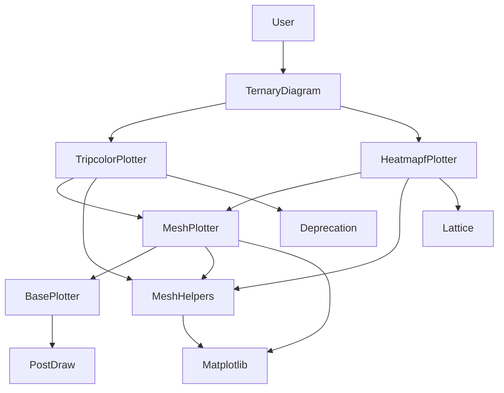
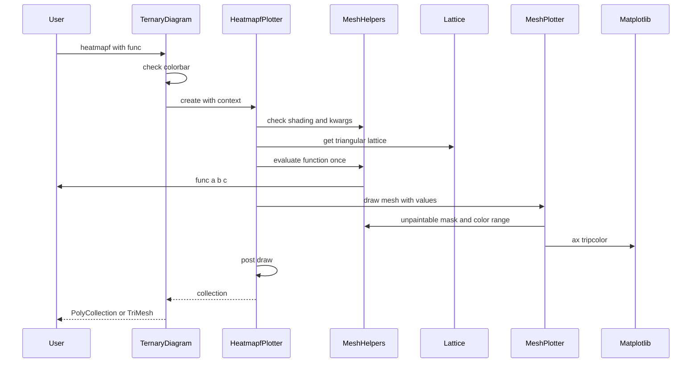

# Design Document: heatmaps

## Overview

**Purpose**: 物性値の分布を補間なしで見せる `TernaryDiagram.tripcolor` と、関数 f(a, b, c) を三角形全体に描く `TernaryDiagram.heatmapf` を追加する。どちらも matplotlib の `Axes.tripcolor` に `Triangulation` と値（点ごと、または三角形ごと）を渡して描き、値の範囲・カラーバー・レイアウトは既存の `scatter` / `contour` と同じ規則に従う。関数ヒートマップの格子は、図なしで使える純粋関数 `utils.get_triangular_lattice` で作る。

**Users**: 実験点がまばらな組成データをそのまま見せたい材料・化学系の研究者と、理論式や機械学習モデルの予測を組成マップにしたい研究者。python-ternary の `heatmapf` から移る利用者も含む。

**Impact**: `_api.py` に共通基底 `_MeshPlotter`、Plotter 2 つ、公開メソッド 2 つ、zorder 定数 1 つを追記する。三角形分割・マスク・色の範囲・関数の評価・kwargs の検証は新しい純粋関数モジュール `_mesh.py` に置き、`_api.py` の差分を抑える。`utils.py` に格子生成関数を 1 つ追記する。既存の Plotter と三角図の土台には触れない。

### Goals
- 測定点を三角形で塗る `tripcolor`（flat / gouraud）と、関数を格子で評価して塗る `heatmapf` を提供する（1.1–1.8、2.1–2.9）
- 図なしで使える正則な三角格子の生成関数を提供する（3.1–3.6）
- 欠損値・無限大を含んでも残りを正しく描く（4.1–4.3）
- `z_min` / `z_max`・カラーバー・レイアウトの扱いを `scatter` / `contour` とそろえる（5.1–5.7、6.1–6.7）
- 呼び出し順によらずヒートマップが最も奥のデータ層になる（7.2）
- `scale=100` で関数の評価と保存を除き 1 秒以内に描く（8.1）

### Non-Goals
- 六角形のヒートマップ、辞書でデータを渡す API、matplotlib にない補間方法
- 細長い三角形の自動マスク、重複した組成の値の自動集約
- `contour` の挙動の変更、カラーバー自動追加とレイアウト自動調整の方針（`plot-side-effects`）
- 三角図の土台の描き方（`diagram-customization`）、使い方ページ（`user-guide-docs`）

## Boundary Commitments

### This Spec Owns
- 公開メソッド `TernaryDiagram.tripcolor` / `TernaryDiagram.heatmapf` のシグネチャ・挙動・docstring
- Plotter `_MeshPlotter`（共通の描画手順）、`_TripcolorPlotter`、`_HeatmapfPlotter`
- zorder 定数 `DEFAULT_ZORDER_HEATMAP`（`_api.py`、値 -1）と、ヒートマップの既定の重なり順
- 純粋関数モジュール `_mesh.py`（塗り方の検証、kwargs の検証、三角形分割、塗れない三角形のマスク、既定の色の範囲、関数の評価、重複の警告文、型別名、`DEFAULT_HEATMAPF_SCALE`）
- 格子生成関数 `utils.get_triangular_lattice` の入出力・並び順・検証
- 上記のテスト（`tests/test_mesh.py`、`tests/test_tripcolor.py`、`tests/test_heatmapf.py`、`tests/test_heatmaps.py`、`tests/test_utils.py` の追記）と CHANGELOG の該当項目（Unreleased の New features に 3 項目）

### Out of Boundary
- `_BasePlotter._post_draw`、`PostDrawContext`、決定表（`decide_layout` / `decide_colorbar`）、カラーバー重複時の警告文、`_deprecation.py` の実装と文面、`utils.check_optional_bool` / `utils.check_bool`、共通 doctest ランナー `tests/test_doctests.py`、CHANGELOG の Unreleased の見出しの組（いずれも `plot-side-effects`）。本 spec は規約どおりに呼ぶ・追記するだけ
- `_skeleton.py` と、`diagram-customization` が `utils.py` に足す配置関数（`get_tick_values`、`get_edge_points`、`get_grid_segments`、`get_axis_label_position`、`get_tick_formatter`、`TickFormat`）
- `DEFAULT_ZORDER_FILL` / `DEFAULT_ZORDER_TEXT` と `fill` / `text`（`region-plots`）
- 既存の `DEFAULT_ZORDER_*` 4 定数の名前・値・並び、既存の 4 Plotter と `contour` の挙動
- 使い方ページ・README・example ノートブック（`user-guide-docs`）、steering の更新

### Allowed Dependencies
- matplotlib の公開 API: `Axes.tripcolor`、`matplotlib.tri.Triangulation`（`triangles`・`mask` 引数、`set_mask`、`triangles` / `mask` 属性）、`matplotlib.collections.PolyCollection` / `TriMesh`（型ヒントのみ）
- numpy（`numpy.ma` を含む）。ランタイム依存は追加しない（8.2）
- `plot-side-effects` の公開名: `_BasePlotter.__init__(..., *, post_draw_context, **kwargs)`、`_BasePlotter._post_draw(*, mappable, colorbar)`、`_post_draw.PostDrawContext`（型ヒントのみ）、`utils.check_optional_bool`、`utils.check_bool`、`_deprecation.warn_external(message, category)`、共通 doctest ランナー `tests/test_doctests.py`。内部の列挙値や文面の定数には依存しない
  - `warn_external` は roadmap の横断の取り決めで「パッケージ全体で利用者向けの警告を出す入口（種類は `category` で選び、既定は FutureWarning）」と定められている。本 spec は重複した組成の警告に `category=UserWarning` で使う（1.8）
  - `colorbar` は `scatter` / `contour` と同じく公開メソッドの層で `check_optional_bool` により Plotter を作る前に検証する（6.4）。単なる真偽値のオプションは `check_bool(value, name)` で検証する規約だが、本 spec の公開引数には該当するものがない（`shading` は文字列、`scale` は整数）
  - docstring の例は tech.md「Docstring Examples」に従い、共通 doctest ランナーで実行される。本 spec は独自の doctest の実行を作らない（9.5）
- 実装の前提（roadmap の Implementation Order）: `plot-side-effects`（上記の公開名、`TernaryDiagram.__init__` の `self.__post_draw_context`、`tests/conftest.py` の `td` fixture が `tight_layout=True` で作る三角図、共通 doctest ランナー、CHANGELOG の Unreleased の見出しの組）と `diagram-customization`（`TernaryDiagram.__init__` の最終的なシグネチャと土台の部品）、直接実装の `annotate-plain-text` がマージ済みであること。`region-plots` とは 1 つずつマージし、どちらが先でもよい
- 既存の内部 API: `_BasePlotter._merge_alias`、`_BasePlotter._set_default_params`、`utils.three2two`、`DEFAULT_CMAP`
- パッケージ内の依存方向（左のモジュールは右を import しない）: `utils` / `_deprecation` / `_mesh` → `_api`
  - `_mesh.py` は numpy と matplotlib だけを import し、パッケージ内のモジュールを import しない
  - `get_triangular_lattice` は `utils.py` 内で完結し、パッケージ内の他モジュールを import しない
  - Plotter だけが Axes に artist を追加する。`_mesh.py` の関数は図を受け取らず、図を変更しない

### Revalidation Triggers
- `tripcolor` / `heatmapf` のシグネチャ・戻り値の型・既定値（`shading="flat"`、`scale=50`）の変更 → `user-guide-docs`
- `DEFAULT_ZORDER_HEATMAP` の値の変更 → `region-plots`（`DEFAULT_ZORDER_FILL` との上下関係）、`user-guide-docs`
- `get_triangular_lattice` のシグネチャ・並び順・頂点の向きの変更 → 利用者のコード、`user-guide-docs`
- 既定の色の範囲の規則（有限な値の最小・最大）の変更 → `scatter` / `contour` との整合
- 上流の変更で本 spec の再確認が必要になるもの: `_post_draw` のシグネチャと呼び出し規約、`check_optional_bool` / `check_bool` / `warn_external` のシグネチャ（`plot-side-effects`）、土台の線の zorder を -1 以下に変えること（`diagram-customization`）、`_merge_alias` の挙動
- `plot-side-effects` の重複カラーバー警告（`colorbar_warning_message`）の文面の変更 → 上流は `z` に触れない一般的な文面にする。本 spec のテストは文面全体に依存せず、`"colorbar"` やメソッド名などの変わりにくい断片だけで照合するので通常は影響しないが、`tripcolor` / `heatmapf` で読んで不自然にならないかを再確認する
- 共通 doctest ランナー（`tests/test_doctests.py`）の対象の集め方・実行条件（一時ディレクトリ、FutureWarning をエラーにする）の変更 → 本 spec の docstring の例
- `region-plots` の `DEFAULT_ZORDER_FILL`（現在 0.5）の値の変更 → `DEFAULT_ZORDER_HEATMAP (-1) < DEFAULT_ZORDER_FILL` の再確認（7.2）

## Architecture

### Existing Architecture Analysis
- ファサード `TernaryDiagram` → 描画種別ごとの `_XxxPlotter` → 状態を持たない `utils` の 3 層構造。Plotter は `__init__` の中で検証・座標変換・matplotlib 呼び出しを行い、`TernaryDiagram` のメソッドは Plotter を作って `x_` / `y_` を記録し、`collection_` を返すだけ
- `plot-side-effects` 後の規約: Plotter は `post_draw_context` をキーワード専用で受けて基底へ渡し、`__init__` の最後で `self._post_draw(mappable=..., colorbar=...)` を 1 回呼ぶ。`tight_layout` やカラーバーを直接呼ばない
- `_BasePlotter.__init__` は `z` が `None` でないときだけ `self.z_min` / `self.z_max` を設定し、`_merge_alias` は `self.kwargs` から別名（`vmin` / `vmax`）を取り出して統合する
- zorder は `DEFAULT_ZORDER_CONTOUR (0) < GRIDS (1) < PLOTS (2) < SCATTER (3)`。`diagram-customization` はグリッドを描き直しても zorder 1 を保つ
- `_api.py` は `region-plots`・`plot-side-effects`・`diagram-customization` も編集する。本 spec は追記だけにする。roadmap の Implementation Order により、本 spec は `plot-side-effects` → `diagram-customization` → `annotate-plain-text` のマージ後に、その時点の `_api.py` の上に実装する。`region-plots` とは 1 つずつマージし、どちらが先でもよい

### Architecture Pattern & Boundary Map



- `TernaryDiagram`・`MeshPlotter`・`TripcolorPlotter`・`HeatmapfPlotter`・`BasePlotter` は `_api.py`。`MeshHelpers` は `_mesh.py`、`Lattice` は `utils.get_triangular_lattice`。`PostDraw`（`_post_draw` と `PostDrawContext`）と `Deprecation`（`warn_external`）は `plot-side-effects` の所有物
- **Selected pattern**: 既存の Plotter パターン + 共通基底 + 純粋関数（functional core / imperative shell）。入力の準備（点の値か三角形の値か）だけを Plotter ごとに変え、マスク・範囲・描画は `_MeshPlotter._draw_mesh` 1 か所で行う
- **Domain boundaries**: 計算と検証は `_mesh.py` と `utils.py`（図を持たない）、artist の追加は Plotter、描画後処理は `_post_draw`（上流）
- **Existing patterns preserved**: `_set_default_params` によるユーザー指定の優先、`_merge_alias` による別名の統合、戻り値は matplotlib のネイティブオブジェクト、`DEFAULT_*` 定数、公開メソッドの層での `colorbar` の検証（`scatter` / `contour` と同じ）、公開 API の docstring の doctest 形式の例（tech.md「Docstring Examples」、実行は共通ランナー）
- **New components rationale**: `_mesh.py` は 2 つの Plotter が共有する検証と計算を図なしで単体テストできるようにし、並行 spec との `_api.py` の衝突を減らす。`_MeshPlotter` は描画手順の重複をなくす
- **Steering compliance**: 公開 API は `TernaryDiagram` に集約、ランタイム依存は numpy と matplotlib のみ、入力検証は意味のあるメッセージ付きの `TypeError` / `ValueError`

### Technology Stack

| Layer | Choice / Version | Role in Feature | Notes |
|-------|------------------|-----------------|-------|
| Runtime | Python >= 3.9 | `typing.Literal` / `Callable` / `Final` で型を表す | `_mesh.py` は新規モジュールなので tech.md の規約どおり `from __future__ import annotations` を置き、注釈には組み込みジェネリクス（`tuple[...]`）と `X \| None` を使う（`plot-side-effects` の新規モジュールと同じ）。実行時に評価されるモジュール変数の型別名だけは 3.9 で `\|` を使えないので `typing.Union` / `typing.Callable` で書く。`_api.py` と `utils.py` は既存の `typing.Tuple` 系に合わせる |
| Plotting | matplotlib（上限なし） | `Axes.tripcolor`、`Triangulation`（qhull による自動分割） | `from matplotlib.tri import Triangulation` は全版で使える。`facecolors=`、`shading`、`Triangulation.mask` は古い版から存在する |
| Numerics | numpy >= 1.20 | 格子生成、マスク、範囲、関数の評価 | 繰り返しは格子の行数（`scale`）に比例する範囲にとどめ、点や三角形ごとの Python の繰り返しを作らない |
| Test | pytest、Agg バックエンド | artist の状態、警告、例外、処理時間 | 画像比較はしない |

## File Structure Plan

### Directory Structure
```
src/ternary_diagram/
├── _mesh.py      # 新規: 三角形を塗る描画の純粋関数（塗り方・kwargs の検証、三角形分割、塗れない三角形のマスク、
│                 #       既定の色の範囲、関数の評価、重複の警告文）と型別名・DEFAULT_HEATMAPF_SCALE。
│                 #       from __future__ import annotations と組み込みジェネリクス
├── _api.py       # 変更: DEFAULT_ZORDER_HEATMAP、_MeshPlotter、_TripcolorPlotter、_HeatmapfPlotter、
│                 #       TernaryDiagram.tripcolor / heatmapf を追記
└── utils.py      # 変更: get_triangular_lattice を追記
tests/
├── test_mesh.py       # 新規: _mesh.py の単体テスト（図を使わない）
├── test_tripcolor.py  # 新規: tripcolor 固有の結合テスト（三角形分割、flat / gouraud の色、重複、欠損）
├── test_heatmapf.py   # 新規: heatmapf 固有の結合テスト（関数の呼び方、評価点、戻り値の検証、速度）
├── test_heatmaps.py   # 新規: 両メソッド共通の結合テスト（値の範囲、カラーバー、レイアウト、重なり順、kwargs、x_ / y_）
└── test_utils.py      # 変更: get_triangular_lattice のテスト（docstring の例の実行は共通ランナーに任せる）
CHANGELOG.md           # 変更: Unreleased の New features に 3 項目
```

- 上流（`plot-side-effects`）が作るファイルで、本 spec が使うが変更しないもの: `src/ternary_diagram/_post_draw.py`（PostDraw、PostDrawContext）、`src/ternary_diagram/_deprecation.py`（Deprecation の `warn_external`）、`utils.check_optional_bool` / `utils.check_bool`、`tests/test_doctests.py`（共通 doctest ランナー。`tripcolor`・`heatmapf`・`get_triangular_lattice` の例もこれで実行される）、CHANGELOG の Unreleased の見出しの組（Breaking changes / New features / Deprecations / Bug fixes / Other changes）

### Modified Files
- `src/ternary_diagram/_api.py`
  - import の追記: `_mesh` の公開名（`Shading`、`HeatmapFunc`、`MeshCollection`、`DEFAULT_HEATMAPF_SCALE` と各関数）、`utils.get_triangular_lattice`。`_deprecation.warn_external` と `utils.check_optional_bool` は `plot-side-effects` が import 済みでなければ足す。`Triangulation`・`three2two`・`Number`・`ArrayLike` は既存の import を使う
  - 定数ブロックの末尾（`DEFAULT_ZORDER_SCATTER` の後。`region-plots` が先にマージされていれば `DEFAULT_ZORDER_FILL` / `DEFAULT_ZORDER_TEXT` の後）に `DEFAULT_ZORDER_HEATMAP = -1` を追加。既存の定数は変えず、並べ替えない
  - `TernaryDiagram` の既存メソッドの後ろに `tripcolor` と `heatmapf` を追加
  - 既存 Plotter の後ろに `_MeshPlotter`、`_TripcolorPlotter`、`_HeatmapfPlotter` を追加
- `src/ternary_diagram/utils.py` — 既存関数の後ろ（`if __name__ == "__main__":` の前）に `get_triangular_lattice` を追加。`from numbers import Integral` を import に足す。既存関数は変えない
- `tests/test_utils.py` — `get_triangular_lattice` のテストを末尾に追加。doctest を実行するコード（`doctest.DocTestFinder` など）は書かない
- `CHANGELOG.md` — Unreleased の New features（`plot-side-effects` がそろえた見出しの組の 1 つ）に `tripcolor`、`heatmapf`、`get_triangular_lattice` を追加する。見出しは足さず、他の spec の項目は並べ替えない

## System Flows

### `heatmapf` の処理順序



- `colorbar` の検証は公開メソッドの層で Plotter を作る前に行う（`scatter` / `contour` と同じ層。6.4）。それ以外の検証・格子生成・関数の評価・マスクと範囲の計算はすべて Plotter の中で `ax.tripcolor` より前に終わる。どこで例外が出ても Axes には何も追加されない（7.8）。matplotlib 自身の検証（`norm` と `vmin` の併用、未知の kwargs）も `Axes.add_collection` より前で失敗する
- `tripcolor` も同じ順序で、格子生成と関数の評価の代わりに「`z` の検証 → 三角形分割 → 重複の警告」を行う
- `_post_draw` は `__init__` の最後で 1 回だけ呼ぶ（`plot-side-effects` の規約）

### 塗り方ごとの値の位置

| メソッド | `shading` | 三角形 | 値の位置 | `ax.tripcolor` への渡し方 | 戻り値 |
|---|---|---|---|---|---|
| `tripcolor` | `"flat"` | 自動分割または利用者指定 | 点（`z`） | 第 2 位置引数（3 頂点の平均で塗られる） | `PolyCollection` |
| `tripcolor` | `"gouraud"` | 同上 | 点（`z`） | 第 2 位置引数 | `TriMesh` |
| `heatmapf` | `"flat"` | 正則な格子 | 三角形（重心での関数値） | `facecolors=` | `PolyCollection` |
| `heatmapf` | `"gouraud"` | 正則な格子 | 点（格子点での関数値） | 第 2 位置引数 | `TriMesh` |

## Requirements Traceability

| Requirement | Summary | Components | Interfaces | Flows |
|-------------|---------|------------|------------|-------|
| 1.1 | `tripcolor` の提供 | TernaryDiagram, TripcolorPlotter | `TernaryDiagram.tripcolor` | 値の位置の表 |
| 1.2 | flat は 3 頂点の平均 | MeshPlotter | `ax.tripcolor(tri, z, shading="flat")` | 値の位置の表 |
| 1.3 | gouraud は線形 | MeshPlotter | `shading="gouraud"` → `TriMesh` | 値の位置の表 |
| 1.4 | 自動分割は凸包の内側だけ | MeshHelpers | `triangulate`（Delaunay） | — |
| 1.5 | 三角形・マスクの指定 | TripcolorPlotter, MeshHelpers | kwargs `triangles` / `mask` → `triangulate` | — |
| 1.6 | `z` の欠落・要素数の不一致 | TripcolorPlotter | `ValueError` | 処理順序 |
| 1.7 | 三角形分割できない入力 | MeshHelpers | `triangulate` → `ValueError`（`from err`） | 処理順序 |
| 1.8 | 重複した組成の警告 | MeshHelpers, TripcolorPlotter, Deprecation | `triangulate` の未使用点数、`duplicate_points_message`、`warn_external(..., UserWarning)` | 処理順序 |
| 2.1 | `heatmapf` の提供 | TernaryDiagram, HeatmapfPlotter | `TernaryDiagram.heatmapf` | 処理順序 |
| 2.2 | 関数を 1 回、3 配列で呼ぶ | MeshHelpers | `evaluate_function` | 処理順序 |
| 2.3 | flat は重心で評価 | HeatmapfPlotter | `vertices[triangles].mean(axis=1)`、`facecolors=` | 値の位置の表 |
| 2.4 | gouraud は格子点で評価 | HeatmapfPlotter | `vertices` を評価点にする | 値の位置の表 |
| 2.5 | `scale` の既定値 | MeshHelpers, TernaryDiagram | `DEFAULT_HEATMAPF_SCALE = 50` | — |
| 2.6 | 戻り値の形 | MeshHelpers | `evaluate_function` の形の規則 | — |
| 2.7 | 呼び出し可能でない | MeshHelpers | `evaluate_function` → `TypeError` | — |
| 2.8 | 戻り値の形・型の誤り | MeshHelpers | `evaluate_function` → `ValueError` | — |
| 2.9 | 関数の例外をそのまま伝える | MeshHelpers | `evaluate_function` は捕捉しない | 処理順序 |
| 3.1 | 格子点と小三角形 | Lattice | `get_triangular_lattice` | — |
| 3.2 | 重なり・隙間なし、同じ大きさ | Lattice | 上向き・下向きの構成規則 | — |
| 3.3 | 決定的・図なし・副作用なし | Lattice | 純粋関数、並び順の規約 | — |
| 3.4 | 整数でない `scale` | Lattice | `TypeError` | — |
| 3.5 | 1 未満の `scale` | Lattice | `ValueError` | — |
| 3.6 | `heatmapf` でも同じ例外 | HeatmapfPlotter | `get_triangular_lattice(scale)` をそのまま呼ぶ | 処理順序 |
| 4.1 | `z` の NaN / inf | MeshHelpers, MeshPlotter | `unpaintable_mask(on_faces=False)`、`set_mask`、`np.ma.masked_invalid` | — |
| 4.2 | 関数の NaN / inf | MeshHelpers, MeshPlotter | `unpaintable_mask(on_faces=...)` | 値の位置の表 |
| 4.3 | 塗れる三角形がない | MeshHelpers | `unpaintable_mask` → `ValueError` | — |
| 5.1 | `z_min` / `z_max` | TernaryDiagram, MeshPlotter | キーワード専用引数 | — |
| 5.2 | `vmin` / `vmax` の別名 | MeshPlotter | `_merge_alias` | — |
| 5.3 | 別名の同時指定 | MeshPlotter | `_merge_alias` → `ValueError`（既存と同じ文面） | — |
| 5.4 | 既定の範囲は有限値の最小・最大 | MeshHelpers, MeshPlotter | `default_color_range` | — |
| 5.5 | 片側だけ指定 | MeshHelpers | `default_color_range` | — |
| 5.6 | `norm` の指定 | MeshPlotter | `norm` があり範囲未指定なら `vmin` / `vmax` を渡さない | — |
| 5.7 | 既定のカラーマップ | MeshPlotter | `_set_default_params(cmap=DEFAULT_CMAP)` | — |
| 6.1 | `colorbar` 引数 | TernaryDiagram, Plotters | `colorbar: Optional[bool] = None`、`_post_draw(colorbar=...)` | 処理順序 |
| 6.2 | 既定のカラーバー規則 | Plotters, PostDraw | `_post_draw(mappable=collection_, colorbar=None)` | 処理順序 |
| 6.3 | レイアウトの規則 | Plotters, PostDraw | `_post_draw`（`tight_layout` を直接呼ばない） | 処理順序 |
| 6.4 | `colorbar` の不正値 | TernaryDiagram | 公開メソッドで Plotter を作る前に `check_optional_bool(colorbar, "colorbar")` | 処理順序 |
| 6.5 | `flag_cbar` を拒否 | MeshHelpers | `check_mesh_kwargs` → `TypeError` | 処理順序 |
| 6.6 | 戻り値からカラーバーを参照 | PostDraw | `mappable.colorbar`（matplotlib が設定） | — |
| 6.7 | `TernaryDiagram.colorbar()` に渡せる | MeshPlotter | 戻り値が `ScalarMappable`、`vmin` / `vmax` と `cmap` を保持 | — |
| 7.1 | 戻り値の型 | MeshPlotter | `PolyCollection` / `TriMesh` | 値の位置の表 |
| 7.2 | 既定の重なり順 | MeshPlotter | `DEFAULT_ZORDER_HEATMAP = -1` | — |
| 7.3 | zorder の上書き | MeshPlotter | `_set_default_params` | — |
| 7.4 | その他の kwargs | MeshPlotter | `**self.kwargs` を `ax.tripcolor` へ | — |
| 7.5 | 不正な `shading` | MeshHelpers | `check_shading` → `ValueError` | 処理順序 |
| 7.6 | `c` / `facecolors` の衝突 | MeshHelpers | `check_mesh_kwargs` → `ValueError` | 処理順序 |
| 7.7 | `heatmapf` の `triangles` / `mask` | MeshHelpers | `check_mesh_kwargs(fixed_lattice=True)` → `ValueError` | 処理順序 |
| 7.8 | 例外時は何も追加しない | Plotters, MeshPlotter | 検証と評価を `ax.tripcolor` より前に行う | 処理順序 |
| 7.9 | `x_` / `y_` の記録 | TernaryDiagram, Plotters | `_append_x_y`、`name` = `"tripcolor"` / `"heatmapf"` | — |
| 7.10 | 既存の挙動を変えない | `_api.py` の追記方針 | 既存のクラス・定数・メソッドを編集しない | — |
| 8.1 | `scale=100` で 1 秒以内 | Lattice, MeshHelpers, MeshPlotter | ベクトル演算、関数は 1 回 | — |
| 8.2 | 依存を増やさない | 全体 | numpy と matplotlib のみ | — |
| 9.1 | docstring の内容 | TernaryDiagram | `tripcolor` / `heatmapf` の docstring | — |
| 9.2 | `heatmapf` の関数の説明 | TernaryDiagram | `heatmapf` の docstring | — |
| 9.3 | 格子生成関数の docstring | Lattice | doctest 形式の Examples | — |
| 9.4 | CHANGELOG | CHANGELOG.md | Unreleased の New features（`plot-side-effects` がそろえた見出しの組） | — |
| 9.5 | 例は共通の規約に従い共通ランナーで通る | TernaryDiagram, Lattice | tech.md「Docstring Examples」、`tests/test_doctests.py`（上流） | — |

## Components and Interfaces

| Component | Domain/Layer | Intent | Req Coverage | Key Dependencies (P0/P1) | Contracts |
|-----------|--------------|--------|--------------|--------------------------|-----------|
| Lattice（`utils.get_triangular_lattice`） | utils | 正則な三角格子を返す純粋関数 | 3.1–3.6, 8.1, 9.3, 9.5 | numpy (P0) | Service |
| MeshHelpers（`_mesh.py`） | 計算と検証 | 三角形を塗る描画に共通の検証・分割・マスク・範囲・評価 | 1.4, 1.5, 1.7, 1.8, 2.2, 2.5–2.9, 4.1–4.3, 5.4, 5.5, 6.5, 7.5–7.7 | matplotlib `Triangulation` (P0), numpy (P0) | Service |
| MeshPlotter（`_api._MeshPlotter`） | 描画 | マスク・範囲・既定値を適用して `ax.tripcolor` を呼ぶ | 1.2, 1.3, 4.1, 4.2, 5.2–5.7, 6.7, 7.1–7.4, 7.8 | BasePlotter (P0), MeshHelpers (P0), matplotlib (P0) | Service |
| TripcolorPlotter（`_api._TripcolorPlotter`） | 描画 | 組成点と `z` から描画の入力を作る | 1.1, 1.5, 1.6, 1.8, 6.1–6.3, 7.9 | MeshPlotter (P0), MeshHelpers (P0), Deprecation (P1), PostDraw (P0) | Service |
| HeatmapfPlotter（`_api._HeatmapfPlotter`） | 描画 | 格子と関数値から描画の入力を作る | 2.1–2.4, 3.6, 6.1–6.3, 7.9 | MeshPlotter (P0), Lattice (P0), MeshHelpers (P0), PostDraw (P0) | Service |
| TernaryDiagram 追加メソッド（`_api.py`） | 公開ファサード | `colorbar` を検証し、Plotter を作り、座標を記録して戻り値を返す | 1.1, 2.1, 2.5, 5.1, 6.1, 6.4, 7.9, 9.1, 9.2, 9.5 | Plotters (P0), PostDrawContext (P0), `utils.check_optional_bool` (P0) | Service |
| `DEFAULT_ZORDER_HEATMAP`（`_api.py`） | 定数 | ヒートマップの既定の重なり順 | 7.2 | — | — |

### utils

#### Lattice（`src/ternary_diagram/utils.py` の `get_triangular_lattice`）

| Field | Detail |
|-------|--------|
| Intent | 三角形の各辺を `scale` 等分した正則な三角格子（組成と小三角形）を返す |
| Requirements | 3.1, 3.2, 3.3, 3.4, 3.5, 3.6, 8.1, 9.3, 9.5 |

**Responsibilities & Constraints**
- 図・Axes・グローバル状態に触れない純粋関数。同じ `scale` に同じ配列を返す
- 繰り返しは numpy のベクトル演算で行い、Python の繰り返しを格子点や三角形の数に比例させない
- 名前は `diagram-customization` の配置関数（`get_tick_values` など）と重ならない

**Dependencies**
- Inbound: HeatmapfPlotter (P0)、利用者 (P2)
- External: numpy (P0)、`numbers.Integral` (P0)

**Contracts**: Service [x]

##### Service Interface
```python
def get_triangular_lattice(scale: int) -> Tuple[np.ndarray, np.ndarray]:
    """Return a regular triangular lattice dividing each edge into `scale` parts."""
```
- 戻り値 `(vertices, triangles)`
  - `vertices`: `float64`、形 `((scale + 1) * (scale + 2) // 2, 3)`。各行は非負整数 `(i, j, k)`（`i + j + k = scale`）を `scale` で割った組成で、列の順は頂点ラベルと同じ（上・左下・右下）。合計は浮動小数点の誤差の範囲で 1
  - `triangles`: `numpy.intp`、形 `(scale ** 2, 3)`。`vertices` の行番号の組
- 並び順（3.3）
  - `vertices`: `i` の降順、同じ `i` の中では `j` の降順（2 次元では上の行から下の行へ、各行は左から右へ）
  - `triangles`: 先に上向きの小三角形 `scale * (scale + 1) // 2` 個、続いて下向きの小三角形 `scale * (scale - 1) // 2` 個。上向きは基準 `(i, j, k)`（`i + j + k = scale - 1`）に対して頂点 `(i+1, j, k), (i, j+1, k), (i, j, k+1)`（上・左下・右下）、下向きは基準 `(i, j, k)`（`i + j + k = scale - 2`）に対して頂点 `(i, j+1, k+1), (i+1, j, k+1), (i+1, j+1, k)`（下・右上・左上）。どちらのグループも基準を `i` の降順、`j` の降順で並べる
  - すべての小三角形は `three2two` の座標で反時計回り、面積はすべて等しく、合計は三角図の面積 `√3 / 4` に一致する（3.2）
- 例: `scale=1` → `vertices = [[1, 0, 0], [0, 1, 0], [0, 0, 1]]`、`triangles = [[0, 1, 2]]`。`scale=2` → `triangles = [[0, 1, 2], [1, 3, 4], [2, 4, 5], [4, 2, 1]]`
- 事前条件と例外
  - `scale` が `bool`、または `numbers.Integral` でない → `` TypeError("`scale` must be an integer, but got ...") ``（3.4）。`numpy.int64` などの整数型は受け付ける
  - `scale < 1` → `` ValueError("`scale` must be 1 or greater, but got ...") ``（3.5）
- docstring（英語、NumPy スタイル）: 戻り値の形・並び順・向きを説明し、`scale=1` と `scale=2` の doctest を持つ（9.3）
  - 例は tech.md「Docstring Examples」に従う。純粋関数なので図を作らず（`plt.subplots` も `TernaryDiagram` も使わない）、`from ternary_diagram.utils import get_triangular_lattice` から始める。ファイルを書き出さず、警告を出さない（9.5）
  - 出力は numpy の版や OS で表記が変わらない形にする（例: `vertices.tolist()`、`triangles.tolist()`、`vertices.shape`）。配列の repr は整数型の `dtype=` 表記が環境で変わりうるので使わない
  - 実行は共通ランナー `tests/test_doctests.py`（`utils` の公開関数が対象）に任せ、本 spec では doctest を実行するコードを書かない

**Implementation Notes**
- Integration: 行ごとの `(i, j)` の列挙を `np.repeat` / `np.cumsum` で作り、`(i, j)` → 行番号の対応表（形 `(scale+1, scale+1)` の整数配列）で上向き・下向きの頂点番号を引く方法で、`scale=400` でも 10 ms 程度（research.md の計測）
- Validation: `tests/test_utils.py` で個数、組成の値、面積と向き、`scale=1, 2` の完全一致、例外を確認する。docstring の例は共通ランナーで通ることを確認する
- Risks: なし（既存関数と独立）

### 計算と検証

#### MeshHelpers（`src/ternary_diagram/_mesh.py`）

| Field | Detail |
|-------|--------|
| Intent | 三角形を塗る描画の検証・三角形分割・塗れない三角形のマスク・既定の色の範囲・関数の評価を、図を持たない関数で提供する |
| Requirements | 1.4, 1.5, 1.7, 1.8, 2.2, 2.5, 2.6, 2.7, 2.8, 2.9, 4.1, 4.2, 4.3, 5.4, 5.5, 6.5, 7.5, 7.6, 7.7 |

**Responsibilities & Constraints**
- すべての関数は引数だけを読み、新しいオブジェクトを返す。引数の配列・辞書・`Triangulation` を変更しない
- 警告を発生させない（文面を返すだけ。発生は Plotter が `warn_external` で行う）
- 例外メッセージは英語で、何が悪いかと受け付ける値を示す
- パッケージ内のモジュールを import しない
- 新規モジュールなので、tech.md の規約どおり先頭に `from __future__ import annotations` を置き、関数の注釈は組み込みジェネリクスと `X | None` で書く。モジュール変数の型別名（`Shading`、`HeatmapFunc`、`MeshCollection`）は実行時に評価されるので、Python 3.9 でも動く `typing.Literal` / `typing.Callable` / `typing.Union` で書く
- private なモジュールなので docstring に `>>>` の例を書かない（tech.md「Docstring Examples」）

**Dependencies**
- Inbound: TripcolorPlotter、HeatmapfPlotter、MeshPlotter (P0)
- External: matplotlib `Triangulation`（qhull）(P0)、numpy (P0)

**Contracts**: Service [x]

##### Service Interface
```python
from __future__ import annotations

from collections.abc import Mapping
from typing import Callable, Final, Literal, Union

import matplotlib.collections
import numpy as np
from matplotlib.tri import Triangulation
from numpy.typing import ArrayLike

# 実行時に評価される型別名は 3.9 でも動く typing の形で書く
Shading = Literal["flat", "gouraud"]
HeatmapFunc = Callable[[np.ndarray, np.ndarray, np.ndarray], ArrayLike]
MeshCollection = Union[
    matplotlib.collections.PolyCollection, matplotlib.collections.TriMesh
]
SHADINGS: Final[tuple[str, ...]] = ("flat", "gouraud")
DEFAULT_HEATMAPF_SCALE: Final[int] = 50

def check_shading(shading: object) -> Shading: ...
def check_mesh_kwargs(
    kwargs: Mapping[str, object],
    *,
    func: str,
    color_source: str,
    fixed_lattice: bool,
) -> None: ...
def triangulate(
    x: np.ndarray,
    y: np.ndarray,
    triangles: ArrayLike | None = None,
    mask: ArrayLike | None = None,
) -> tuple[Triangulation, int]: ...
def unpaintable_mask(
    triangulation: Triangulation, values: np.ndarray, *, on_faces: bool
) -> np.ndarray: ...
def default_color_range(
    values: np.ndarray, z_min: float | None, z_max: float | None
) -> tuple[float, float]: ...
def evaluate_function(func: object, points: np.ndarray) -> np.ndarray: ...
def duplicate_points_message(n_unused: int) -> str: ...
```

- `check_shading(shading)`: `shading` が `SHADINGS` のいずれかならそのまま返す。それ以外は `` ValueError("`shading` must be 'flat' or 'gouraud', but got ...") ``（7.5）
- `check_mesh_kwargs(kwargs, *, func, color_source, fixed_lattice)`（検査順に記載）
  1. `"flag_cbar"` があれば `` TypeError("`{func}` does not accept `flag_cbar`. Use `colorbar` instead.") ``（6.5）
  2. `"c"` または `"facecolors"` があれば `` ValueError("`{name}` cannot be used together with `{color_source}` because the colors are determined by `{color_source}`.") ``（7.6。`scatter` の `c` と `z` の衝突と同じ言い回し）。`color_source` は `tripcolor` で `"z"`、`heatmapf` で `"func"`
  3. `fixed_lattice=True` のとき `"triangles"` または `"mask"` があれば `` ValueError("`{name}` cannot be specified for `{func}` because it always uses a regular triangular lattice. Return NaN from `func` to leave regions unpainted.") ``（7.7）
- `triangulate(x, y, triangles=None, mask=None)`
  - `triangles is None`: `Triangulation(x, y)`（qhull の Delaunay 分割。凸包の内側だけを覆う。1.4）。`ValueError` / `RuntimeError` を受けたら `` ValueError("Cannot triangulate the compositions automatically: at least 3 distinct, finite compositions that are not all on one straight line are required.") from err `` を送出する（1.7）。置き換えるのは `Triangulation(x, y)` の呼び出しで出た例外だけ。`mask` があれば分割後に `set_mask(mask)` し、その検証の例外（長さの不一致など）はそのまま伝える。未使用点の数 `len(x) - np.unique(tri.triangles).size` を返す（1.8）
  - `triangles is not None`: `Triangulation(x, y, triangles, mask)`。matplotlib の検証の例外はそのまま伝える。未使用点の数は 0（重複の警告の対象外。1.5）
  - 戻り値: `(triangulation, n_unused)`
- `unpaintable_mask(triangulation, values, *, on_faces)`
  - `bad = ~np.isfinite(values)`。`on_faces=True` なら三角形ごとの `bad`（`values` の長さは三角形の数）、`False` なら `bad[triangulation.triangles].any(axis=1)`（頂点に有限でない値を 1 つでも持つ三角形。4.1、4.2）
  - 既存の `triangulation.mask`（利用者の指定）との論理和を新しい配列で返す
  - すべてが真なら `` ValueError("No triangle can be painted: all values are NaN or infinite, or all triangles are masked.") ``（4.3）
- `default_color_range(values, z_min, z_max)`
  - `None` の側を `values` の有限な値の最小値・最大値で埋めて `(vmin, vmax)` を返す（5.4、5.5）。指定された側はそのまま使う
  - 埋める必要があるのに有限な値が 1 つもない場合は `unpaintable_mask` と同じ文面の `ValueError`（通常は `unpaintable_mask` が先に送出する）
- `evaluate_function(func, points)`
  - `callable(func)` でなければ `` TypeError("`func` must be callable, but got ...") ``（2.7）
  - `points`（形 `(m, 3)`）の列を連続した新しい配列 `a, b, c` に複製し、`func(a, b, c)` をちょうど 1 回呼ぶ（2.2）。関数内で引数を書き換えても `points` は変わらない。関数が送出した例外は捕捉しない（2.9）
  - 戻り値を `np.ma.asarray(raw, dtype=float).filled(np.nan)` で浮動小数点に変換する（マスクされた要素は NaN として扱う）。変換で `TypeError` / `ValueError` が出たら下記の `ValueError` に `from err` で置き換える
  - 形が `(m,)`、`(m, 1)`、`(1, m)` のいずれかなら形 `(m,)` の新しい配列を返す（2.6）。それ以外（スカラー、要素数の不一致など）は `` ValueError("`func` must return m numeric values (an array of shape (m,)), but returned ... If `func` only accepts scalars, wrap it with `numpy.vectorize`.") ``（2.8。`m` は実際の数）
- `duplicate_points_message(n_unused)`: 使われなかった点の数、正規化後に同じ組成だったため 1 点の値だけを描いたこと、`tripcolor` を呼ぶ前に重複した組成の `z` を集約（平均など）すべきことを含む英文を返す（1.8）
- `DEFAULT_HEATMAPF_SCALE = 50`（2.5。根拠は research.md の「`scale` の既定値は 50」）

**Implementation Notes**
- Integration: 型別名と `DEFAULT_HEATMAPF_SCALE` は `_api.py` のシグネチャで使う。`Triangulation` は `from matplotlib.tri import Triangulation`（全版で利用可能）
- Validation: `tests/test_mesh.py` で各関数の正常系・例外・引数を変更しないことを確認する
- Risks: qhull のエラーの種類が版で変わっても、`ValueError` / `RuntimeError` の両方を受けて元の例外をつなぐので、利用者には同じ文面が届く

### 描画

#### MeshPlotter（`src/ternary_diagram/_api.py` の `_MeshPlotter`）

| Field | Detail |
|-------|--------|
| Intent | 三角形を塗る描画の共通手順（マスク・色の範囲・既定値・`ax.tripcolor`）を 1 か所で行う |
| Requirements | 1.2, 1.3, 4.1, 4.2, 5.2, 5.3, 5.4, 5.5, 5.6, 5.7, 6.7, 7.1, 7.2, 7.3, 7.4, 7.8 |

**Responsibilities & Constraints**
- `_BasePlotter` のサブクラス。`__init__` を持たず、サブクラスが基底の初期化を終えた後に `_draw_mesh` を呼ぶ
- `_draw_mesh` は `_post_draw` を呼ばない。描画後処理は各サブクラスの `__init__` の最後で行う
- `ax.tripcolor` を呼ぶ前に、送出しうる本 spec の例外をすべて送出し終える

**Dependencies**
- Inbound: TripcolorPlotter、HeatmapfPlotter (P0)
- Outbound: MeshHelpers `unpaintable_mask`・`default_color_range` (P0)、`_BasePlotter._merge_alias`・`_set_default_params` (P0)
- External: matplotlib `Axes.tripcolor` (P0)

**Contracts**: Service [x]

##### Service Interface
```python
DEFAULT_ZORDER_HEATMAP = -1  # 既存 4 定数の後ろに追加。等高線（0）より奥

class _MeshPlotter(_BasePlotter):
    def _draw_mesh(
        self,
        triangulation: Triangulation,
        values: np.ndarray,
        *,
        on_faces: bool,
        shading: Shading,
    ) -> MeshCollection: ...
```
- 事前条件: 基底の初期化が済み、`self.z` が `None` でない（`self.z_min` / `self.z_max` が設定済み）。`values` は浮動小数点の 1 次元配列で、`on_faces=True` なら長さは三角形の数、`False` なら点の数。`triangulation` は Plotter が作った新しいオブジェクト
- 手順
  1. `z_min = self._merge_alias(self.z_min, "z_min", "vmin")`、`z_max = self._merge_alias(self.z_max, "z_max", "vmax")`（5.2、5.3）
  2. `mask = unpaintable_mask(triangulation, values, on_faces=on_faces)`（4.1–4.3）
  3. `self.kwargs.get("norm") is not None` かつ `z_min is None` かつ `z_max is None` のときは範囲を渡さない（5.6）。それ以外は `vmin, vmax = default_color_range(values, z_min, z_max)` を渡す（5.4、5.5）。`norm` と範囲を併用した場合の `ValueError` は matplotlib が送出する（`scatter` と同じ）
  4. `self._set_default_params(cmap=DEFAULT_CMAP, zorder=DEFAULT_ZORDER_HEATMAP)`（5.7、7.2、7.3）
  5. `triangulation.set_mask(mask)`
  6. `masked = np.ma.masked_invalid(values)`。`on_faces` なら `self.ax.tripcolor(triangulation, facecolors=masked, shading=shading, ...)`、そうでなければ `self.ax.tripcolor(triangulation, masked, shading=shading, ...)`。範囲と `**self.kwargs` を渡す（1.2、1.3、7.4）
- 事後条件: 戻り値は flat で `PolyCollection`、gouraud で `TriMesh`（7.1）。塗られる三角形はマスクされていないものだけ。戻り値の `norm.vmin` / `norm.vmax` と `cmap` は手順 3・4 の値で、`TernaryDiagram.colorbar()` に渡すと同じ範囲のカラーバーになる（6.7）

**Implementation Notes**
- Integration: 有限でない値に触れる三角形は `set_mask` で除き、範囲も `vmin` / `vmax` として明示するので、塗られる三角形の色と範囲は matplotlib の版による `set_array` の NaN の扱いの差に依存しない。値を `np.ma.masked_invalid` で渡すのは、利用者が `norm` だけを渡して範囲を matplotlib に任せる場合のための補助である。flat の `tripcolor` では各三角形の色は頂点の値の平均なので、カラーバーの端の色に届く三角形がないことがある（docstring に書く）
- Validation: `tests/test_heatmaps.py` で両メソッドをパラメータ化して確認する
- Risks: `ax.tripcolor` は内部で `ax.grid(False)` を呼ぶ。土台は Axes のグリッドを使わないので影響しない

#### TripcolorPlotter（`src/ternary_diagram/_api.py` の `_TripcolorPlotter`）

| Field | Detail |
|-------|--------|
| Intent | 組成点と `z` を検証し、三角形分割して `_draw_mesh` に渡す |
| Requirements | 1.1, 1.5, 1.6, 1.8, 6.1, 6.2, 6.3, 7.9 |

**Contracts**: Service [x]

##### Service Interface
```python
class _TripcolorPlotter(_MeshPlotter):
    def __init__(
        self,
        vector: ArrayLike,
        ax: Optional[matplotlib.axes.Axes] = None,
        z: Optional[ArrayLike] = None,
        z_min: Optional[Number] = None,
        z_max: Optional[Number] = None,
        shading: Shading = "flat",
        colorbar: Optional[bool] = None,
        *,
        post_draw_context: PostDrawContext,
        **kwargs,
    ) -> None: ...

    @property
    def name(self) -> str:  # "tripcolor"
        ...
```
- 前提: `colorbar` は公開メソッド `TernaryDiagram.tripcolor` が `check_optional_bool` で検証済みの値（`None` / `True` / `False`）を受け取る。Plotter では検証し直さない
- 手順
  1. `shading = check_shading(shading)`、`check_mesh_kwargs(kwargs, func="tripcolor", color_source="z", fixed_lattice=False)`（7.5、7.6、6.5）
  2. `triangles = kwargs.pop("triangles", None)`、`mask = kwargs.pop("mask", None)`（1.5。matplotlib の kwargs に残さない）
  3. `super().__init__(vector, ax=ax, z=z, z_min=z_min, z_max=z_max, post_draw_context=post_draw_context, **kwargs)`（組成の検証・正規化・座標変換）
  4. `self.z is None` なら `` ValueError("`z` is required to draw `tripcolor`.") ``、`self.z.size != len(self.x_)` なら `` ValueError("`z` must have one value per composition (n), but got ...") ``（1.6）
  5. `values = self.z.astype(float)`、`triangulation, n_unused = triangulate(self.x_, self.y_, triangles, mask)`
  6. `n_unused > 0` なら `warn_external(duplicate_points_message(n_unused), category=UserWarning)`（1.8。発生位置は利用者のコード）。`warn_external` は roadmap の横断の取り決めでパッケージ全体の利用者向け警告の入口とされ、`category` で種類を選べるので、FutureWarning 以外のこの警告にも使ってよい
  7. `self.collection_ = self._draw_mesh(triangulation, values, on_faces=False, shading=shading)`
  8. `self._post_draw(mappable=self.collection_, colorbar=colorbar)`（6.1–6.3。`__init__` の最後で 1 回）
- 事後条件: `x_` / `y_` は組成点の 2 次元座標（7.9）

#### HeatmapfPlotter（`src/ternary_diagram/_api.py` の `_HeatmapfPlotter`）

| Field | Detail |
|-------|--------|
| Intent | 正則な格子を作り、関数を 1 回評価して `_draw_mesh` に渡す |
| Requirements | 2.1, 2.2, 2.3, 2.4, 3.6, 6.1, 6.2, 6.3, 7.9 |

**Contracts**: Service [x]

##### Service Interface
```python
class _HeatmapfPlotter(_MeshPlotter):
    def __init__(
        self,
        func: HeatmapFunc,
        ax: Optional[matplotlib.axes.Axes] = None,
        scale: int = DEFAULT_HEATMAPF_SCALE,
        z_min: Optional[Number] = None,
        z_max: Optional[Number] = None,
        shading: Shading = "flat",
        colorbar: Optional[bool] = None,
        *,
        post_draw_context: PostDrawContext,
        **kwargs,
    ) -> None: ...

    @property
    def name(self) -> str:  # "heatmapf"
        ...
```
- 前提: `colorbar` は公開メソッド `TernaryDiagram.heatmapf` が `check_optional_bool` で検証済みの値を受け取る
- 手順
  1. `shading = check_shading(shading)`、`check_mesh_kwargs(kwargs, func="heatmapf", color_source="func", fixed_lattice=True)`（7.5、7.6、7.7、6.5）
  2. `vertices, triangles = get_triangular_lattice(scale)`（3.6。例外はそのまま伝える）
  3. 評価点: flat なら重心 `vertices[triangles].mean(axis=1)`（形 `(scale**2, 3)`、辺上の点を含まない。2.3）、gouraud なら `vertices`（辺と頂点を含む。2.4）
  4. `values = evaluate_function(func, points)`（2.2、2.6–2.9）
  5. `super().__init__(points, ax=ax, z=values, z_min=z_min, z_max=z_max, post_draw_context=post_draw_context, **kwargs)`
  6. `vx, vy = three2two(vertices)`、`triangulation = Triangulation(vx, vy, triangles)`
  7. `self.collection_ = self._draw_mesh(triangulation, values, on_faces=(shading == "flat"), shading=shading)`
  8. `self._post_draw(mappable=self.collection_, colorbar=colorbar)`
- 事後条件: `x_` / `y_` は評価点の 2 次元座標（7.9）。関数はちょうど 1 回呼ばれている

#### TernaryDiagram の追加メソッド（`src/ternary_diagram/_api.py`）

| Field | Detail |
|-------|--------|
| Intent | 公開 API。`colorbar` を検証して引数を Plotter に渡し、座標を記録し、matplotlib のオブジェクトを返す |
| Requirements | 1.1, 2.1, 2.5, 5.1, 6.1, 6.4, 7.9, 9.1, 9.2, 9.5 |

**Contracts**: Service [x]

##### Service Interface
```python
class TernaryDiagram:
    def tripcolor(
        self,
        vector: ArrayLike,
        z: ArrayLike,
        *,
        z_min: Optional[Number] = None,
        z_max: Optional[Number] = None,
        shading: Shading = "flat",
        colorbar: Optional[bool] = None,
        **kwargs,
    ) -> MeshCollection: ...

    def heatmapf(
        self,
        func: HeatmapFunc,
        *,
        scale: int = DEFAULT_HEATMAPF_SCALE,
        z_min: Optional[Number] = None,
        z_max: Optional[Number] = None,
        shading: Shading = "flat",
        colorbar: Optional[bool] = None,
        **kwargs,
    ) -> MeshCollection: ...
```
- 本体
  1. `colorbar = check_optional_bool(colorbar, "colorbar")`（6.4。`scatter` / `contour` と同じく公開メソッドの層で、Plotter を作る前に検証する。不正値では何も描かない）
  2. 既存のメソッドと同じ 3 行: Plotter を `ax=self.ax`、`post_draw_context=self.__post_draw_context`、検証済みの `colorbar` で作り、`self._append_x_y(plotter)`、`return plotter.collection_`
- データの引数（`vector`・`z`・`func`）だけを位置引数にし、オプションはキーワード専用にする。`flag_cbar` は受け付けない（理由は research.md。検出は Plotter の `check_mesh_kwargs`）
- 単なる真偽値の公開引数はない。将来足す場合は roadmap の横断の取り決めどおり `utils.check_bool(value, name)` で公開メソッドの層で検証する
- docstring（英語、NumPy スタイル。9.1、9.2）
  - 共通: 各引数の意味と既定値、`Returns`（flat は `PolyCollection`、gouraud は `TriMesh`）、`Examples`、`https://matplotlib.org/stable/api/_as_gen/matplotlib.pyplot.tripcolor.html` へのリンク、`colorbar` の 3 通りの意味（`scatter` と同じ。v4.0.0 の既定を含む）、`z_min` / `z_max` の既定（有限な値の最小・最大）と別名 `vmin` / `vmax`、NaN / inf の三角形は塗られないこと、`edgecolors="face"` で継ぎ目を消せること、See Also（`contour`、もう一方のメソッド、`utils.get_triangular_lattice`）
  - `tripcolor`: flat は 3 頂点の平均で塗るのでカラーバーの端に届く三角形がないこと、自動分割は凸包の内側だけを塗ること、`triangles` / `mask` を kwargs で渡せること、重複した組成は集約してから渡すこと
  - `heatmapf`: 関数は `func(a, b, c)` の形で 1 回だけ呼ばれ、`a, b, c` は頂点ラベルの順の 1 次元配列（各点で合計 1）であること、返す値の形（`(m,)`、`(m, 1)`、`(1, m)`）、スカラー専用の関数は `numpy.vectorize` で包むこと、機械学習モデルの例（`lambda a, b, c: model.predict(np.column_stack([a, b, c]))`）、塗らない領域は NaN を返すこと、flat は重心・gouraud は格子点で評価すること（辺で定義されない関数には flat を勧める）、`scale` の既定値 50 と、三角形の数（`scale**2`）・速度・ベクトル保存のファイルサイズの目安
  - `Examples`（9.5。tech.md「Docstring Examples」）
    - doctest 形式（`>>>`）で、`import matplotlib.pyplot as plt` と `from ternary_diagram import TernaryDiagram` の後、`fig, ax = plt.subplots(layout="constrained")` で図を作り、`td = TernaryDiagram([...], ax=ax)` で三角図を作るところから始める。レイアウトエンジンのある図なので `tight_layout` を指定しなくても FutureWarning は出ない
    - データはその場で配列として作る（共通ランナーは一時ディレクトリで実行するので `example/` の CSV は読まない）。`tripcolor` の例の組成は重複させない（`UserWarning` を出さない）
    - 1 つの例の中で既定の `colorbar` のまま色付きの描画を 2 回以上しない（2 回目で重複カラーバーの FutureWarning が出るため）。ヒートマップに `scatter` などを重ねる例では、後の描画に `colorbar=False` を渡す
    - 戻り値は変数に代入し、アドレスを含む repr を出力しない。確かめる出力は型名や三角形の数など環境で変わらないもの（例: `type(mesh).__name__` → `'PolyCollection'`、`len(mesh.get_paths())`）にする
    - `savefig` は書かず、ファイルを書き出さない。実行は共通ランナー `tests/test_doctests.py` に任せる
- docstring の行が長くなる場合は既存と同じく `# noqa: E501` を付ける

**Implementation Notes**
- Integration: `self.__post_draw_context` は `plot-side-effects` が `TernaryDiagram.__init__` で作る属性。`check_optional_bool` は `plot-side-effects` が `scatter` / `contour` のために `_api.py` へ import 済み（なければ足す）。`_api.py` の既存のクラス・定数・メソッドは編集しない（7.10）
- Validation: `tests/test_tripcolor.py`、`tests/test_heatmapf.py`、`tests/test_heatmaps.py`。docstring の例は共通ランナー `tests/test_doctests.py`
- Risks: `region-plots` も `TernaryDiagram` にメソッドを追記する。roadmap の順で 1 つずつマージするので、後からマージする側がその時点の `_api.py` の既存メソッドの後ろに追記する

## Data Models

### Domain Model
- **正則な三角格子**: 分割数 n に対し、格子点 (n+1)(n+2)/2 個と小三角形 n² 個（上向き n(n+1)/2、下向き n(n−1)/2）。不変条件: 各格子点の成分は 1/n の整数倍で合計 1、小三角形は互いに重ならず三角図を覆い、面積は等しく、頂点は反時計回り
- **塗りの入力**: 三角形分割（点の 2 次元座標、三角形、マスク）と値（点ごと、または三角形ごと）の組。値が有限でない三角形と利用者がマスクした三角形は塗らない。色の範囲は値の有限な値から決まる（指定がない側だけ）
- **評価点**: `heatmapf` の flat では小三角形の重心（n² 個、辺上にない）、gouraud では格子点。`x_["heatmapf"]` / `y_["heatmapf"]` に記録される

## Error Handling

### Error Strategy
- 利用者の入力誤りは、`ax.tripcolor` を呼ぶ前に、何が悪いかと受け付ける値を示すメッセージ付きで送出する。三角図には何も追加しない（7.8）
- 利用者の関数が送出した例外は置き換えない。matplotlib の例外を本 spec の文面に置き換えるのは自動の三角形分割の失敗だけで、元の例外を `from` でつなぐ

### Error Categories and Responses

| 状況 | 例外 / 警告 | 送出元 | 要件 |
|---|---|---|---|
| `shading` が flat / gouraud 以外 | `ValueError` | `check_shading` | 7.5 |
| kwargs に `flag_cbar` | `TypeError`（`colorbar` を案内） | `check_mesh_kwargs` | 6.5 |
| kwargs に `c` / `facecolors` | `ValueError` | `check_mesh_kwargs` | 7.6 |
| `heatmapf` の kwargs に `triangles` / `mask` | `ValueError`（NaN を返す方法を案内） | `check_mesh_kwargs` | 7.7 |
| `colorbar` が `None` / 真偽値以外 | `TypeError`（`scatter` と同じ） | `check_optional_bool`（公開メソッドで Plotter を作る前） | 6.4 |
| `tripcolor` の `z` が `None` / 要素数の不一致 | `ValueError` | TripcolorPlotter | 1.6 |
| 自動の三角形分割ができない | `ValueError`（`from` で元の例外） | `triangulate` | 1.7 |
| 正規化後に同じ組成の点がある | `UserWarning`（利用者のコード位置） | TripcolorPlotter（`warn_external`） | 1.8 |
| `scale` が整数でない / 1 未満 | `TypeError` / `ValueError` | `get_triangular_lattice` | 3.4–3.6 |
| `func` が呼び出し可能でない | `TypeError` | `evaluate_function` | 2.7 |
| `func` の戻り値の形・型が不正 | `ValueError`（`numpy.vectorize` を案内） | `evaluate_function` | 2.8 |
| `func` が例外を送出 | 元の例外のまま | 利用者の関数 | 2.9 |
| 塗れる三角形がない | `ValueError` | `unpaintable_mask` | 4.3 |
| `z_min` と `vmin`（`z_max` と `vmax`）の同時指定 | `ValueError`（既存と同じ文面） | `_merge_alias` | 5.3 |
| カラーバーが重複（`colorbar` 未指定） | `FutureWarning`（三角図ごとに 1 回） | `_post_draw`（上流） | 6.2 |

### Monitoring
- ライブラリなのでログは出さない。利用者への通知は例外と警告だけ

## Testing Strategy

### Unit Tests
- `tests/test_utils.py`（`get_triangular_lattice`）
  - `scale=1, 2, 3, 50` で格子点 (n+1)(n+2)/2 個・小三角形 n² 個、各成分が 1/n の整数倍で合計 1、組成の集合が全列挙と一致（3.1）
  - 面積がすべて正（反時計回り）で等しく、合計が `√3 / 4`（3.2）
  - `scale=1, 2` の配列が規約の値と完全一致し、2 回呼んでも同じ（3.3）
  - `1.5`・`"3"`・`True` で `TypeError`、`0`・`-1` で `ValueError`、`numpy.int64(3)` は受け付ける（3.4、3.5）
  - docstring の例の実行はここに書かない（下の「docstring の例」を参照）
- `tests/test_mesh.py`（`_mesh.py`、図を使わない）
  - `check_shading`: 2 値を受け、`"Flat"`・`None` で `ValueError`（7.5）
  - `check_mesh_kwargs`: `flag_cbar` で `TypeError`、`c`・`facecolors` で `ValueError`、`triangles`・`mask` は `fixed_lattice=True` のときだけ `ValueError`、引数の辞書を変更しない（6.5、7.6、7.7）
  - `triangulate`: 4 点（三角形の頂点 3 つと内部 1 点）で 3 三角形・未使用 0、2 点と一直線上の 3 点で `ValueError` かつ `__cause__` が元の例外、重複 1 点で未使用 1、`triangles` 指定で未使用 0・指定どおりの三角形、`mask` の反映（1.4、1.5、1.7、1.8）
  - `unpaintable_mask`: 点の NaN / inf がその点を含む三角形だけを真にする、三角形の値の NaN、既存マスクとの論理和、全部真で `ValueError`、`Triangulation` の `mask` を変更しない（4.1–4.3）
  - `default_color_range`: NaN / inf を除いた最小・最大、片側指定、両側指定（5.4、5.5）
  - `evaluate_function`: 呼び出し回数 1、3 つの引数が形 `(m,)` の浮動小数点配列で `points` の各列と一致、引数を書き換えても `points` が変わらない、`(m, 1)` と `(1, m)` を受ける、マスク付き配列のマスクが NaN になる、スカラー・`(m + 1,)`・`(m, 2)`・文字列で `ValueError`（メッセージに `numpy.vectorize`）、呼び出し可能でないと `TypeError`、関数の例外が同じオブジェクトのまま伝わる（2.2、2.6–2.9）
  - `duplicate_points_message`: 数を含む（1.8）

### Integration Tests（`TernaryDiagram` 経由、`td` fixture）
- `tests/test_tripcolor.py`
  - flat で `PolyCollection`、gouraud で `TriMesh` が返る（1.1、7.1）
  - flat の `get_array()` が `z[triangulation.triangles].mean(axis=1)` と一致、gouraud の `get_array()` が `z` と一致（1.2、1.3）
  - 頂点 3 つと内部の点で塗った多角形の面積の合計が三角図全体、内側の小さな三角形の 3 頂点 + 内部点では、その小さな三角形の面積に一致（凸包の外を塗らない。1.4）
  - kwargs の `triangles=[[0, 1, 2]]` で多角形 1 つ、`mask` で塗る三角形が減る（1.5）
  - `z=None`、要素数の不一致、2 点、一直線上の点で `ValueError`、いずれも `ax.collections` が増えない（1.6、1.7、7.8）
  - 重複点で `UserWarning` が 1 件、`filename` がテストファイル（1.8）
  - `z` に NaN / inf があると、flat / gouraud とも、その点を含む三角形が描かれない。全部 NaN で `ValueError`（4.1、4.3）
- `tests/test_heatmapf.py`
  - flat で `PolyCollection`（既定の `scale` で多角形 2,500 個）、gouraud で `TriMesh`（1,326 点）（2.1、2.5、7.1）
  - 記録用の関数で呼び出し回数が 1、引数が 3 つの 1 次元配列で各点の合計が 1、flat では要素数 n² で全成分が 0 より大きい（辺上なし）、gouraud では要素数 (n+1)(n+2)/2 で頂点 `(1, 0, 0)` などを含む。`a` が上の頂点の成分であること（`func=lambda a, b, c: a` の色が上ほど大きい）（2.2–2.4）
  - flat の `get_array()` が重心での関数値と一致（2.3）
  - `(m, 1)` を返す関数で描ける。スカラーを返す関数、呼び出し可能でないもの、例外を送出する関数で、それぞれ `ValueError` / `TypeError` / 元の例外となり `ax.collections` が増えない（2.6–2.9、7.8）
  - `scale=0`・`scale=2.5` で `ValueError` / `TypeError`（3.6）
  - `a < 0.3` で NaN を返す関数で、flat / gouraud とも該当する小三角形が描かれない。常に NaN で `ValueError`（4.2、4.3）
  - kwargs の `triangles` / `mask` で `ValueError`（7.7）
  - `scale=100` の flat を `time.perf_counter` で計測し 1 秒未満（関数は軽い numpy 式、図の保存は含めない）（8.1）
- `tests/test_heatmaps.py`（`tripcolor` と `heatmapf` をパラメータ化）
  - `z_min` / `z_max` と `vmin` / `vmax` で `norm.vmin` / `norm.vmax` が同じ、同時指定で `scatter` と同じ文面の `ValueError`（5.1–5.3）
  - 未指定で `norm.vmin` / `norm.vmax` が有限な値の最小・最大（`tripcolor` の flat では三角形の平均の範囲より広いことも確認）、片側指定（5.4、5.5）
  - `norm=matplotlib.colors.LogNorm()` で例外なく、戻り値の `norm` が渡したもの（5.6）
  - 既定の `cmap` が `"rainbow"`（5.7）
  - カラーバー: 既定で 1 本追加され戻り値の `.colorbar` から参照できる、2 回目の既定の描画で追加かつ `FutureWarning` 1 回（文面は `plot-side-effects` の所有物なので、`match=` は `"colorbar"` かメソッド名などの変わりにくい断片だけにする）、`colorbar=False` で増えない、`colorbar=True` で増える、`colorbar=1` で `TypeError` かつ `ax.collections` が増えない、`flag_cbar=False` で `TypeError`（6.1、6.2、6.4–6.6、7.8）
  - `td.colorbar(戻り値)` のカラーバーの `norm` の範囲と `cmap` が戻り値と一致（6.7）
  - レイアウト: `TernaryDiagram(..., tight_layout=False)` で `fig.subplotpars` が変わらない、`layout="constrained"` の図でエンジンが変わらない（6.3）
  - 重なり順: `scatter`・`contour`・`plot` を先に描いてからヒートマップを描いても、ヒートマップの zorder が土台の線・等高線・線・散布図のどれよりも小さい。`zorder=5` を渡すと 5（7.2、7.3）
  - kwargs: `alpha=0.5`、`edgecolors="face"` が戻り値に反映される（7.4）
  - `shading="smooth"` で `ValueError`、`c` / `facecolors` で `ValueError`（7.5、7.6）
  - `td.x_["tripcolor"]` / `td.x_["heatmapf"]` に座標が 1 組ずつ記録される（7.9）
  - ヒートマップを描いても土台の `ax.lines` と `ax.texts` の数が変わらない（7.10）

### docstring の例（共通ランナー）
- `TernaryDiagram.tripcolor`・`TernaryDiagram.heatmapf`・`utils.get_triangular_lattice` の例が、共通ランナー `tests/test_doctests.py`（`plot-side-effects` 所有。一時ディレクトリで、FutureWarning をエラーにして実行）で通る（9.3、9.5）
- 本 spec は doctest を実行する独自のテスト（`doctest.DocTestFinder` / `DocTestRunner` など）を作らず、ランナーも変更しない。ランナーが公開 API を自動で集めず一覧で持つ形だった場合は、ランナーの所有者（`plot-side-effects`）の規約に従って対象に入っていることを確認する

### 回帰の観点
- 既存の `test_scatter.py`・`test_contour.py`・`test_plot.py`・`test_annotate.py`・`test_ternary_diagram.py` が変更なしで通る（7.10）
- 警告と例外の文面は `match=` で要点（`"numpy.vectorize"`、`"colorbar"`、`"aggregate"` など）だけを確認する。上流が所有する文面（重複カラーバーの FutureWarning など）は全文に依存しない
- `region-plots` が先にマージされている場合は、`DEFAULT_ZORDER_HEATMAP (-1) < DEFAULT_ZORDER_FILL (0.5)` であることを確認する（`region-plots` が後になる場合は、その統合時の確認に任せる。`region-plots` の Revalidation Triggers にも同じ関係がある）

## Performance & Scalability
- 目標: `scale=100`（小三角形 1 万個）で、関数の評価と図の保存を除き 1 秒以内（8.1）。計測値は格子生成 0.5 ms、`ax.tripcolor` 43 ms（research.md）
- 方針: 格子生成・重心・マスク・範囲はすべて numpy のベクトル演算。関数は 1 回だけ配列で呼ぶ。`scale` に上限は設けず、docstring に三角形の数と保存時間の目安を書く

## Open Questions / Risks
- **`DEFAULT_ZORDER_FILL` との上下関係（確定、統合時に再確認）**: `region-plots` は `DEFAULT_ZORDER_FILL = 0.5` に決めたので、`DEFAULT_ZORDER_HEATMAP (-1) < DEFAULT_ZORDER_FILL (0.5)` を満たす。`region-plots` と本 spec のうち後からマージする側が統合時にこの関係を確認する。どちらかの値が変わる場合は Revalidation Triggers に従う
- **`_api.py` の同時編集**: roadmap の Implementation Order に従い、`plot-side-effects` → `diagram-customization` → `annotate-plain-text` のマージ後に、`region-plots` と 1 つずつマージする（どちらが先でもよい）。同じ定数ブロック・クラス末尾・メソッド末尾に追記するので、追記のみとし、既存行の並べ替えはしない
- **重複した組成の扱い**: 警告して描画を続ける方針を採った。利用者から「止めてほしい」要望が多ければ、例外にする引数の追加を後で検討する
