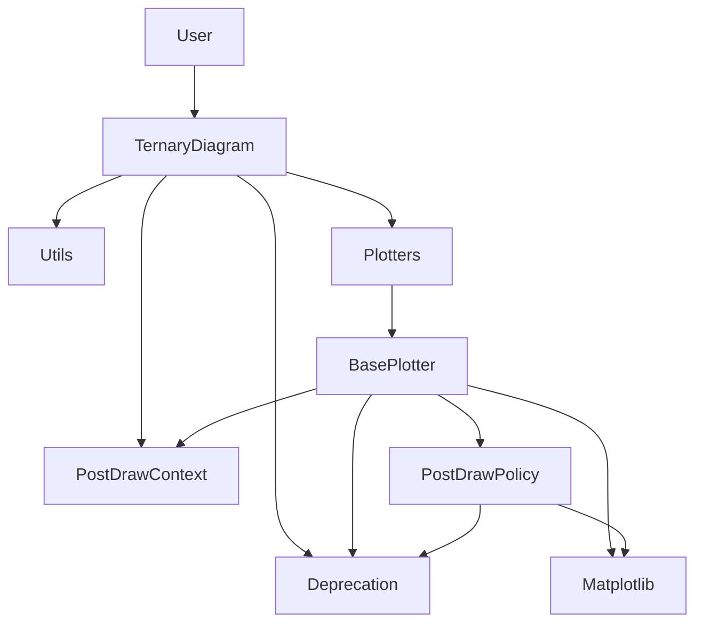
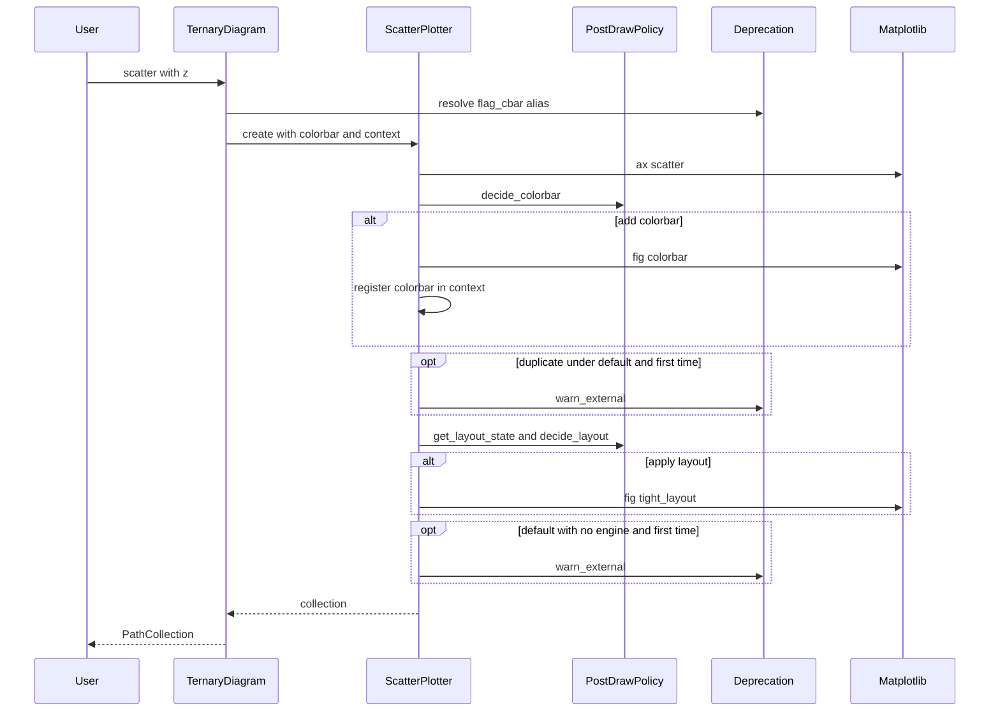

# Design Document: plot-side-effects

## Overview

**Purpose**: 描画メソッドが図全体に起こしている 2 つの副作用（描画ごとの `fig.tight_layout()` と、`z` があるたびのカラーバー追加）を、利用者が切り替えられるようにする。図に設定済みのレイアウトエンジンは上書きしない（現行は `layout="constrained"` の図でカラーバーを追加した直後の `tight_layout` が `RuntimeError` になり、エンジンも外れる）。v4.0.0 で既定値を変える挙動には、結果が変わる呼び出しにだけ移行方法付きの FutureWarning を出す。

**Users**: ternary-diagram の三角図を、`plt.subplots` の複数パネル、`layout="constrained"`、subfigure などを使った自分の matplotlib の図に組み込む材料・化学系の研究者。

**Impact**: 4 つの Plotter（`_ScatterPlotter`・`_ContourPlotter`・`_LinePlotter`・`_AnnotatePlotter`）が個別に持っていた描画後処理を、`_BasePlotter._post_draw` に集約する。`TernaryDiagram` にキーワード専用引数 `tight_layout`、`scatter` / `contour` に `colorbar` を足し、`flag_cbar` を非推奨の別名にする。利用者向けの警告の共通の入口 `_deprecation.warn_external` と非推奨・既定値変更の文面ヘルパーを `_deprecation.py` に新設し、後続の spec も使う。あわせて、後続の spec と共有する真偽値の検証 `utils.check_bool` と、公開 API の docstring の使用例を実行する共通 doctest ランナー `tests/test_doctests.py` を作り、CHANGELOG の Unreleased の見出しの組をそろえる。

### Goals
- レイアウト自動調整を三角図単位で「有効 / 無効 / 未指定」から選べる（1.1–1.6）
- 図に設定済みのレイアウトエンジンを置き換えない。subfigure 上でも、constrained の図でカラーバーを追加しても描画が失敗しない（2.1–2.6）
- カラーバーの自動追加を呼び出し単位で選べ、すでにカラーバーがある三角図での重複を予告して止められる（3.1–3.7、4.1–4.4）
- `flag_cbar` を使う既存コードがそのまま動く（5.1–5.4）
- 結果が変わる呼び出しだけに、利用者のコード位置を指す FutureWarning を三角図ごとに 1 回出す（6.1–6.9）
- 引数を何も変えていない既存ユーザーの図の見た目を変えない（7.1–7.4）
- 後続の spec が使う真偽値の検証と、公開 API の使用例を実行する共通のテストを用意する（9.1–9.4）

### Non-Goals
- v4.0.0 での既定値の切り替えそのもの（決定表の変更は v4.0.0 のリリース作業で行う）
- カラーバーの見た目の変更（`colorbar()` の既定値 `shrink=0.8`、`format="%.1f"` などはそのまま）
- メソッドごとのレイアウト引数、作成後にレイアウト設定を変える setter
- 利用者が `subplots_adjust` などで手動調整した余白の自動検出
- 新しい描画メソッド、三角図の土台の描画、使い方ページ・README・example ノートブックの更新

## Boundary Commitments

### This Spec Owns
- 描画後処理の共通入口 `_BasePlotter._post_draw` と、その呼び出し規約（すべての Plotter が `__init__` の最後で 1 回だけ呼ぶ）
- レイアウト自動調整の方針: 図の状態の判定（`get_layout_state`）、決定表（`decide_layout`）、`TernaryDiagram(..., tight_layout=...)` 引数
- カラーバー自動追加の方針: 決定表（`decide_colorbar`）、三角図ごとのカラーバー登録と存否判定、`scatter` / `contour` の `colorbar` 引数、`flag_cbar` 別名の扱い
- 三角図ごとの描画後処理の状態 `PostDrawContext`
- `_deprecation.py` のインターフェース: パッケージ全体で利用者向けの警告を出す入口 `warn_external`（種類は `category` で選ぶ。既定は FutureWarning）、非推奨・既定値変更の警告文の形式、`FUTURE_VERSION`
- 入力検証関数 `utils.check_optional_bool` と `utils.check_bool`（後続の spec も使う）
- 共通 doctest ランナー `tests/test_doctests.py`（対象の収集規則と実行条件）
- 既存 4 つの Plotter のうち、描画後処理（`tight_layout` とカラーバーの呼び出し）にあたる部分。`_BasePlotter._set_default_params` / `_merge_alias` の docstring の `>>>` 行を doctest でない記述に直すこと
- `TernaryDiagram.__init__` の最終シグネチャのうち `tight_layout` の位置と、検証の順のうち `tight_layout` の位置（roadmap の「横断の取り決め」）
- docstring のうち、`scatter` / `contour` の `colorbar`・`flag_cbar` の Parameters の項目と、`TernaryDiagram.__init__` の `tight_layout` の Parameters の項目だけ
- CHANGELOG の Unreleased の見出しの組（Breaking changes / New features / Deprecations / Bug fixes / Other changes）と、本 spec の項目
- 本機能のテスト

### Out of Boundary
- `TernaryDiagram.__init__` が描く三角図の土台（外枠・グリッド・目盛り・ラベル）、`materials` の検証、`*_kw` 引数とその検証。`diagram-customization`（本 spec の後にマージ）が持つ。本 spec が `__init__` に加えるのは、キーワード専用引数 `tight_layout`、その Parameters の項目、`check_ax` の直後の検証と `PostDrawContext` の作成だけ
- `TernaryDiagram.colorbar()` / `_BasePlotter.colorbar()` の引数・既定値・見た目（本 spec は作成したカラーバーを登録するだけ）
- docstring のうち上記の Parameters の項目以外: `TernaryDiagram.colorbar()` メソッドの docstring、`__init__` の Examples 節、`scatter` / `contour` の Notes・Examples などの節（`user-guide-docs`）。`*_kw` の Parameters の項目（`diagram-customization`）
- 他の spec が書く使用例の中身（各 spec が書き、本 spec のランナーで通ることを確かめる）
- 新しい Plotter（`fill`・`text`・`tripcolor`・`heatmapf` など）。`region-plots` / `heatmaps` が本 spec の規約に従って追加する
- v4.0.0 での決定表の切り替えと `flag_cbar` の削除
- zorder 定数、`utils.get_label` の判定（`annotate-plain-text`）
- example ノートブック・README・使い方ページ（`user-guide-docs`）、steering の更新（実装後に `/kiro-steering` で同期）

### Allowed Dependencies
- Python 標準ライブラリ: `warnings`、`sys`、`re`、`dataclasses`、`enum`、`typing`（テストの共通 doctest ランナーは `doctest`、`pkgutil`、`importlib`、`inspect` も使う）
- matplotlib の公開 API のみ: `Figure.tight_layout`、`Figure.get_layout_engine`（3.6+）、`matplotlib.layout_engine.PlaceHolderLayoutEngine`（3.6+）、`Figure.get_constrained_layout` / `Figure.get_tight_layout`（3.6 未満の分岐）、`matplotlib.figure.Figure`、`Colorbar.mappable`、`ScalarMappable.colorbar`
- ランタイム依存は追加しない（numpy と matplotlib のみ）
- パッケージ内の依存方向（左のモジュールは右を import しない）: `_deprecation` / `utils` → `_post_draw` → `_api`
  - `_deprecation.py` と `utils.py` はパッケージ内のどのモジュールも import しない
  - `_post_draw.py` は `_deprecation.py` だけを import する
  - `_api.py` は `_post_draw.py`、`_deprecation.py`、`utils.py` を import する
  - 後続 spec の Plotter は `_post_draw` / `_deprecation` の公開名（下記インターフェース）と `utils.check_optional_bool` / `check_bool` だけを使い、内部の列挙値や文面の定数に依存しない

### Revalidation Triggers
- `_BasePlotter._post_draw` のシグネチャ、または「`__init__` の最後で 1 回呼ぶ」規約の変更（`region-plots`、`heatmaps` に影響）
- `PostDrawContext` の公開メソッド（`register_colorbar`、`has_colorbar`、`first_time`）の変更
- `_deprecation.py` の関数シグネチャ（`warn_external` の `category` の扱いを含む）、`FUTURE_VERSION`、警告文の形式の変更（後続のすべての spec と、`user-guide-docs` の移行ガイドに影響）
- `colorbar_warning_message(func)` の文面の変更（`heatmaps` の `tripcolor` / `heatmapf` が同じ文面を出し、`user-guide-docs` の移行ページが文面を示す）
- 決定表（`decide_layout` / `decide_colorbar`）の変更。v4.0.0 の切り替えを含む
- `colorbar` 引数の意味の変更、`flag_cbar` の削除
- `TernaryDiagram.__init__` の最終シグネチャ、または検証の順（`ax` → `materials` → `tight_layout` → `*_kw`）の変更（roadmap の「横断の取り決め」。`diagram-customization`、`user-guide-docs` に影響）
- `utils.check_optional_bool` / `check_bool` のシグネチャや例外の文面の変更（`check_bool` は `diagram-customization`、`check_optional_bool` は `region-plots` の `text` と `heatmaps` の `colorbar` が使う）
- 共通 doctest ランナーの収集規則・実行条件（一時ディレクトリ、FutureWarning をエラーにする、option flags）、または `xfail` の一覧の変更（使用例を書くすべての spec に影響）

## Architecture

### Existing Architecture Analysis
- ファサード `TernaryDiagram` が描画種別ごとの `_XxxPlotter` を生成し、各 Plotter が `__init__` の中で検証 → 座標変換 → matplotlib 呼び出し → `self.fig.tight_layout()` まで行う。三角図の状態は `ax` / `fig` と `x_` / `y_` だけ
- カラーバーは `_ScatterPlotter` / `_ContourPlotter` が `flag_cbar` を見て `_BasePlotter.colorbar`（静的メソッド）で追加する。`TernaryDiagram.colorbar()` も同じ静的メソッドに委譲する
- 既存の別名統合 `_merge_alias`（`vmin` → `z_min`）は matplotlib の kwargs 名との衝突用で、警告は出さない。本 spec の改名ヘルパーとは目的が違うので、そのまま残す
- `_AnnotatePlotter` は `self.kwargs` ではなくローカルの `kwargs` を `ax.annotate` に渡す。新しい引数は `**kwargs` に紛れ込ませず、各 Plotter のシグネチャで明示的に受ける

### Architecture Pattern & Boundary Map



- `TernaryDiagram`、`Plotters`、`BasePlotter` は `_api.py`。`PostDrawPolicy`（判定関数・決定表・文面）と `PostDrawContext` は `_post_draw.py`。`Deprecation` は `_deprecation.py`。`Utils` は `utils.py`

**Architecture Integration**:
- Selected pattern: 既存の Plotter パターンを保ち、描画後処理だけを基底クラスの 1 メソッドに集約する。判定は純粋関数、副作用は `_post_draw` だけで実行する（Functional core / imperative shell）
- Domain boundaries: 「何をするか」の判定（`_post_draw.py`）と「実行」（`_BasePlotter._post_draw`）を分ける。警告の形式と発生位置は `_deprecation.py` だけが決める
- Existing patterns preserved: `_set_default_params` によるユーザー指定の優先、`utils.check_*` による入力検証、戻り値は matplotlib のネイティブオブジェクト、モジュール冒頭での matplotlib バージョン分岐
- New components rationale: `_deprecation.py` はパッケージ全体で利用者向けの警告を出す唯一の入口（後続 spec も再利用する）。`_post_draw.py` は `_api.py` の差分を減らし、後続 spec（`diagram-customization` など）との衝突を避ける。`tests/test_doctests.py` は全 spec の使用例を同じ条件で実行する唯一のランナー
- Steering compliance: ランタイム依存を増やさない。公開 API は `TernaryDiagram` に集約したまま。matplotlib の古いバージョンは分岐で吸収する

### Technology Stack

| Layer | Choice / Version | Role in Feature | Notes |
|-------|------------------|-----------------|-------|
| Runtime | Python >= 3.9 | 新規の `_deprecation.py` / `_post_draw.py` は tech.md「Compatibility」の規約どおり先頭に `from __future__ import annotations` を置き、注釈は組み込みジェネリクス（`list[...]`、`set[...]`、`type[...]`）と `X \| None` で書く（`typing.Optional` / `List` / `Set` は使わない。`Any`・`Final` だけは `typing` から import する）。既存の `_api.py` / `utils.py` は、ファイル内で書き方を揃える規約に従い `typing.Optional` / `Tuple` / `List` のままにする（本 spec のインターフェースのうち `_api.py` / `utils.py` に置くものが `Optional[...]` なのはこのため） | 注釈は `from __future__ import annotations` により文字列のまま保持されるので、3.9 でも `X \| None` は評価されない（`dataclass` もフィールドの注釈を評価しない）。本 spec の新規モジュールには実行時に評価される型別名はない。足す場合は 3.9 で `X \| None` を評価できないので、その別名だけ `typing.Optional` / `Union` で書く。`warnings.warn(skip_file_prefixes=)` は 3.12+ のため使わない |
| Plotting | matplotlib（上限なし、3.6 前後で分岐） | レイアウトエンジンの照会、`tight_layout`、`colorbar` | 3.6+ は `get_layout_engine`、3.6 未満は `get_constrained_layout` / `get_tight_layout` |
| Test | pytest、Agg バックエンド、標準ライブラリ `doctest` | `pytest.warns`、`warnings.catch_warnings`、`monkeypatch`、共通 doctest ランナー | 画像比較はせず、`subplotpars`、レイアウトエンジン、Axes の数、警告の内容と位置を assert する |

## File Structure Plan

### Directory Structure
```
src/ternary_diagram/
├── _deprecation.py   # 新規: 利用者向けの警告の共通の入口と、非推奨・既定値変更の文面ヘルパー（パッケージ内依存なし）
├── _post_draw.py     # 新規: 描画後処理の方針（PostDrawContext、図のレイアウト状態の判定、決定表、警告文）
├── _api.py           # 変更: TernaryDiagram と Plotter を新しい描画後処理に移行
└── utils.py          # 変更: check_optional_bool と check_bool を追加
tests/
├── test_deprecation.py   # 新規: _deprecation の単体テスト
├── test_post_draw.py     # 新規: _post_draw の判定関数・状態・バージョン分岐の単体テスト
├── test_side_effects.py  # 新規: TernaryDiagram 経由のレイアウト・カラーバー・警告の結合テスト
└── test_doctests.py      # 新規: 公開 API の docstring の使用例を実行する共通 doctest ランナー（全 spec が使う）
```

### Modified Files
- `src/ternary_diagram/_api.py`
  - `TernaryDiagram.__init__`: キーワード専用引数 `tight_layout: Optional[bool] = None` を追加。`check_ax(ax)` の直後（Axes に触れる前、土台を描く前）で `check_optional_bool` による検証と `PostDrawContext` の作成を行い、`self.__post_draw_context` に保持する。docstring の Parameters に `tight_layout` の項目を足す（Examples 節には触れない）。土台の描画コードは変更しない
  - `TernaryDiagram.scatter` / `contour`: `flag_cbar` の位置に `colorbar: Optional[bool] = None` を置き、`flag_cbar` は `**kwargs` から取り出して `_resolve_colorbar_arg` で解決する。docstring を更新する
  - `TernaryDiagram.plot` / `annotate`: Plotter に `post_draw_context` を渡す
  - `TernaryDiagram.colorbar`: 作成した `Colorbar` を `PostDrawContext.register_colorbar` で登録する（引数・既定値・戻り値・docstring は変えない）
  - 新しいモジュール関数 `_resolve_colorbar_arg`
  - `_BasePlotter`: キーワード専用の必須引数 `post_draw_context` と `_post_draw` メソッドを追加。`_set_default_params` / `_merge_alias` の docstring にある `>>> self...` の行を、doctest でない記述（本文での説明）に書き換える（private なメソッドには `>>>` を書かない。9.4）
  - 4 つの Plotter: `post_draw_context` を明示的に受けて基底へ渡す。`self.fig.tight_layout()` と個別のカラーバー追加を `self._post_draw(...)` 1 回に置き換える。`_ScatterPlotter` / `_ContourPlotter` の `flag_cbar` 引数は `colorbar` に改める
- `src/ternary_diagram/utils.py` — `check_optional_bool` と `check_bool` を追加（どちらも doctest 形式の Examples 付き）
- `tests/conftest.py` — `td` fixture を `TernaryDiagram(MATERIALS, ax=ax, tight_layout=True)` にして、既存テストが従来と同じ処理経路を通りつつ FutureWarning を出さないようにする
- `tests/test_scatter.py`、`tests/test_contour.py`、`tests/test_ternary_diagram.py` — `flag_cbar=False` を `colorbar=False` に置き換える。example を読むテストはレイアウト設定を明示する
- `tests/test_utils.py` — `check_optional_bool` と `check_bool` のテスト
- `CHANGELOG.md` — Unreleased の見出しを Breaking changes / New features / Deprecations / Bug fixes / Other changes の組にそろえ（足りない New features と Deprecations を足す）、本 spec の項目を Breaking changes / New features / Deprecations / Bug fixes / Other changes に追記（Breaking changes は、`scatter` / `contour` の 6 番目の位置引数に `0` / `1` など真偽値以外を渡す呼び出しが `TypeError` になること）

## System Flows

### `z` を伴う `scatter` の描画後処理



- カラーバーを先に追加し、その後でレイアウトを調整する（現行と同じ順序。7.1）
- エンジンのある図（`HAS_ENGINE`）では `tight_layout` を呼ばない。現行は constrained の図でカラーバーを追加した直後に `fig.tight_layout()` がエンジンを tight に切り替えようとして `RuntimeError`（"Colorbar layout of new layout engine not compatible with old engine"）になり、`finally` 節でエンジンが `PlaceHolderLayoutEngine` に置き換わるが、本設計ではこの経路を通らない（2.6）
- 警告は「決定表が警告を求め、かつ `PostDrawContext.first_time(key)` が真」のときだけ出す（6.8）

### 決定表（v3.x）

**レイアウト** `decide_layout(setting, state)`

| setting \ state | `NO_ENGINE` | `HAS_ENGINE` | `UNSUPPORTED`（subfigure） |
|---|---|---|---|
| `None`（未指定） | `APPLY_AND_WARN` | `SKIP` | `SKIP` |
| `True` | `APPLY` | `SKIP` | `SKIP` |
| `False` | `SKIP` | `SKIP` | `SKIP` |

**カラーバー** `decide_colorbar(requested, has_mappable, has_existing)`

| requested \ 状況 | mappable なし | mappable あり・既存なし | mappable あり・既存あり |
|---|---|---|---|
| `None`（未指定） | `SKIP` | `ADD` | `ADD_AND_WARN` |
| `True` | `SKIP` | `ADD` | `ADD` |
| `False` | `SKIP` | `SKIP` | `SKIP` |

- v4.0.0 では `None` の行だけが変わる（レイアウト: `APPLY_AND_WARN` → `SKIP`、カラーバー: `ADD_AND_WARN` → `SKIP`）。他のセルは v4.0.0 でも同じなので、警告を出さない（6.4、6.5）

## Requirements Traceability

| Requirement | Summary | Components | Interfaces | Flows |
|-------------|---------|------------|------------|-------|
| 1.1 | 三角図単位で 3 通りの指定 | TernaryDiagram, PostDrawContext | `TernaryDiagram(..., *, tight_layout)` | — |
| 1.2 | 無効なら余白を変えない | PostDrawPolicy, BasePlotter | `decide_layout` → `SKIP` | 決定表 |
| 1.3 | 有効かつエンジンなしで tight | PostDrawPolicy, BasePlotter | `decide_layout` → `APPLY` | 決定表 |
| 1.4 | 未指定かつエンジンなしで従来どおり tight | PostDrawPolicy, BasePlotter | `decide_layout` → `APPLY_AND_WARN` | 決定表 |
| 1.5 | 全描画メソッドに同じ設定 | TernaryDiagram, BasePlotter, 4 Plotter | `post_draw_context`、`_post_draw` | 描画後処理 |
| 1.6 | 不正値は TypeError | Utils | `check_optional_bool` | — |
| 2.1 | 設定済みエンジンを置き換えない | PostDrawPolicy | `get_layout_state` → `HAS_ENGINE` | 決定表 |
| 2.2 | matplotlib のレイアウト変更警告を出さない | BasePlotter | `HAS_ENGINE` で `tight_layout` を呼ばない | 決定表 |
| 2.3 | ライブラリ自身の痕跡はエンジンとみなさない | PostDrawPolicy | `PlaceHolderLayoutEngine` → `NO_ENGINE` | — |
| 2.4 | subfigure で失敗しない | PostDrawPolicy | `SubFigure` → `UNSUPPORTED` | 決定表 |
| 2.5 | 古い matplotlib の判定 | PostDrawPolicy | `_HAS_LAYOUT_ENGINE` 分岐 | — |
| 2.6 | constrained の図でカラーバーを追加しても失敗せずエンジンを変えない | PostDrawPolicy, BasePlotter | `HAS_ENGINE` → `decide_layout` が `SKIP`（`tight_layout` を呼ばない）。カラーバーは図のエンジンのまま追加 | 描画後処理 |
| 3.1 | 呼び出し単位で 3 通りの指定 | TernaryDiagram | `scatter(..., colorbar)`、`contour(..., colorbar)` | — |
| 3.2 | 追加しない | PostDrawPolicy | `decide_colorbar` → `SKIP` | 決定表 |
| 3.3 | 追加する | PostDrawPolicy | `decide_colorbar` → `ADD` | 決定表 |
| 3.4 | 未指定・既存なしで従来どおり追加 | PostDrawPolicy | `decide_colorbar` → `ADD` | 決定表 |
| 3.5 | `z` なしの scatter は追加しない | ScatterPlotter | `_post_draw(mappable=None)` | — |
| 3.6 | 返却オブジェクトから参照可能 | BasePlotter | `mappable.colorbar`（matplotlib が設定） | — |
| 3.7 | 不正値は TypeError | Utils, TernaryDiagram | `check_optional_bool`、`_resolve_colorbar_arg` | — |
| 4.1 | 既存カラーバーの定義 | PostDrawContext, TernaryDiagram | `register_colorbar`、`has_colorbar` | — |
| 4.2 | 重複時は追加して警告 | PostDrawPolicy, BasePlotter, Deprecation | `ADD_AND_WARN`、`colorbar_warning_message`、`warn_external` | 描画後処理 |
| 4.3 | 削除済みは数えない | PostDrawContext | `has_colorbar`（`cb.mappable.colorbar is cb`） | — |
| 4.4 | 判定範囲を docstring に記載 | TernaryDiagram | `scatter` / `contour` の docstring | — |
| 5.1 | `flag_cbar` を従来の意味で受け付ける | TernaryDiagram | `_resolve_colorbar_arg`（`bool()` で解釈） | — |
| 5.2 | `flag_cbar` 明示は既定値警告なし | TernaryDiagram, PostDrawPolicy | 明示値として `decide_colorbar` に渡す | 決定表 |
| 5.3 | 改名の FutureWarning | Deprecation | `resolve_renamed_parameter` | — |
| 5.4 | 両方指定は ValueError | Deprecation | `resolve_renamed_parameter` | — |
| 6.1 | v4.0.0 のレイアウト既定を明示 | TernaryDiagram docstring, CHANGELOG | — | — |
| 6.2 | v4.0.0 のカラーバー既定を明示 | TernaryDiagram docstring, CHANGELOG | — | — |
| 6.3 | 結果が変わるなら警告 | PostDrawPolicy, BasePlotter | `*_AND_WARN` | 決定表 |
| 6.4 | 結果が変わらないなら警告しない | PostDrawPolicy | 決定表の `SKIP` / `ADD` / `APPLY` | 決定表 |
| 6.5 | 明示した項目は警告しない | PostDrawPolicy | `True` / `False` 行 | 決定表 |
| 6.6 | 警告本文の構成 | Deprecation, PostDrawPolicy | `format_default_change` | — |
| 6.7 | 利用者のコード位置を報告 | Deprecation | `warn_external` | — |
| 6.8 | 三角図ごと・理由ごとに 1 回 | PostDrawContext | `first_time(key)` | 描画後処理 |
| 6.9 | 非推奨と既定値変更を同じ形式で | Deprecation | `format_default_change`、`format_renamed_parameter` | — |
| 7.1 | 既定のままなら見た目が同じ | PostDrawPolicy, BasePlotter | `None` 行と処理順序 | 描画後処理 |
| 7.2 | 戻り値と kwargs の扱いを変えない | TernaryDiagram, 4 Plotter | 既存シグネチャ | — |
| 7.3 | 既存の位置引数の並び（真偽値以外は `TypeError` で、Breaking changes に記載） | TernaryDiagram, CHANGELOG.md | `colorbar` を `flag_cbar` の位置に置く。`check_optional_bool` で真偽値以外の位置引数を `TypeError` にする | — |
| 7.4 | `colorbar()` を変えない | TernaryDiagram | 登録のみ追加 | — |
| 8.1 | CHANGELOG の見出しの組と本 spec の項目 | CHANGELOG.md | Unreleased の 5 見出しと、Breaking changes（位置引数の厳密化）を含む本 spec の項目 | — |
| 8.2 | docstring の Parameters の項目 | TernaryDiagram | `__init__` の `tight_layout`、`scatter` / `contour` の `colorbar`・`flag_cbar` の Parameters の項目（`TernaryDiagram.colorbar()` メソッドの docstring は `user-guide-docs` の担当で、本 spec は変えない） | — |
| 9.1 | 真偽値の検証関数 | Utils | `check_bool` | — |
| 9.2 | 検証関数の doctest | Utils, DoctestRunner | `check_optional_bool` / `check_bool` の Examples | — |
| 9.3 | 公開 API の使用例を実行する共通のテスト | DoctestRunner | `tests/test_doctests.py` | — |
| 9.4 | private なメソッドに `>>>` を書かない | DoctestRunner, BasePlotter | 収集規則で private を除外。`_set_default_params` / `_merge_alias` の docstring の書き換え | — |

## Components and Interfaces

| Component | Domain/Layer | Intent | Req Coverage | Key Dependencies (P0/P1) | Contracts |
|-----------|--------------|--------|--------------|--------------------------|-----------|
| Deprecation（`_deprecation.py`） | 共通基盤 | 利用者向けの警告の入口（発生位置の統一）と、非推奨・既定値変更の文面を提供する | 5.3, 5.4, 6.6, 6.7, 6.9 | 標準ライブラリのみ (P0) | Service |
| PostDrawPolicy（`_post_draw.py` の関数群） | 描画後処理の判定 | 図の状態と設定から、実行と警告の要否を決める | 1.2–1.4, 2.1–2.6, 3.2–3.4, 4.2, 6.3–6.5 | matplotlib (P0), Deprecation (P1) | Service |
| PostDrawContext（`_post_draw.py`） | 描画後処理の状態 | 三角図ごとのレイアウト設定、カラーバー登録、警告済みの理由を保持する | 1.1, 1.5, 4.1, 4.3, 6.8 | matplotlib `Colorbar` (P1) | State |
| BasePlotter `_post_draw`（`_api.py`） | 描画後処理の実行 | 判定結果に従ってカラーバー追加・レイアウト調整・警告を実行する | 1.2–1.5, 2.2, 2.6, 3.5, 3.6, 4.2, 6.3, 7.1, 9.4 | PostDrawPolicy (P0), PostDrawContext (P0), Deprecation (P0) | Service |
| TernaryDiagram 変更点（`_api.py`） | 公開ファサード | 新しい引数の受け付け・検証・別名解決・状態の配線 | 1.1, 1.6, 3.1, 3.7, 4.1, 4.4, 5.1, 5.2, 6.1, 6.2, 7.2–7.4, 8.2 | Utils (P0), Deprecation (P0), PostDrawContext (P0) | Service |
| 既存 4 Plotter 変更点（`_api.py`） | 描画 | 描画後処理を `_post_draw` 1 回に置き換える | 1.5, 3.5, 7.1, 7.2 | BasePlotter (P0) | — |
| `check_optional_bool` / `check_bool`（`utils.py`） | 入力検証 | `None` / 真偽値以外、または真偽値以外を `TypeError` にする | 1.6, 3.7, 9.1, 9.2 | numpy (P2) | Service |
| DoctestRunner（`tests/test_doctests.py`） | テスト基盤 | 公開 API の docstring の使用例を、全 spec 共通の条件で実行する | 9.2, 9.3, 9.4 | 標準ライブラリ `doctest` (P0)、`tests/conftest.py` の Agg バックエンド (P1) | — |

### 共通基盤

#### Deprecation（`src/ternary_diagram/_deprecation.py`）

| Field | Detail |
|-------|--------|
| Intent | パッケージ全体の利用者向けの警告を利用者のコード位置で出す入口と、非推奨・既定値変更の統一した文面を提供する |
| Requirements | 5.3, 5.4, 6.6, 6.7, 6.9 |

**Responsibilities & Constraints**
- `warn_external` は、パッケージ全体で利用者向けの警告を出す唯一の入口。警告の種類は呼び出し側が `category` で選ぶ（既定は `FutureWarning`。非推奨・既定値変更以外の利用者向けの注意には `UserWarning` なども渡せる）。発生位置（`stacklevel`）はここだけが決める。パッケージ内の他のモジュール（後続 spec が足すものを含む）は `warnings.warn` を直接呼ばない
- 非推奨・既定値変更の本文の構成（`format_default_change` / `format_renamed_parameter`）もここで決める。この 2 つの文面は `FutureWarning` で出す（6.9）
- 状態を持たない。「三角図ごとに 1 回」の抑制は呼び出し側（`PostDrawContext.first_time`）が行う
- パッケージ内のどのモジュールも import しない（葉モジュール）
- 文面は英語（docstring・例外メッセージと同じ）

**Dependencies**
- Inbound: `_post_draw.py`（既定値変更の文面）、`_api.py`（改名の解決、警告の実行）、後続 spec の Plotter とモジュール（利用者向けの警告すべて）(P0)
- External: `warnings`、`sys`、`re` (P0)

**Contracts**: Service [x]

##### Service Interface（後続 spec が再利用するインターフェース）
```python
from __future__ import annotations  # 新規モジュール: 組み込みジェネリクスと X | None

from typing import Any, Final

FUTURE_VERSION: Final[str] = "4.0.0"
"""既定値の変更と、非推奨の名前の削除を予定しているバージョン。"""

class _Unset:
    """引数が省略されたことを表す番兵の型。repr は "<UNSET>"。"""

UNSET: Final[_Unset]
"""省略を None と区別するための唯一のインスタンス。"""

def warn_external(message: str, category: type[Warning] = FutureWarning) -> None:
    """パッケージ外で最初に見つかる呼び出し元のフレームを発生位置として、category の警告を出す。"""

def format_default_change(
    *,
    current: str,
    future: str,
    keep: str,
    adopt: str,
    version: str = FUTURE_VERSION,
) -> str:
    """既定値変更の警告文を組み立てる（純粋関数）。"""

def format_renamed_parameter(
    *, func: str, old: str, new: str, version: str = FUTURE_VERSION
) -> str:
    """改名した引数の警告文を組み立てる（純粋関数）。"""

def resolve_renamed_parameter(
    *,
    func: str,
    old: str,
    new: str,
    old_value: Any,
    new_value: Any,
    version: str = FUTURE_VERSION,
) -> Any:
    """改名前後の引数から、実際に使う値を決める。"""
```

- `warn_external`
  - 事前条件: `category` は `Warning` のサブクラス（既定は `FutureWarning`。`UserWarning` などを渡せる）
  - 事後条件: `sys._getframe` から呼び出し元へ遡り、モジュール名（`f_globals["__name__"]`）が正規表現 `\Aternary_diagram(\Z|\.)` に一致しない最初のフレームを発生位置として `warnings.warn(message, category, stacklevel=n)` を呼ぶ。経路の深さ（`TernaryDiagram` のメソッドから呼ぶか、Plotter の中から呼ぶか）に依存しない
  - パッケージ外のフレームが見つからない場合（フレームが尽きた場合）は、たどれた最後の段数を使う
- `format_default_change`
  - 本文: `"{current} In ternary-diagram {version}, {future} To keep the current behavior, {keep}. To adopt the new behavior now, {adopt}."`
  - 引数の役割: `current` = 今起きたこと（完結した 1 文）、`future` = 変更後の挙動（完結した 1 文）、`keep` / `adopt` = 「〜するには」に続く動詞句（末尾のピリオドなし）
  - 事前条件: 4 つの文字列がすべて空でない。空なら `ValueError`（開発者向けの誤用検出）
- `format_renamed_parameter`
  - 本文: `` "`{old}` of `{func}` was renamed to `{new}`. `{old}` will be removed in ternary-diagram {version}. Pass `{new}` instead." ``
  - 6.9 の「何が変わるか・いつ変わるか・どう書けばよいか」を既定値変更と同じ順で含める
- `resolve_renamed_parameter`
  - `old_value is UNSET` のとき: 警告を出さずに `new_value` を返す
  - `old_value is not UNSET` かつ `new_value is not None` のとき: `` ValueError("`{old}` and `{new}` cannot be specified at the same time.") ``（既存の `_merge_alias` と同じ言い回し）
  - `old_value is not UNSET` かつ `new_value is None` のとき: `format_renamed_parameter` の文面を `warn_external` で出し、`old_value` をそのまま返す（解釈の変換は呼び出し側が行う）
  - 前提: 新しい名前の既定値は `None`。`None` 以外を既定に持つ引数の改名には使わない

**Implementation Notes**
- Integration: 後続 spec が自分の既定値変更を予告するときは、`PostDrawContext.first_time("<feature>.<topic>")` で 1 回に絞ってから `warn_external(format_default_change(...))` を呼ぶ。キーは機能名で名前空間を切る（本 spec は `"layout.tight_layout"` と `"colorbar.duplicate"` を使う）。既定値変更以外の利用者向けの注意は `warn_external(message, UserWarning)` のように `category` を指定して出す
- Validation: `tests/test_deprecation.py` で文面の構成要素、発生位置（`record[0].filename == __file__`。`category=UserWarning` でも同じ）、改名解決の 4 通りを検証する
- docstring: `_deprecation.py` は private なモジュールで、共通 doctest ランナーの対象外。docstring に `>>>` の例を書かない（tech.md「Docstring Examples」）。`_post_draw.py` も同じ
- Risks: `sys._getframe` は CPython / PyPy にある。matplotlib も同じ方法を使っている

### 描画後処理

#### PostDrawContext（`src/ternary_diagram/_post_draw.py`）

| Field | Detail |
|-------|--------|
| Intent | 三角図 1 つ分の描画後処理の状態（レイアウト設定、作成したカラーバー、警告済みの理由）を保持する |
| Requirements | 1.1, 1.5, 4.1, 4.3, 6.8 |

**Contracts**: State [x]

##### State Management
```python
from __future__ import annotations  # 新規モジュール: 組み込みジェネリクスと X | None

from dataclasses import dataclass, field
import matplotlib.colorbar

@dataclass(frozen=True)
class PostDrawContext:
    tight_layout: bool | None = None
    _colorbars: list[matplotlib.colorbar.Colorbar] = field(
        default_factory=list, init=False, repr=False
    )
    _warned: set[str] = field(default_factory=set, init=False, repr=False)

    def register_colorbar(self, colorbar: matplotlib.colorbar.Colorbar) -> None:
        """この三角図を通じて作成したカラーバーを登録する。"""

    def has_colorbar(self) -> bool:
        """登録済みのカラーバーのうち、削除されていないものが 1 本以上あれば True。"""

    def first_time(self, key: str) -> bool:
        """key を初めて受け取ったときだけ True を返し、key を記録する。"""
```
- State model: `TernaryDiagram` 1 つにつき 1 インスタンス。`TernaryDiagram.__init__` が作成し、すべての Plotter と `TernaryDiagram.colorbar()` が同じインスタンスを共有する（1.5）
- 不変条件: `frozen=True` により `tight_layout` は作成後に変えられない。`_colorbars` と `_warned` はコンストラクタ引数にせず、メソッドを通じた追加だけを行う
- `has_colorbar` の判定: `any(cb.mappable.colorbar is cb for cb in self._colorbars)`。`Colorbar.remove()` が `mappable.colorbar` を `None` にするので、削除済みは数えない（4.3）。matplotlib の関数で直接作ったカラーバーは登録されず、数えない（4.1）
- Concurrency: 1 つの図をスレッド間で共有する使い方は matplotlib 自体が想定していないので、ロックは持たない

#### PostDrawPolicy（`src/ternary_diagram/_post_draw.py` の関数群）

| Field | Detail |
|-------|--------|
| Intent | 図のレイアウト状態を判定し、レイアウト調整・カラーバー追加・警告の要否を決める |
| Requirements | 1.2, 1.3, 1.4, 2.1, 2.2, 2.3, 2.4, 2.5, 3.2, 3.3, 3.4, 4.2, 6.3, 6.4, 6.5, 6.6 |

**Responsibilities & Constraints**
- `get_layout_state` だけが図を読む。図を変更する関数はない
- 決定表は「Flows」節の 2 表のとおり。v4.0.0 の切り替えはこの 2 関数の `None` 行だけで完結する
- 警告文（英語）の組み立てもここに置き、`_api.py` に文面を散らさない

**Dependencies**
- Inbound: BasePlotter `_post_draw` (P0)
- Outbound: Deprecation `format_default_change` (P1)
- External: matplotlib `Figure`、`layout_engine.PlaceHolderLayoutEngine`（3.6+）(P0)

**Contracts**: Service [x]

##### Service Interface
```python
from __future__ import annotations  # 新規モジュール: 組み込みジェネリクスと X | None

from enum import Enum
import matplotlib.figure

class LayoutState(Enum):
    NO_ENGINE = "no_engine"      # エンジンなし、または PlaceHolderLayoutEngine
    HAS_ENGINE = "has_engine"    # 利用者・rcParams が設定したエンジン
    UNSUPPORTED = "unsupported"  # Figure 以外（SubFigure）

class LayoutAction(Enum):
    SKIP = "skip"
    APPLY = "apply"
    APPLY_AND_WARN = "apply_and_warn"

class ColorbarAction(Enum):
    SKIP = "skip"
    ADD = "add"
    ADD_AND_WARN = "add_and_warn"

LAYOUT_WARNING_KEY: str = "layout.tight_layout"
COLORBAR_WARNING_KEY: str = "colorbar.duplicate"

def get_layout_state(fig: matplotlib.figure.FigureBase) -> LayoutState: ...
def decide_layout(setting: bool | None, state: LayoutState) -> LayoutAction: ...
def decide_colorbar(
    requested: bool | None, *, has_mappable: bool, has_existing: bool
) -> ColorbarAction: ...
def layout_warning_message() -> str: ...
def colorbar_warning_message(func: str) -> str: ...
```

- `get_layout_state(fig)`
  1. `fig` が `matplotlib.figure.Figure` のインスタンスでなければ `UNSUPPORTED`（`SubFigure` を含む。2.4）
  2. matplotlib 3.6 以上（モジュール冒頭の定数 `_HAS_LAYOUT_ENGINE`）: `fig.get_layout_engine()` が `None` または `PlaceHolderLayoutEngine` なら `NO_ENGINE`、それ以外は `HAS_ENGINE`（2.1、2.3）
  3. 3.6 未満: `fig.get_constrained_layout()` または `fig.get_tight_layout()` が真なら `HAS_ENGINE`、どちらも偽なら `NO_ENGINE`（2.5）
- `decide_layout` / `decide_colorbar`: 「決定表（v3.x）」のとおり。全域関数で例外を出さない
- `layout_warning_message()`: `format_default_change` を次の内容で呼ぶ
  - current: `` "TernaryDiagram called `Figure.tight_layout()` after plotting because the figure has no layout engine and `tight_layout` was not specified." ``
  - future: `"TernaryDiagram will no longer adjust the figure layout by default (tight_layout=False)."`
  - keep: `` "pass `tight_layout=True` to `TernaryDiagram`" ``
  - adopt: `` "pass `tight_layout=False` and call `fig.tight_layout()` yourself, or create the figure with `layout=\"constrained\"`" ``
- `colorbar_warning_message(func)`: `format_default_change` を次の内容で呼ぶ（`func` は Plotter の `name`、例: `"scatter"`、`"heatmapf"`）
  - current: `` "`{func}` added another colorbar to this diagram, which already has one, because `colorbar` was not specified." ``
  - 文面は `z` に触れない。`z` を引数に持たない値で色付けした描画（`heatmaps` の `heatmapf` など）も同じ文面を使う
  - future: `"a colorbar will be added automatically only when the diagram has none."`
  - keep: `` "pass `colorbar=True`" ``
  - adopt: `` "pass `colorbar=False`" ``

**Implementation Notes**
- Integration: 新規の 2 モジュールは `from __future__ import annotations` を置き、注釈は組み込みジェネリクスと `X | None` で書く（tech.md「Compatibility」）。これにより `matplotlib.figure.FigureBase`（3.4+）などの注釈が古い matplotlib の import 時に評価されず、`bool | None` も Python 3.9 で評価されない。実行時に評価される型別名はこの 2 モジュールに置かない（置く場合は 3.9 向けに `typing.Optional` / `Union` で書く）。バージョン定数はモジュール冒頭で `tuple(map(int, matplotlib.__version__.split(".")[:2])) >= (3, 6)` とし、`PlaceHolderLayoutEngine` の import も同じ分岐の中に置く（tech.md の既存パターン）
- Validation: `tests/test_post_draw.py` で決定表の全セル、各種エンジンの判定、3.6 未満の分岐（`monkeypatch` で定数を `False` にする）を検証する
- Risks: matplotlib が将来 `PlaceHolderLayoutEngine` を廃止した場合は判定を見直す（Revalidation Triggers に準じて扱う）

#### BasePlotter `_post_draw`（`src/ternary_diagram/_api.py`）

| Field | Detail |
|-------|--------|
| Intent | すべての Plotter の描画後処理を 1 か所で実行する |
| Requirements | 1.2, 1.3, 1.4, 1.5, 2.2, 2.6, 3.5, 3.6, 4.2, 6.3, 7.1, 9.4 |

**Responsibilities & Constraints**
- 副作用（カラーバーの追加と登録、`fig.tight_layout()`、警告）を実行する唯一の場所。Plotter は `fig.tight_layout()` や `self.colorbar(...)` を直接呼ばない
- 実行順序: カラーバーの判定と追加 → カラーバーの警告 → レイアウトの判定と調整 → レイアウトの警告
- matplotlib が出す例外・警告（例: tight_layout が適用できないときの UserWarning）は握りつぶさずに伝える

**Dependencies**
- Inbound: 4 つの既存 Plotter、後続 spec の Plotter (P0)
- Outbound: PostDrawPolicy（判定と警告文）、PostDrawContext、Deprecation `warn_external`（FutureWarning の発生）(P0)
- External: matplotlib `Figure.tight_layout`、`Figure.colorbar`（既存の `_BasePlotter.colorbar` 経由）(P0)

**Contracts**: Service [x]

##### Service Interface（後続 spec の Plotter が従う規約）
```python
# _api.py は既存ファイルなので、ファイル内の書き方（typing.Optional / Tuple / List）に合わせる
from typing import Optional
import matplotlib.cm
import matplotlib.colorbar

class _BasePlotter:
    def __init__(
        self,
        vector: ArrayLike,
        ax: Optional[matplotlib.axes.Axes] = None,
        z: Optional[ArrayLike] = None,
        z_min: Optional[Number] = None,
        z_max: Optional[Number] = None,
        *,
        post_draw_context: PostDrawContext,
        **kwargs,
    ) -> None: ...

    def _post_draw(
        self,
        *,
        mappable: Optional[matplotlib.cm.ScalarMappable] = None,
        colorbar: Optional[bool] = None,
    ) -> Optional[matplotlib.colorbar.Colorbar]: ...
```
- `post_draw_context` は必須のキーワード専用引数。渡し忘れは `TypeError` になり、配線漏れを実装時に検出できる。各サブクラスは自分のシグネチャで `post_draw_context` を明示的に受けて基底へ渡し、`**kwargs` に紛れ込ませない
- `_post_draw` の事前条件: 描画（`self.collection_` の設定）が済んでいる。`mappable` には値で色付けしたオブジェクト（`z` を伴う描画の戻り値）を、`z` を伴わない描画では `None` を渡す。`colorbar` には利用者の指定（`flag_cbar` 解決後の値）をそのまま渡す
- `_post_draw` の事後条件: 決定表に従ってカラーバーを追加した場合は `PostDrawContext.register_colorbar` で登録し、その `Colorbar` を返す（追加しない場合は `None`）。追加したカラーバーは matplotlib により `mappable.colorbar` からも参照できる（3.6）
- 呼び出し規約: すべての Plotter は `__init__` の最後で `_post_draw` をちょうど 1 回呼ぶ

**Implementation Notes**
- Integration: 既存の `_ScatterPlotter` は `z` がないとき `mappable=None`、あるとき `mappable=self.collection_` を渡す。`_ContourPlotter` は常に `mappable=self.collection_`。`_LinePlotter` / `_AnnotatePlotter` は引数なしで呼ぶ
- docstring: `_post_draw` を含む private なメソッドには `>>>` の例を書かない。既存の `_set_default_params`（`>>> self._set_default_params(zorder=2)`）と `_merge_alias`（`>>> z_min = self._merge_alias(...)`）の Examples 節は、`>>>` を使わない本文の説明に書き換える（9.4）
- Validation: `tests/test_side_effects.py` で 4 メソッドを対象に、レイアウトとカラーバーの挙動と警告を検証する
- Risks: Plotter の `name` を警告文に使うので、後続 spec の Plotter は利用者に見えるメソッド名と同じ `name` を返す

#### TernaryDiagram の変更点（`src/ternary_diagram/_api.py`）

| Field | Detail |
|-------|--------|
| Intent | 新しい引数を受け付けて検証し、`flag_cbar` を解決し、`PostDrawContext` を Plotter と `colorbar()` に配線する |
| Requirements | 1.1, 1.6, 3.1, 3.7, 4.1, 4.4, 5.1, 5.2, 6.1, 6.2, 7.2, 7.3, 7.4, 8.2 |

**Contracts**: Service [x]

##### Service Interface（公開 API の変更点）
```python
# _api.py は既存ファイルなので、ファイル内の書き方（typing.Optional / Tuple / List）に合わせる
class TernaryDiagram:
    def __init__(
        self,
        materials: Tuple[str, str, str],
        ax: Optional[matplotlib.axes.Axes] = None,
        auto_latex_notation: bool = True,
        *,
        tight_layout: Optional[bool] = None,
        # diagram-customization（本 spec の後にマージ）がここに
        # border_kw, grid_kw, tick_kw, axis_label_kw, vertex_label_kw を足す
    ) -> None: ...

    def scatter(
        self,
        vector: ArrayLike,
        z: Optional[ArrayLike] = None,
        z_min: Optional[Number] = None,
        z_max: Optional[Number] = None,
        annotations: Optional[List[str]] = None,
        colorbar: Optional[bool] = None,
        **kwargs,  # 非推奨の flag_cbar もここで受ける
    ) -> matplotlib.collections.PathCollection: ...

    def contour(
        self,
        vector: ArrayLike,
        z: Optional[ArrayLike] = None,
        z_min: Optional[Number] = None,
        z_max: Optional[Number] = None,
        fill: bool = True,
        colorbar: Optional[bool] = None,
        **kwargs,  # 非推奨の flag_cbar もここで受ける
    ) -> TriContourSet: ...

def _resolve_colorbar_arg(
    func: str, colorbar: Optional[bool], kwargs: dict
) -> Optional[bool]:
    """kwargs から flag_cbar を取り除き、実際に使うカラーバーの指定を返す。"""
```
- `__init__` の最終シグネチャ（roadmap「横断の取り決め」で確定）: `(materials, ax=None, auto_latex_notation=True, *, tight_layout=None, border_kw=None, grid_kw=None, tick_kw=None, axis_label_kw=None, vertex_label_kw=None)`。検証の順は `ax` → `materials` → `tight_layout` → `*_kw`
  - 本 spec が足すのは `tight_layout` だけ（キーワード専用マーカー `*` の直後）。`*_kw` 引数は `diagram-customization` が `tight_layout` の後ろに、この順で足す
  - 本 spec の段階では `materials` の検証はないので、`check_ax(ax)` の直後に `tight_layout` を検証する。`diagram-customization` は `materials` の検証を `check_ax` と `tight_layout` の検証の間に、`*_kw` の検証を `tight_layout` の検証の後に入れる
- `tight_layout`
  - `None`（既定）: v3.x の挙動。エンジンのない図では描画のたびに tight に調整し、三角図ごとに 1 回 FutureWarning を出す
  - `True`: エンジンのない図では描画のたびに tight に調整する。警告は出さない
  - `False`: レイアウトに触れない。警告は出さない（v4.0.0 の既定）
  - どの値でも、図にレイアウトエンジンがある場合や subfigure の場合は調整しない
  - 検証と `PostDrawContext(tight_layout=...)` の作成は `check_ax(ax)` の直後、Axes に触れる前（土台を描く前）に行い、不正値で土台の artist が残らないようにする
- `colorbar`
  - `None`（既定）: 三角図にまだカラーバーがなければ追加する。すでにあれば v3.x では追加し、三角図ごとに 1 回 FutureWarning を出す（v4.0.0 では追加しない）
  - `True`: 常に追加する。`False`: 追加しない。どちらも警告なし
  - `z` を渡さない `scatter` では値にかかわらず追加しない
  - 位置引数としては従来の `flag_cbar` と同じ 6 番目に置き、位置引数で書かれた既存の呼び出しを同じ意味で受ける（7.3）。ただし真偽値以外（`0` / `1` など）は `check_optional_bool` で `TypeError` になる（3.7）。この非互換は CHANGELOG の Breaking changes に記載する（7.3、8.1）
- `_resolve_colorbar_arg(func, colorbar, kwargs)`
  1. `flag_cbar = kwargs.pop("flag_cbar", UNSET)`
  2. `resolve_renamed_parameter(func=func, old="flag_cbar", new="colorbar", old_value=flag_cbar, new_value=colorbar)` を呼ぶ（両方指定なら `ValueError`、`flag_cbar` だけなら FutureWarning）
  3. `flag_cbar` が使われた場合は `bool(flag_cbar)` を返す（従来の真偽の解釈。5.1）。明示値なので既定値変更の警告の対象にならない（5.2）
  4. それ以外は `check_optional_bool(colorbar, "colorbar")` の結果を返す
- `colorbar()`: 引数・既定値・戻り値・docstring は変えず、作成した `Colorbar` を `register_colorbar` で登録する（4.1、7.4）。メソッドの docstring は `user-guide-docs` が持つ
- docstring（英語、NumPy スタイル）: 本 spec が書くのは次の Parameters の項目だけ（4.4、6.1、6.2、8.2）。どの項目も tech.md「Docstring Examples」の規則に従い、1 文目に「何を切り替える引数か」を書く文を置き、既定値を持つ引数は最後の文の後に `, by default None` を添える。文のない項目や、`, by default None` だけの項目は書かない
  - `__init__` の `tight_layout`（型の行は `tight_layout : bool or None, optional`）: 1 文目で、描画のたびに `Figure.tight_layout()` で図の余白を調整するかを書く。続けて受け付ける値、v3.x の既定の挙動（`None`: 調整して三角図ごとに 1 回 FutureWarning）、v4.0.0 の既定（`tight_layout=False`）、レイアウトエンジンがある図と subfigure では調整しないことを書き、`, by default None` で終える
  - `scatter` / `contour` の `colorbar`（型の行は `colorbar : bool or None, optional`）: 1 文目で、値で色付けした描画にカラーバーを自動で追加するかを書く。続けて受け付ける値、v3.x の既定の挙動、v4.0.0 の既定（すでにカラーバーがある三角図には自動追加しない）、「既存のカラーバー」の範囲（この TernaryDiagram を通じて追加し、削除されていないもの。`fig.colorbar` などで直接追加したものは含めない）を書き、`, by default None` で終える
  - `scatter` / `contour` の `flag_cbar`（型の行は `flag_cbar : bool, optional`）: `colorbar` の直後に置く項目。1 文目で `colorbar` の非推奨の別名であることを書き、4.0.0 で削除予定であること、代わりに `colorbar` を使うこと、`colorbar` と同時に指定すると `ValueError` になることを続ける（`**kwargs` から受ける引数だが、Parameters の項目として示す）。既定値を持たないので `by default` は添えず、省略時は `colorbar` に従うことを文で書く
  - 項目の形の例（文面は実装時に調整してよい。形として、意味の文から始まり `, by default None` で終わることを守る）:
    ```text
    tight_layout : bool or None, optional
        Whether to adjust the figure margins with ``Figure.tight_layout()``
        after each plotting call. ``True`` adjusts them and ``False`` leaves
        the layout untouched. ``None`` keeps the v3.x behavior (adjust them
        and emit a FutureWarning once per diagram); the default will change
        to ``False`` in ternary-diagram 4.0.0. Figures with a layout engine
        (e.g. ``layout="constrained"``) and subfigures are never adjusted,
        by default None
    ```
  - それ以外の節（`__init__` の Examples 節、`scatter` / `contour` の Notes・Examples 節など）と `TernaryDiagram.colorbar()` メソッドの docstring は `user-guide-docs` が持ち、本 spec は手を加えない。`*_kw` の Parameters の項目は `diagram-customization` が書く
  - 既存の `__init__` の Examples 節（`ax` を渡さず、戻り値の repr を出し、`savefig` する）は共通 doctest ランナーで通らないが、書き直しは `user-guide-docs` が行う（DoctestRunner の「既知の失敗」を参照）

**Implementation Notes**
- Integration: `__init__` への変更は `diagram-customization` と同じ箇所に入る。roadmap の実装順で本 spec が先にマージされ、`diagram-customization` が上記の最終シグネチャと検証の順に合わせて `*_kw` 引数を足す。キーワード専用マーカー `*` は 1 つで、`tight_layout` がその直後に来る
- Validation: 既存テストの `flag_cbar=False` を `colorbar=False` に置き換え、別名の挙動は専用のテストで確認する
- Risks: 位置引数で `flag_cbar` に `1` / `0` を渡していた呼び出しは、`colorbar` の厳密な検証で `TypeError` になる。真偽値以外を位置引数で渡す例は example・テスト・README に見当たらず影響は小さいと判断し、非互換として受け入れる。CHANGELOG の Breaking changes に記載する（7.3、8.1、タスク 4.4）。キーワードの `flag_cbar` は従来どおり `bool()` で解釈するので、この変更の対象外

#### 既存 4 Plotter の変更点（`src/ternary_diagram/_api.py`）
- `_ScatterPlotter(vector, ax=None, z=None, z_min=None, z_max=None, annotations=None, colorbar=None, *, post_draw_context, **kwargs)`: `flag_cbar` を `colorbar` に改め、`self.fig.tight_layout()` と個別のカラーバー追加を `self._post_draw(mappable=..., colorbar=colorbar)` に置き換える
- `_ContourPlotter(vector, ax=None, z=None, z_min=None, z_max=None, fill=True, colorbar=None, *, post_draw_context, **kwargs)`: 同上
- `_LinePlotter(vector, ax=None, *, post_draw_context, **kwargs)` / `_AnnotatePlotter(text, vector, ax=None, *, post_draw_context, **kwargs)`: `self.fig.tight_layout()` を `self._post_draw()` に置き換える
- 描画そのもの（座標、zorder、cmap、levels、annotations）には手を加えない（7.2）

#### `check_optional_bool`（`src/ternary_diagram/utils.py`）
```python
# utils.py は既存ファイルなので、ファイル内の書き方（typing.Optional / Tuple）に合わせる
def check_optional_bool(value: object, name: str) -> Optional[bool]:
    """None または真偽値（bool、numpy.bool_）を受け付け、None か bool を返す。"""
```
- `None` → `None`、`bool` / `numpy.bool_` → `bool(value)`、それ以外 → `` TypeError(f"`{name}` must be None, True or False, but got {value!r}.") ``
- doctest 形式の Examples を持つ（tech.md の規約。9.2）

#### `check_bool`（`src/ternary_diagram/utils.py`）
```python
def check_bool(value: object, name: str) -> bool:
    """真偽値（bool、numpy.bool_）だけを受け付け、bool を返す。"""
```
- `bool` / `numpy.bool_` → `bool(value)`、それ以外（`None`、`0` / `1`、文字列を含む）→ `` TypeError(f"`{name}` must be True or False, but got {value!r}.") ``（9.1）
- `check_optional_bool` の隣に置き、同じ形の文面にする。本 spec の中では使わない。使うのは `diagram-customization` で、`None` を受け付けない真偽値の引数 `visible`・`endpoints` の検証に呼ぶ。`region-plots` の `text(auto_latex_notation=None)` は `None` を受け付ける（三角図単位の設定を引き継ぐ）ので、`check_bool` ではなく `check_optional_bool` を使う
- doctest 形式の Examples（受け付ける値と、`TypeError` になる値の例）を持つ（9.2）
- 本 spec が書く使用例（`check_optional_bool`、`check_bool`）は図を作らない純粋関数の例で、ファイルも書き出さない。tech.md「Docstring Examples」に従い、各 docstring の例は自分が使う名前の import の行から始め、その docstring だけで実行できるようにする: `>>> from ternary_diagram.utils import check_optional_bool`（`check_bool` の例では `check_bool`）、`numpy.bool_` を渡す例では続けて `>>> import numpy as np`。ランナーの名前空間は `utils` の globals なので import しなくても動くが、規約にそろえる
- 2 つの関数の docstring の Parameters（`value`、`name`）にも、それぞれ意味を書く文を置く（既定値はないので `by default` は添えない）
- 本 spec が図を作る使用例を足すことはないが、足す場合は `>>> import matplotlib.pyplot as plt` と `>>> from ternary_diagram import TernaryDiagram` の行から始め、`fig, ax = plt.subplots(layout="constrained")` で図を作って `ax=ax` を渡し、`savefig` を書かない

### テスト基盤

#### DoctestRunner（`tests/test_doctests.py`）

| Field | Detail |
|-------|--------|
| Intent | 公開 API の docstring の使用例を、全 spec 共通の条件で実行する |
| Requirements | 9.2, 9.3, 9.4 |

**Responsibilities & Constraints**
- 共通の doctest ランナーはこれ 1 つ。後続の spec は自分のランナーを作らず、このランナーで自分の使用例が通ることを確かめる（tech.md「Docstring Examples」）
- 収集の対象（公開 API だけ）
  1. `ternary_diagram.__all__` の名前（現時点では `TernaryDiagram`）: クラスの docstring、`__init__`、名前が `_` で始まらないメソッドとプロパティ
  2. 公開モジュール（`pkgutil.iter_modules(ternary_diagram.__path__)` のうち名前が `_` で始まらないもの。現時点では `utils`。後続の spec が足す公開モジュールも自動で対象になる）で定義された、名前が `_` で始まらない関数とクラス（`obj.__module__` がそのモジュールのもの。import しただけの名前は除く）
  - private なモジュール（`_api` の `TernaryDiagram` 以外、`_deprecation`、`_post_draw`、`__main__` など）と、名前が `_` で始まるメソッド（`__init__` を除く）は対象外（9.4）
- 実行の条件
  - `doctest.DocTestFinder` で収集し、`>>>` の例を持つ docstring ごとに 1 つのテストとして `pytest.mark.parametrize` する（id は `DocTest.name`）。名前空間はその docstring が属するモジュールの globals の写し（`DocTestFinder` の既定）で、ランナーは名前を足さない
  - 作業ディレクトリを `tmp_path` に移し（`monkeypatch.chdir`）、`warnings.catch_warnings()` の中で `warnings.simplefilter("error", FutureWarning)` を設定して `doctest.DocTestRunner` で実行する。失敗が 1 件でもあれば、失敗した例と出力の差分をメッセージに含めて fail にする
  - option flags は `doctest.ELLIPSIS | doctest.NORMALIZE_WHITESPACE`。matplotlib のオブジェクトの repr（メモリ番地を含む）は期待出力に書かず、戻り値は変数に受ける（例の書き方の規約）
  - 図の後始末は `tests/conftest.py` の autouse fixture（`plt.close("all")`）と Agg バックエンドに任せる
- 既知の失敗: 既存の `TernaryDiagram.__init__` の Examples 節は、戻り値の repr を出す（期待出力と一致しない）、`ax` を渡さない、`savefig` する、の 3 点で規約に合わず、本 spec の適用後は FutureWarning（レイアウト）もエラーになる。この節は `user-guide-docs` が書き直すので、ランナーは `ternary_diagram._api.TernaryDiagram.__init__` の 1 件だけを `pytest.mark.xfail(strict=True, reason=...)` にする。書き直されると XPASS が失敗になり、`xfail` の一覧から外すことを促す。一覧に他の項目を足さない

**Implementation Notes**
- Validation: 本 spec の完了時点で、`utils` の既存の例（`check_1d_vector`、`three2two`、`get_label`）と `check_optional_bool` / `check_bool` の例が通り、`__init__` の 1 件が xfail になる。`_BasePlotter` の private なメソッドが収集されないことも確かめる
- Risks: 後続の spec の例が FutureWarning を出すと、このランナーで失敗する。これは意図した検出で、例を `plt.subplots(layout="constrained")` から始めれば避けられる

## Data Models

### Domain Model
- **TernaryDiagram 1 : 1 PostDrawContext**: 状態は三角図ごと。同じ図に複数の三角図があれば、それぞれが自分のカラーバー登録と警告済みの記録を持つ
- **PostDrawContext 1 : n Colorbar**: 自動追加と `colorbar()` で作成したものだけを登録する。生死は `cb.mappable.colorbar is cb` で判定し、登録の削除は行わない
- 不変条件: 「既存のカラーバー」と「警告済みの理由」は追加のみで、v3.x の既定の結果（レイアウトとカラーバーの本数）には影響しない（影響するのは警告の有無だけ）

## Error Handling

### Error Strategy
- 利用者の入力誤りは、描画（と土台の作成）より前に、何が悪いかを示すメッセージ付きで送出する
- matplotlib が出す例外・警告はそのまま伝える。本 spec の処理で握りつぶさない

### Error Categories and Responses
| 状況 | 例外 / 警告 | メッセージの要点 | 要件 |
|---|---|---|---|
| `tight_layout` に `None` / 真偽値以外 | `TypeError` | `` `tight_layout` must be None, True or False, but got ... `` | 1.6 |
| `colorbar` に `None` / 真偽値以外（6 番目の位置引数の `0` / `1` を含む。Breaking changes） | `TypeError` | `` `colorbar` must be None, True or False, but got ... `` | 3.7, 7.3 |
| `check_bool` に真偽値以外（`diagram-customization` の `visible`・`endpoints`） | `TypeError` | `` `{name}` must be True or False, but got ... `` | 9.1 |
| `flag_cbar` と `colorbar` を同時に指定 | `ValueError` | `` `flag_cbar` and `colorbar` cannot be specified at the same time. `` | 5.4 |
| `flag_cbar` を指定 | `FutureWarning` | 改名と削除予定（4.0.0）と書き換え方 | 5.3 |
| 既定のままエンジンのない図で tight を実行 | `FutureWarning`（三角図ごとに 1 回） | 今の挙動、4.0.0 の挙動、保つ方法、先取りする方法 | 1.4, 6.3, 6.6 |
| 既定のまま既存カラーバーのある三角図に追加 | `FutureWarning`（三角図ごとに 1 回） | 同上 | 4.2, 6.3, 6.6 |

### Monitoring
- ライブラリなのでログは出さない。本 spec が出す利用者向けの通知は FutureWarning だけ（すべて `warn_external` 経由）

## Testing Strategy

### Unit Tests
- `tests/test_deprecation.py`
  - `format_default_change` の本文が current / version / future / keep / adopt をこの順で含み、空文字列で `ValueError` になる（6.6）
  - `warn_external` で出した警告の `filename` がテストファイル、`lineno` が呼び出し行になる。パッケージ内の関数を 2 段経由しても同じ。`category` を省略すると `FutureWarning`、`category=UserWarning` を渡すと `UserWarning` で、発生位置の規則は同じ（6.7）
  - `resolve_renamed_parameter` の 4 通り: 省略 → 警告なしで新しい値、旧名のみ → FutureWarning と旧値、両方 → `ValueError`、新しい名前のみ → 警告なし（5.3、5.4）
  - `format_renamed_parameter` が旧名・新名・`FUTURE_VERSION` を含む（6.9）
- `tests/test_post_draw.py`
  - `decide_layout` の 9 セルと `decide_colorbar` の 9 セルが決定表どおり（1.2–1.4、3.2–3.4、4.2、6.3–6.5）
  - `colorbar_warning_message("heatmapf")` が `"4.0.0"`、`colorbar=True`、`colorbar=False` を含み、`` `z` `` を含まない
  - `get_layout_state`: 新しい図 → `NO_ENGINE`、`fig.tight_layout()` 後 → `NO_ENGINE`、`layout="constrained"` / `"compressed"` / `"tight"`、rcParams `figure.autolayout` / `figure.constrained_layout.use` → `HAS_ENGINE`、subfigure → `UNSUPPORTED`（2.1、2.3、2.4）
  - `_HAS_LAYOUT_ENGINE` を `monkeypatch` で `False` にし、`get_constrained_layout` / `get_tight_layout` による判定を確認する（2.5）
  - `PostDrawContext.has_colorbar` が登録後に真、`Colorbar.remove()` 後に偽。`first_time` が同じキーで 2 回目に偽（4.3、6.8）
- `tests/test_utils.py`: `check_optional_bool` が `None` / `True` / `False` / `numpy.bool_` を受け、`1`・`"yes"` で `TypeError`（1.6、3.7）。`check_bool` が `True` / `False` / `numpy.bool_` を受けて `bool` を返し、`None`・`1`・`"yes"` で引数名を含む `TypeError`（9.1）
- `tests/test_doctests.py`（共通 doctest ランナー）: `utils` の既存の例と `check_optional_bool` / `check_bool` の例が FutureWarning をエラーにした一時ディレクトリで通る。`TernaryDiagram.__init__` の 1 件は `xfail(strict=True)`。`_BasePlotter._set_default_params` / `_merge_alias` を含む private なメソッドと private なモジュールは収集されない（9.2–9.4）

### Integration Tests（`tests/test_side_effects.py`、TernaryDiagram 経由）
- レイアウト（`scatter` / `contour` / `plot` / `annotate` でパラメータ化）
  - 既定・エンジンなし: `fig.subplotpars` が既定値から変わり、FutureWarning が 1 回出る。2 回目の描画でも調整が続き、警告は増えない（1.4、2.3、6.8）
  - `tight_layout=True`: 調整され、警告なし（`warnings.simplefilter("error")` で確認）。`False`: `subplotpars` とエンジンが変わらず、警告なし（1.2、1.3、6.5）
  - `layout="constrained"` の図: 描画後もエンジンが `ConstrainedLayoutEngine` のままで、警告が 1 つも出ない（2.1、2.2、6.4）
  - `layout="constrained"` の図で既定のまま `contour(z)` → `scatter(z)`: どちらも例外なく完了し（現行は 1 回目の `contour(z)` で `RuntimeError`）、エンジンが `ConstrainedLayoutEngine` のまま。出る警告はカラーバー重複の FutureWarning 1 件だけで、レイアウトの FutureWarning と matplotlib のレイアウト変更警告は出ない（2.6）
  - subfigure 上の Axes: `scatter(z=...)` と `plot` がエラーなく完了する（2.4）
- カラーバー
  - `contour(z)` だけ: カラーバー 1 本、警告なし（3.4、6.4）。戻り値の `.colorbar` が追加されたカラーバー（3.6）
  - `contour(z)` → `scatter(z)`（既定）: 2 本、FutureWarning 1 回。3 回目の描画でも警告は増えない（4.2、6.8）
  - `colorbar=True` で 2 本・警告なし、`colorbar=False` で増えない（3.2、3.3、6.5）
  - `td.colorbar(m)` の後の既定の `scatter(z)` で警告（4.1）。`fig.colorbar` で直接作ったカラーバーは数えない（4.1）。`cb.remove()` 後は警告なし（4.3）
  - `scatter` に `z` なしで `colorbar=True`: 追加されない（3.5）
  - 不正値（`colorbar=1`、`tight_layout="yes"`）で `TypeError`（1.6、3.7）
- `flag_cbar`
  - `flag_cbar=False` → カラーバーなし・改名の FutureWarning。`flag_cbar=True` を既存カラーバーのある三角図で使うと追加され、警告は改名の 1 件だけ（5.1–5.3）
  - `flag_cbar` と `colorbar` の同時指定で `ValueError`（5.4）
  - 位置引数 `td.scatter(v, z, None, None, None, False)` でカラーバーなし、`td.scatter(v, z, None, None, None, 1)` で `TypeError`（7.3、3.7）
- 後方互換
  - 既定のまま（エンジンなし）: 導入前と同じく、描画のたびに tight が実行され、`z` を伴う描画ごとにカラーバーが 1 本増える（7.1）
  - 既存の `test_scatter.py` / `test_contour.py` / `test_ternary_diagram.py` が、`flag_cbar` → `colorbar` の置き換えとレイアウト設定の明示（`td` fixture と example を読むテスト）以外の変更なしで通る（7.2、7.4）

### 回帰の観点
- 警告の文面に依存する assert は `match=` で要点（`"4.0.0"`、`"tight_layout=True"` など）だけを確認し、全文一致にしない

## Migration Strategy
- v3.x（本 spec）: 新しい引数を追加し、既定のまま結果が変わる呼び出しに FutureWarning を出す。`flag_cbar` は動作するが FutureWarning を出す。6 番目の位置引数（カラーバーの指定）は `None` / 真偽値に限り、`0` / `1` などは `TypeError` になる。位置引数の `None` は未指定として扱うので、導入前と違い、値で色付けした描画ではカラーバーを追加する（この 2 点が非互換。CHANGELOG の Breaking changes）
- v4.0.0（本 spec の範囲外）: 決定表の `None` 行を `SKIP` に変え、`flag_cbar` を削除する。`FUTURE_VERSION` を次の予定に更新する
- 利用者の移行: 警告文の `keep` / `adopt` のどちらかを書く。具体的な手順は `user-guide-docs` の移行ページにまとめる

## Open Questions / Risks
- **v4.0.0 のカラーバーの既定値**: 「まだなければ追加」を選んだ。「自動追加しない」を選ぶ場合は、決定表の `None` 行の警告条件（すべての自動追加で警告）と 6.2 の文言を見直す
- **`flag_cbar` の削除時期**: 4.0.0 を予定とした。既定値の切り替えと同時に削除するかは、リリース計画で確認する
- **位置引数の厳密化**（決定済み）: 非互換として受け入れ、CHANGELOG の Breaking changes に記載すると決めた。詳細は「TernaryDiagram の変更点」の Risks、要件 7.3・8.1、タスク 4.4 を参照
- **`__init__` の統合**（解決済み）: 最終シグネチャと検証の順は roadmap の「横断の取り決め」で確定した。本 spec が先にマージし、`diagram-customization` が合わせる
- **`__init__` の既存の Examples 節**: 共通 doctest ランナーで通らないが、書き直しは `user-guide-docs` の担当。ランナーは 1 件だけ `xfail(strict=True)` にし、`user-guide-docs` が書き直した時点で一覧から外す
