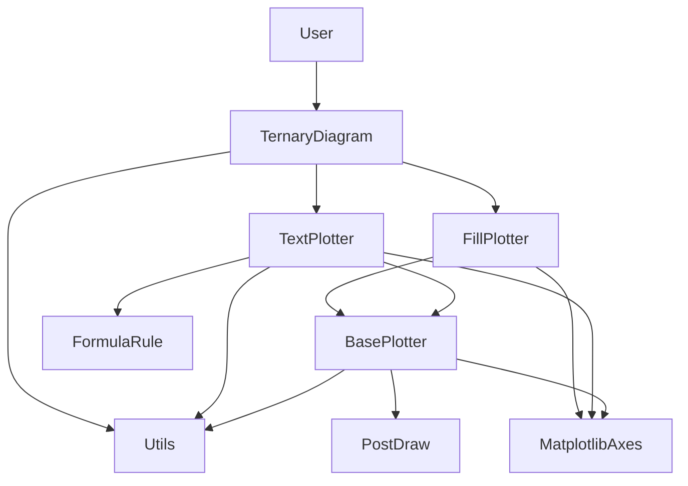
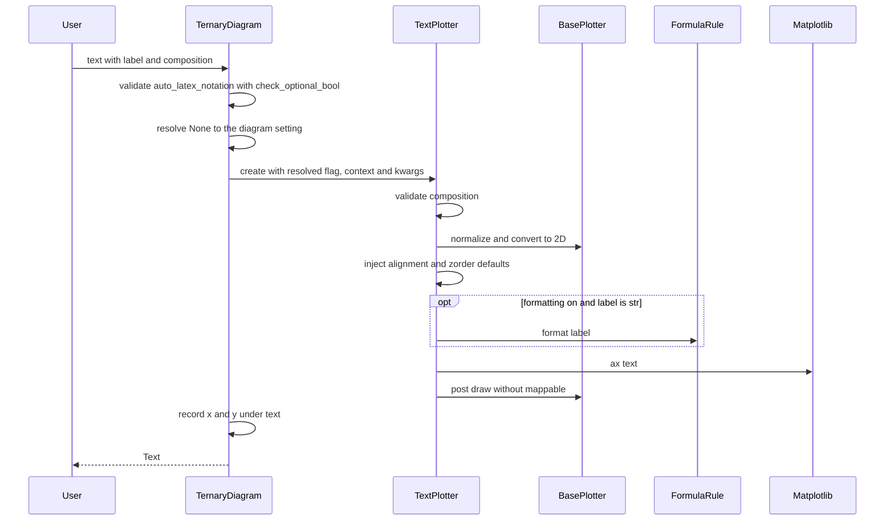

# Design Document: region-plots

## Overview

**Purpose**: 三元系の相図を描く材料・化学系の研究者に、組成で指定した多角形を塗る `TernaryDiagram.fill` と、組成点のちょうどその位置に文字を置く `TernaryDiagram.text` を提供する。利用者は座標変換を自分で書かずに、相領域の塗り分けと相の名前の配置ができる。

**Users**: `TernaryDiagram` で組成マップを描く研究者。相領域ごとに `td.fill(vertices, label=...)` を呼び、領域の中心に `td.text("Li2TiO3", composition)` を置く。

**Impact**: `_api.py` に `_FillPlotter` / `_TextPlotter`（既存の Plotter パターン）、`TernaryDiagram.fill` / `text`、zorder 定数 `DEFAULT_ZORDER_FILL` / `DEFAULT_ZORDER_TEXT` を足す。`text` の化学式の整形は、呼び出しごとの `auto_latex_notation=None` で三角図単位の設定（`TernaryDiagram` 作成時の `auto_latex_notation`）を引き継ぐ。描画後の処理は `plot-side-effects` の `_BasePlotter._post_draw` に任せ、真偽値の検証は `plot-side-effects` の `utils.check_optional_bool` を使い、化学式の整形は `annotate` と同じ入口（`annotate-plain-text` が持つ）を使う。docstring の使用例は `plot-side-effects` の共通 doctest ランナーで実行される。既存のメソッド・Plotter・定数は変えない。

### Goals
- 組成で指定した頂点を渡された順に結ぶ多角形を、比率のまま塗れる（1.1–1.5）
- 組成点に文字列の中心を合わせて置け、化学式の整形を三角図単位の設定から引き継ぎつつ呼び出しごとに切り替えられる（2.1–2.4、3.1–3.6）
- 塗りつぶしがグリッド・外枠・線・点・文字を隠さず、相の名前が塗りつぶしや点に隠れない（4.1–4.6）
- 既存の描画メソッドと同じ kwargs の扱い・座標の記録・入力の検証・描画後の処理（5.1–5.4、6.1–6.4、7.1–7.3）
- docstring の使用例が共通の doctest ランナーで通り、CHANGELOG の New features に載る（8.1–8.3）

### Non-Goals
- 相境界・凸包の計算、頂点の並べ替え、領域ラベルの自動配置
- 1 回の呼び出しで複数の多角形・複数の文字列を描く API
- ハッチングなどの見た目のプリセット
- 化学式とみなす判定の規則の定義・変更
- 使い方ページ・README・example ノートブック（`user-guide-docs`）

## Boundary Commitments

### This Spec Owns
- 公開メソッド `TernaryDiagram.fill` / `TernaryDiagram.text` のシグネチャ、既定値、戻り値、docstring（使用例を含む）
- `_FillPlotter` / `_TextPlotter`（`name` はそれぞれ `"fill"` / `"text"`）と、それぞれの入力規則（`fill` の頂点数、`text` の 1 点の組成）
- `text` の `auto_latex_notation` の解決規則（呼び出しごとの `True` / `False` が優先、`None` なら三角図単位の設定を引き継ぐ）と、その検証の呼び出し（`TernaryDiagram.text` で `check_optional_bool` を呼ぶ）
- 三角図単位の `auto_latex_notation` を `text` から読むこと。保持先は roadmap「横断の取り決め」で決まった private な bool 属性 `TernaryDiagram.__auto_latex_notation` で、`annotate-plain-text` と共有する。最初に必要になった側が `__init__` 本体に 1 行（`self.__auto_latex_notation = bool(auto_latex_notation)`）を足し、もう一方はそれを使う。roadmap の実装順では `annotate-plain-text` が先にマージされるので、そこで足されていれば本 spec はそれを使い、足されていなければ本 spec が足す。どちらの場合も別名の属性は作らない
- zorder 定数 `DEFAULT_ZORDER_FILL`（0.5）と `DEFAULT_ZORDER_TEXT`（4）、およびそれが定める既存の描画との重なり順
- `text` の配置の既定値（中央・中央）と、別名・`fontdict` を考慮した既定値の注入規則
- `tests/test_fill.py`、`tests/test_text.py`、CHANGELOG の New features の該当項目

### Out of Boundary
- 描画後の処理: `_BasePlotter._post_draw`、`PostDrawContext`、レイアウト・カラーバーの決定表、`_deprecation.py`（`plot-side-effects`）。本 spec の Plotter は規約どおり呼ぶだけで、`fig.tight_layout()` やカラーバーの追加を直接行わない
- 真偽値の検証関数 `utils.check_optional_bool` / `utils.check_bool`、共通の doctest ランナー `tests/test_doctests.py`、CHANGELOG の Unreleased の見出しの組（Breaking changes / New features / Deprecations / Bug fixes / Other changes）（いずれも `plot-side-effects`）。本 spec は使うだけで、変更しない
- `TernaryDiagram.__init__` のシグネチャ・検証の順序（`plot-side-effects` が確定）、土台の構築（`diagram-customization`）。`auto_latex_notation` の意味と受け付ける値（既存。真偽で解釈する）も変えない
- 三角図の土台: `_skeleton.py`、外枠・グリッド・目盛り・ラベルとその zorder、`utils.py` に追加される配置の関数（`diagram-customization`）
- 化学式とみなす判定の規則と、その入口（`annotate-plain-text` 適用前は `utils.get_label`）および `annotate` の整形の切り替え（`annotate-plain-text`）
- 既存の `DEFAULT_ZORDER_*` 定数の値・名前・並び、既存の Plotter と描画メソッド
- `heatmaps` の Plotter とその zorder 定数 `DEFAULT_ZORDER_HEATMAP`
- 使い方ページ・README・example ノートブック（`user-guide-docs`）、steering の更新

### Allowed Dependencies
- `_api.py` 内: `_BasePlotter`（`__init__` の検証・正規化・座標変換、`_set_default_params`、`plot-side-effects` が追加する `post_draw_context` 引数と `_post_draw`）、`TernaryDiagram._append_x_y`、`TernaryDiagram` が保持する `PostDrawContext`
- `utils.py` の公開関数: `check_1d_vector`、`check_2d_vector`（基底経由）、`check_optional_bool`（`plot-side-effects` が追加。`None` / 真偽値を受け付ける）、整形の入口（`annotate-plain-text` が持つ。適用前は `get_label`）
- matplotlib の公開 API のみ: `Axes.fill`、`Axes.text`、`matplotlib.patches.Polygon`・`matplotlib.text.Text`（型注釈）
- 使わないもの: `_deprecation.py`（既定値の変更がないため）、`_post_draw.py` の内部の列挙値や関数、`_skeleton.py`、`utils.py` の配置の関数、`utils.check_bool`（本 spec には `None` を受け付けない真偽値の引数がないため）
- ランタイム依存は追加しない（numpy と matplotlib のみ）
- パッケージ内の依存方向は `plot-side-effects` の定めたとおり（`_deprecation` / `utils` → `_post_draw` → `_api`）。本 spec は `_api.py` だけを変更し、新しい import の向きを作らない

### Revalidation Triggers
- `DEFAULT_ZORDER_FILL` / `DEFAULT_ZORDER_TEXT` の値の変更 → `heatmaps`（重なり順の相対関係）、`user-guide-docs`（相図のページ）
- `heatmaps` の `DEFAULT_ZORDER_HEATMAP`（現在 -1）の値の変更 → `DEFAULT_ZORDER_HEATMAP < DEFAULT_ZORDER_FILL`（ヒートマップが fill より奥）が保たれているかを確かめる
- `fill` / `text` のシグネチャ、既定値、戻り値の型の変更 → `user-guide-docs`
- `name`（`"fill"` / `"text"`）の変更 → `x_` / `y_` のキーと警告文に影響する
- `annotate-plain-text` が整形の入口を移す、または `annotate` の切り替え引数に `auto_latex_notation` 以外の名前を選ぶ → `_TextPlotter` の呼び出し先、`text` の引数名をそろえる
- roadmap「横断の取り決め」の三角図単位の設定の保持先（`TernaryDiagram.__auto_latex_notation`、private な bool 属性）の変更 → `TernaryDiagram.text` の `None` の解決と、`__init__` の 1 行の要否を見直す
- `plot-side-effects` の `_post_draw` のシグネチャ・呼び出し規約、`_BasePlotter.__init__` の `post_draw_context` 引数の変更 → 本 spec の 2 つの Plotter
- `plot-side-effects` の `check_optional_bool` の受け付ける値・文面の変更 → `text` の検証のテスト
- `plot-side-effects` の共通 doctest ランナーの対象の集め方・実行条件の変更 → `fill` / `text` の例が対象に入り、通ることを確かめる
- `diagram-customization` が土台の zorder の値を変える → 要件 4 の重なり順を見直す

## Architecture

### Existing Architecture Analysis
- ファサード `TernaryDiagram` → 描画種別ごとの `_XxxPlotter` → 状態を持たない `utils` の 3 層。描画メソッドは Plotter を作り、`_append_x_y` で `x_` / `y_` に記録し、`collection_` を返すだけ
- `plot-side-effects` 適用後の `_BasePlotter.__init__` は `(vector, ax=None, z=None, z_min=None, z_max=None, *, post_draw_context, **kwargs)`。`check_2d_vector`（shape と行ごとの正規化）、`check_ax`、`three2two` を行う
- 重なり順はモジュール定数 `DEFAULT_ZORDER_CONTOUR`（0）< `GRIDS`（1）< `PLOTS`（2）< `SCATTER`（3）で固定する。土台の文字と `annotate` は matplotlib の既定（3）
- `TernaryDiagram.__init__` の `auto_latex_notation` は頂点ラベルの整形に使うだけで、現状は属性として保持していない（`diagram-customization` 適用後も `_VertexLabels` に渡すだけ）。真偽で解釈し、型の検証はしない
- `_api.py` は `plot-side-effects`・`diagram-customization`・`heatmaps` も編集する。roadmap の実装順により、本 spec は `plot-side-effects` → `diagram-customization` → `annotate-plain-text` のマージ後に、`heatmaps` とは 1 つずつ（どちらが先でもよい）マージする。設計はこの 3 つが適用済みの `_api.py` を前提にする

### Architecture Pattern & Boundary Map



- `TernaryDiagram`・`FillPlotter`・`TextPlotter`・`BasePlotter` は `_api.py`。本 spec が新しく持つのは `FillPlotter` と `TextPlotter`、`TernaryDiagram` の 2 メソッドだけ。三角図単位の `auto_latex_notation` を保持する private 属性 `__auto_latex_notation` は `annotate-plain-text` と共有するもので、まだなければ本 spec が `__init__` に 1 行足す（roadmap「横断の取り決め」）
- `PostDraw` は `plot-side-effects` の `_post_draw` と `PostDrawContext`（境界外）。`FormulaRule` は `annotate-plain-text` が持つ整形の入口（境界外）。`Utils` は `check_1d_vector` / `check_2d_vector`（既存）と `check_optional_bool`（`plot-side-effects`。`TernaryDiagram.text` が呼ぶ）

**Architecture Integration**:
- Selected pattern: 既存の Plotter パターン（`_BasePlotter` のサブクラス）。新しいモジュールは作らない。別モジュールにすると `_BasePlotter` との間で循環 import になる
- Domain/feature boundaries: 描画（本 spec）、描画後の処理と真偽値の検証（`plot-side-effects`）、整形の規則（`annotate-plain-text`）、土台（`diagram-customization`）を分け、本 spec は他の 3 つを呼ぶだけにする
- Existing patterns preserved: `_set_default_params` によるユーザー指定の優先、`DEFAULT_ZORDER_*` による呼び出し順に依存しない重なり順、`utils.check_*` による検証、戻り値は matplotlib のネイティブオブジェクト、`name` ごとの座標の記録
- New components rationale: `_FillPlotter` は多角形の頂点数の規則と `Axes.fill` の呼び出し、`_TextPlotter` は 1 点の組成・配置の既定値・整形の適用と `Axes.text` の呼び出しを持つ
- Steering compliance: 公開 API は `TernaryDiagram` に集約、ランタイム依存なし、docstring は英語の NumPy スタイル、例は tech.md「Docstring Examples」に従う、検証は `utils.check_*` を使い `assert` を使わない

### Technology Stack

| Layer | Choice / Version | Role in Feature | Notes |
|-------|------------------|-----------------|-------|
| Runtime | Python >= 3.9 | 型ヒント | `_api.py` の既存の書き方（`typing.List` / `Optional` など）にそろえる |
| Plotting | matplotlib（上限なし） | `Axes.fill`、`Axes.text` | どちらも古い版から引数と戻り値が変わっていないので、バージョン分岐は不要 |
| Numerics | numpy >= 1.20 | 入力の配列化（既存の utils 経由） | 追加の使い方はない |
| Test | pytest、Agg バックエンド | artist の状態の assert | 画像比較はしない（steering） |

## File Structure Plan

### Directory Structure
```
src/ternary_diagram/
└── _api.py            # 変更: import、zorder 定数 2 つ、TernaryDiagram.fill / text、__auto_latex_notation の 1 行（まだなければ）、_FillPlotter / _TextPlotter
tests/
├── test_fill.py       # 新規: fill の描画・既定値・重なり順・kwargs・座標の記録・検証・描画後の処理
└── test_text.py       # 新規: text の配置・整形とその引き継ぎ・重なり順・別名の優先・座標の記録・検証・描画後の処理
CHANGELOG.md           # 変更: Unreleased の New features に fill と text
```

`tests/test_doctests.py`（共通 doctest ランナー）は `plot-side-effects` のもので、本 spec は変更しない。`fill` / `text` は `TernaryDiagram` の公開メソッドなので、ランナーの対象に入る。

### Modified Files
- `src/ternary_diagram/_api.py`
  - import: `import matplotlib.patches` を足す（`fill` の戻り値と `_FillPlotter.collection_` の型注釈。タスク 2）。`PostDrawContext`（`_FillPlotter` / `_TextPlotter` の `__init__` の型注釈）は `plot-side-effects` が `_BasePlotter.__init__` の型注釈のために `ternary_diagram._post_draw` から import しているはずなので、入っていなければタスク 2 で足す。`ternary_diagram.utils` からの import に `check_optional_bool` が入っていなければタスク 3.2 で足す。整形の入口は `annotate` と同じものを使う（`annotate-plain-text` 適用後の `_api.py` で確かめ、別の名前なら import を足す）。`matplotlib.text`・`List`・`Tuple`・`Optional` は既存の import を使う
  - 定数: `DEFAULT_ZORDER_SCATTER` の直後に `DEFAULT_ZORDER_FILL = 0.5` と `DEFAULT_ZORDER_TEXT = 4` をまとめて置く。既存の定数は並べ替えない（`heatmaps` が先にマージされていれば、その `DEFAULT_ZORDER_HEATMAP` の後ろに置く）
  - `TernaryDiagram.__init__`: roadmap「横断の取り決め」に従い、三角図単位の設定は private な bool 属性 `self.__auto_latex_notation` に保持する。`annotate-plain-text` がすでにこの 1 行を足していれば何も足さずにそれを使う。まだなければ、本体の `self.x_` / `self.y_` の初期化の直前に `self.__auto_latex_notation = bool(auto_latex_notation)` を 1 行だけ足す（頂点ラベルと同じく真偽で解釈する）。別名の属性は作らない。シグネチャ・検証・土台の構築は変えない
  - `TernaryDiagram`: `annotate` の直後、`colorbar` の前に `fill` と `text` を続けて置く
  - Plotter: `_AnnotatePlotter` の直後（`if __name__ == "__main__":` の前）に `_FillPlotter` と `_TextPlotter` を続けて置く。`text` の配置の既定値の組を表すモジュール定数 `_TEXT_ALIGNMENT_DEFAULTS` は `_TextPlotter` の直前に置く
  - いずれも追加だけで、既存の行を書き換えない（`heatmaps` との衝突を「両方を残す」で解けるようにする）
- `CHANGELOG.md` — `plot-side-effects` がそろえた Unreleased の見出しの組のうち「New features」に、`fill` と `text` を 1 項目ずつ書く。見出しは足さない・並べ替えない

## System Flows

### `text` の描画（`fill` も同じ流れで、整形と配置の既定値の手順がない）



- すべての検証は artist を作る前に終わる。`auto_latex_notation` の検証に失敗すると Plotter が作られず、組成の検証に失敗すると Plotter の作成が例外で終わるので、どちらの場合も `_append_x_y` は呼ばれない（6.4）
- `auto_latex_notation` の解決: 呼び出しごとの値が `True` / `False` ならそれを、`None` なら三角図単位の設定（`self.__auto_latex_notation`）を使う（3.1、3.6）。解決した値は `_TextPlotter` に渡すだけで、三角図単位の設定は書き換えない
- `_post_draw()` は `__init__` の最後でちょうど 1 回、引数なしで呼ぶ。値で色付けした描画ではないので、カラーバーは追加されず（7.2）、レイアウトと警告は三角図単位の設定に従う（7.1、7.3）

## Requirements Traceability

| Requirement | Summary | Components | Interfaces | Flows |
|-------------|---------|------------|------------|-------|
| 1.1 | 頂点を渡された順に結んで閉じた多角形を塗る | `_FillPlotter` | `TernaryDiagram.fill`、`Axes.fill` | text の描画（同じ流れ） |
| 1.2 | 行ごとに正規化して比率のまま受け付ける | `_BasePlotter`（既存） | `check_2d_vector(scale=True)` | 同上 |
| 1.3 | matplotlib のネイティブオブジェクトを返す | `TernaryDiagram.fill` | 戻り値 `List[Polygon]` | — |
| 1.4 | ラベルを凡例に表示 | `_FillPlotter` | `label` を `Axes.fill` へ渡す | — |
| 1.5 | 色の指定がなければ matplotlib の既定の色の順番 | `_FillPlotter` | 色の既定値を入れない | — |
| 2.1 | 組成点に文字列を 1 つ置く | `_TextPlotter` | `TernaryDiagram.text`、`Axes.text` | text の描画 |
| 2.2 | 組成を正規化して比率のまま受け付ける | `_TextPlotter`、`_BasePlotter` | `check_1d_vector(scale=False)` → 基底の正規化 | text の描画 |
| 2.3 | 既定で文字列の中心を組成点に重ねる | `_TextPlotter` | `_TEXT_ALIGNMENT_DEFAULTS` | text の描画 |
| 2.4 | matplotlib のネイティブオブジェクトを返す | `TernaryDiagram.text` | 戻り値 `Text` | — |
| 3.1 | 呼び出しごとの指定を三角図単位の設定より優先し、その呼び出しだけに適用 | `TernaryDiagram.text` | `auto_latex_notation: Optional[bool] = None` の解決（`True` / `False` はそのまま使い、`self.__auto_latex_notation` は書き換えない） | text の描画 |
| 3.2 | 整形は `annotate` と同じ規則・同じ表示 | `_TextPlotter` | `annotate` と同じ入口（`annotate-plain-text` が持つ） | text の描画 |
| 3.3 | 整形しない設定ではそのまま表示 | `_TextPlotter` | 解決後の `auto_latex_notation` が偽 | — |
| 3.4 | 文字列以外は整形せず matplotlib の変換で表示 | `_TextPlotter` | `isinstance(text, str)` の分岐 | text の描画 |
| 3.5 | `None`・真偽値以外は `TypeError` | `TernaryDiagram.text` | `utils.check_optional_bool(auto_latex_notation, "auto_latex_notation")`（`plot-side-effects`） | text の描画 |
| 3.6 | 指定がなければ三角図単位の設定を引き継ぐ（既定は整形する） | `TernaryDiagram.__init__`（保持の 1 行。`annotate-plain-text` が足していなければ本 spec が足す）、`TernaryDiagram.text` | `self.__auto_latex_notation`（`TernaryDiagram(auto_latex_notation=True)` が既定） | text の描画 |
| 4.1 | fill はグリッド・外枠・線・点・注釈・text より奥 | 定数 | `DEFAULT_ZORDER_FILL = 0.5` | — |
| 4.2 | fill は等高線図より手前 | 定数 | `DEFAULT_ZORDER_FILL > DEFAULT_ZORDER_CONTOUR` | — |
| 4.3 | text は fill・グリッド・外枠・線・点より手前 | 定数 | `DEFAULT_ZORDER_TEXT = 4` | — |
| 4.4 | 呼び出し順・土台の描き直しに依存しない | 定数、`_FillPlotter`、`_TextPlotter` | zorder の値だけで順序を決める | — |
| 4.5 | 利用者の zorder を優先 | `_FillPlotter`、`_TextPlotter` | `_set_default_params(zorder=...)` | — |
| 4.6 | 既存の重なり順を変えない | 定数 | 既存の `DEFAULT_ZORDER_*` に触れない | — |
| 5.1 | kwargs を matplotlib に渡し、利用者の指定を優先 | 2 Plotter | `**self.kwargs` を `Axes.fill` / `Axes.text` へ | — |
| 5.2 | 別名での指定も既定値より優先 | `_TextPlotter` | `_TEXT_ALIGNMENT_DEFAULTS` の判定（kwargs と `fontdict`） | text の描画 |
| 5.3 | `x_` / `y_` にメソッド名ごとに記録 | `TernaryDiagram` | `_append_x_y`、`name` = `"fill"` / `"text"` | text の描画 |
| 5.4 | 既存メソッドを変えない | `_api.py` の変更方針 | 追加のみ | — |
| 6.1 | 形が違えば `ValueError` | `_BasePlotter`（既存） | `check_2d_vector` | — |
| 6.2 | 頂点が 3 個未満なら `ValueError` | `_FillPlotter` | 頂点数の検査 | — |
| 6.3 | 組成が 3 成分でなければ `ValueError` | `_TextPlotter` | `check_1d_vector` | — |
| 6.4 | 検証失敗時は何も描かず記録も変えない | 2 Plotter、`TernaryDiagram` | 検証を描画の前に置く | text の描画 |
| 7.1 | レイアウト自動調整は三角図単位の設定に従う | 2 Plotter | `_post_draw()`（`plot-side-effects`） | text の描画 |
| 7.2 | カラーバーを追加しない | 2 Plotter | `_post_draw()` に `mappable` を渡さない | text の描画 |
| 7.3 | 既定値変更の警告を同じ条件・頻度で適用 | 2 Plotter | `_post_draw()` と `PostDrawContext` の共有 | text の描画 |
| 8.1 | docstring | `TernaryDiagram.fill` / `text` | NumPy スタイルの docstring | — |
| 8.2 | CHANGELOG | `CHANGELOG.md` | Unreleased の New features（`plot-side-effects` がそろえた見出し） | — |
| 8.3 | 使用例が共通 doctest ランナーで通る | `TernaryDiagram.fill` / `text` の Examples | tech.md「Docstring Examples」の形式、`tests/test_doctests.py`（`plot-side-effects`） | — |

## Components and Interfaces

| Component | Domain/Layer | Intent | Req Coverage | Key Dependencies (P0/P1) | Contracts |
|-----------|--------------|--------|--------------|--------------------------|-----------|
| zorder 定数（`_api.py`） | 描画の共通設定 | fill と text の既定の重なり順を固定する | 4.1–4.4, 4.6 | 既存の `DEFAULT_ZORDER_*`（P0） | — |
| `TernaryDiagram.fill` / `text`（`_api.py`） | 公開ファサード | 引数を受け、`auto_latex_notation` を検証・解決し、Plotter を作り、座標を記録し、matplotlib のオブジェクトを返す | 1.3, 2.4, 3.1, 3.5, 3.6, 5.3, 5.4, 6.4, 8.1, 8.3 | Plotter（P0）、`PostDrawContext`（P0）、`check_optional_bool`（P0） | Service |
| `TernaryDiagram.__auto_latex_notation`（`_api.py`） | 公開ファサードの状態 | 三角図単位の整形の設定を `text` から参照できるように保持する（roadmap「横断の取り決め」で `annotate-plain-text` と共有。最初に必要になった側が足す） | 3.6 | `TernaryDiagram.__init__`（P0） | State |
| `_FillPlotter`（`_api.py`） | 描画 | 頂点数を検査し、多角形を塗り、描画後処理を呼ぶ | 1.1, 1.2, 1.4, 1.5, 4.5, 5.1, 6.1, 6.2, 6.4, 7.1–7.3 | `_BasePlotter`（P0）、`Axes.fill`（P0） | Service |
| `_TextPlotter`（`_api.py`） | 描画 | 1 点の組成を検証し、配置の既定値と整形を適用して文字を置き、描画後処理を呼ぶ | 2.1–2.3, 3.2–3.4, 4.5, 5.1, 5.2, 6.3, 6.4, 7.1–7.3 | `_BasePlotter`（P0）、`Axes.text`（P0）、整形の入口（P1） | Service |
| `CHANGELOG.md` | 変更履歴 | 追加したメソッドを利用者に知らせる | 8.2 | — | — |

### 描画の共通設定

#### zorder 定数

```python
DEFAULT_ZORDER_CONTOUR = 0   # 既存（変更しない）
DEFAULT_ZORDER_GRIDS = 1     # 既存（変更しない）
DEFAULT_ZORDER_PLOTS = 2     # 既存（変更しない）
DEFAULT_ZORDER_SCATTER = 3   # 既存（変更しない）
DEFAULT_ZORDER_FILL = 0.5    # 新規: 等高線図より手前、グリッド・外枠より奥
DEFAULT_ZORDER_TEXT = 4      # 新規: 散布図、annotate・土台の文字（matplotlib の既定 3）より手前
```
- 不変条件: `DEFAULT_ZORDER_CONTOUR < DEFAULT_ZORDER_FILL < DEFAULT_ZORDER_GRIDS < DEFAULT_ZORDER_PLOTS < DEFAULT_ZORDER_SCATTER < DEFAULT_ZORDER_TEXT`。matplotlib の文字の既定 zorder（3）より `DEFAULT_ZORDER_TEXT` が大きい
- 土台の線（外枠・グリッド）は `diagram-customization` により描き直し後も `DEFAULT_ZORDER_GRIDS` を保つので、4.4 の「土台の描き直しに関係なく」は zorder の値の比較だけで成り立つ
- `heatmaps` の定数 `DEFAULT_ZORDER_HEATMAP`（-1）は `heatmaps` が別名で追加する。本 spec の重なり順の要件はその値に依存しないが、ヒートマップが fill より奥にあること（`DEFAULT_ZORDER_HEATMAP < DEFAULT_ZORDER_FILL`、つまり -1 < 0.5）は両 spec の取り決めとして保つ。`heatmaps` が先にマージされていれば本 spec の定数のテストで確かめ、本 spec が先なら `heatmaps` 側が確かめる

### 公開ファサード

#### `TernaryDiagram.fill` / `TernaryDiagram.text`

| Field | Detail |
|-------|--------|
| Intent | 組成で指定した多角形と文字を描く公開メソッド |
| Requirements | 1.3, 2.4, 3.1, 3.5, 3.6, 5.3, 5.4, 6.4, 8.1, 8.3 |

**Responsibilities & Constraints**
- Plotter を作り、成功したときだけ `_append_x_y(plotter)` で記録し、`plotter.collection_` を返す（既存の描画メソッドと同じ）
- Plotter には `post_draw_context=self.__post_draw_context`（`plot-side-effects` が `__init__` で作るもの）を渡す
- `text` だけは、Plotter を作る前に `auto_latex_notation` を検証して解決する。`plot-side-effects` の `scatter` / `contour` が `colorbar` をファサードで `check_optional_bool` に通すのと同じ置き場所
  1. `flag = check_optional_bool(auto_latex_notation, "auto_latex_notation")`（`None` / `bool` / `numpy.bool_` 以外は `TypeError`。3.5）
  2. `flag is None` なら `flag = self.__auto_latex_notation`（三角図単位の設定。3.6）。`True` / `False` ならそのまま使う（3.1）
  3. `_TextPlotter(text, vector, ax=self.ax, auto_latex_notation=flag, post_draw_context=..., **kwargs)`
  - 解決した値はこの呼び出しの Plotter に渡すだけで、`self.__auto_latex_notation` を書き換えない（3.1 の「その呼び出しだけに適用」）
- 三角図単位の設定の保持: roadmap「横断の取り決め」の private な bool 属性 `self.__auto_latex_notation` を読む。`annotate-plain-text` が先に `__init__` 本体へ `self.__auto_latex_notation = bool(auto_latex_notation)` を足していればそれを使い、まだなければ本 spec が同じ 1 行を足す。別名の属性は作らない。`__init__` は `auto_latex_notation` を検証しない（既存のまま真偽で解釈する）ので、`check_bool` は使わない

**Dependencies**
- Outbound: `_FillPlotter` / `_TextPlotter` — 描画（P0）
- Outbound: `PostDrawContext`（`plot-side-effects`）— Plotter へ渡すだけ（P0）
- Outbound: `utils.check_optional_bool`（`plot-side-effects`）— `text` の `auto_latex_notation` の検証（P0）

**Contracts**: Service [x] / State [x]

##### Service Interface
```python
class TernaryDiagram:
    def fill(
        self, vector: ArrayLike, **kwargs: Any
    ) -> List[matplotlib.patches.Polygon]: ...

    def text(
        self,
        text: str,
        vector: ArrayLike,
        *,
        auto_latex_notation: Optional[bool] = None,
        **kwargs: Any,
    ) -> matplotlib.text.Text: ...
```
- `fill`
  - 入力: `vector` は shape `(n, 3)`、`n >= 3` の ArrayLike。各行は 3 成分の比率（合計は 1 でなくてよい）。頂点は上 → 左下 → 右下の成分順（既存の規約）
  - 出力: `Axes.fill` の戻り値そのもの（長さ 1 の `list[Polygon]`）
  - 例外: shape 違い・頂点不足は `ValueError`（「Error Handling」の表）
- `text`
  - 入力: `text` は表示する文字列（文字列以外は整形せずに matplotlib に渡す）。`vector` は shape `(3,)` または `(1, 3)` の 1 点の組成。`auto_latex_notation` は `None`（既定。三角図単位の設定を引き継ぐ）・`True`・`False`（キーワード専用）
  - 出力: `Axes.text` の戻り値（`Text`）
  - 例外: `auto_latex_notation` の型違いは `TypeError`（組成の検証より先）、成分数の違いは `ValueError`
- docstring（英語、NumPy スタイル。8.1）
  - 1 行目と「This is a wrapper of `matplotlib.pyplot.fill`（`text`）.」、ラップしている関数の URL（`https://matplotlib.org/stable/api/_as_gen/matplotlib.pyplot.fill.html` / `...pyplot.text.html`）。長い行には `# noqa: E501`
  - Parameters: tech.md「Docstring Examples」に従い、`**kwargs` を含む各項目に意味を書く文を必ず置き、既定値は文の後に `, by default X` と添える（`, by default None` だけの項目は書かない）。`vector` は既存メソッドと同じ説明（比率、合計は 1 でなくてよい、頂点の順序）。`fill` では「頂点は渡された順に結び、自動で閉じる。凸包は計算しない」「3 個以上」
  - `text` の `auto_latex_notation : bool or None, optional`（範囲を明記する）: `annotate` と同じ規則で化学式を LaTeX の表記に整形するかどうか。`None`（既定）なら `TernaryDiagram` 作成時の `auto_latex_notation`（頂点ラベルの整形にも使う三角図単位の設定。既定は `True`）を引き継ぐ。`True` / `False` はこの呼び出しの文字列にだけ効き、三角図単位の設定・頂点ラベル・他の `text` / `annotate` の呼び出しには影響しない。数式の `$...$` を含む文字列などは `False` でそのまま表示できる。文字列以外の `text` は設定にかかわらず整形しない
  - Notes: 既定値とその変え方。`fill` は zorder 0.5（等高線図より手前、グリッド・外枠より奥）、色を指定しなければ matplotlib の塗りつぶしの色の順番、不透明なので等高線図に重ねるときは `alpha` を使うこと、`zorder` で順序を変えられること。`text` は中央・中央（`ha` / `va` で変えられる）、zorder 4、文字の大きさは rcParams の既定
  - Returns: 型と内容。`fill` は「1 要素のリスト」と明記する
- Examples（8.1、8.3）: tech.md「Docstring Examples」に従う。doctest 形式（`>>>`）で、下の 3 つの例のブロックはどれも `>>> import matplotlib.pyplot as plt` と `>>> from ternary_diagram import TernaryDiagram` の 2 行で始める。共通 doctest ランナー（`tests/test_doctests.py`）の名前空間は docstring が定義されたモジュール（`_api.py`）の globals で、`_api.py` は `pyplot` を import しないため、この 2 行がないと `plt` が未定義になる。import の後、`fig, ax = plt.subplots(layout="constrained")` で図を作り、`TernaryDiagram(..., ax=ax)` を渡す（レイアウトエンジンのある図なので、`tight_layout` を指定しなくても v3.x のレイアウトの FutureWarning が出ない）。`savefig` は書かない。戻り値は変数に受けて、doctest の出力に artist の repr が出ないようにする。出力を示すのは表示する文字列（`get_text()`）だけにし、`annotate-plain-text` の判定規則で結果が変わりうる普通の名前（`"Phase 1"` など）は、整形する設定での出力を示さない
  - `fill`: 三相域を半透明で塗って凡例を出す例

    ```python
    >>> import matplotlib.pyplot as plt
    >>> from ternary_diagram import TernaryDiagram
    >>> fig, ax = plt.subplots(layout="constrained")
    >>> td = TernaryDiagram(["Li2O", "La2O3", "TiO2"], ax=ax)
    >>> (polygon,) = td.fill(
    ...     [[0.5, 0.25, 0.25], [0.25, 0.5, 0.25], [0.25, 0.25, 0.5]],
    ...     alpha=0.5,
    ...     label="three-phase region",
    ... )
    >>> legend = td.ax.legend()
    ```
  - `text`: Examples を 2 つの段落（例のブロック）に分け、各段落の前に 1 文の説明を置く。どちらのブロックも import の 2 行から始め、そのブロックだけを貼り付けても動くようにする（ランナー上は同じ docstring の続きとして実行されるので、import の重複は害がない）
    - 1 つ目: 既定の三角図で、領域の中心に相の名前を置く例（三角図単位の設定を引き継いで整形）と、`auto_latex_notation=False` でこの呼び出しだけ整形しない例

    ```python
    >>> import matplotlib.pyplot as plt
    >>> from ternary_diagram import TernaryDiagram
    >>> fig, ax = plt.subplots(layout="constrained")
    >>> td = TernaryDiagram(["Li2O", "La2O3", "TiO2"], ax=ax)
    >>> label = td.text("Li2TiO3", [0.5, 0, 0.5])
    >>> label.get_text()
    'Li$_{2}$TiO$_{3}$'
    >>> plain = td.text(
    ...     "Phase 1", [0.2, 0.4, 0.4], auto_latex_notation=False
    ... )
    >>> plain.get_text()
    'Phase 1'
    ```
    - 2 つ目: 三角図単位で整形しない設定にして、指定なしでは整形されず、`auto_latex_notation=True` でこの呼び出しだけ整形する例

    ```python
    >>> import matplotlib.pyplot as plt
    >>> from ternary_diagram import TernaryDiagram
    >>> fig, ax = plt.subplots(layout="constrained")
    >>> td = TernaryDiagram(
    ...     ["Li2O", "La2O3", "TiO2"], ax=ax, auto_latex_notation=False
    ... )
    >>> label = td.text("Li2TiO3", [0.5, 0, 0.5])
    >>> label.get_text()
    'Li2TiO3'
    >>> formula = td.text(
    ...     "Li2TiO3", [0.5, 0, 0.5], auto_latex_notation=True
    ... )
    >>> formula.get_text()
    'Li$_{2}$TiO$_{3}$'
    ```
  - 79 文字を超える行は doctest の継続行（`...`）で折り返す。例の実行は共通 doctest ランナー（`tests/test_doctests.py`、`plot-side-effects`）に任せ、本 spec では別のランナーやテストを作らない

**Implementation Notes**
- Integration: roadmap の実装順により、`plot-side-effects`（`self.__post_draw_context`、`check_optional_bool`、共通 doctest ランナー）、`diagram-customization`（`__init__` の土台の構築）、`annotate-plain-text`（整形の入口）がマージされた後に実装する。メソッドは同じクラス内なので name mangling された属性をそのまま参照できる
- Validation: 戻り値の型、`x_["fill"]` / `x_["text"]` への記録、検証失敗時に `x_` にキーが増えないこと、`auto_latex_notation` の解決（引き継ぎ・上書き・三角図単位の設定が書き換わらないこと）をテストする。使用例は共通 doctest ランナーで確かめる
- Risks: `heatmaps` も同じ位置付近にメソッドを足す。追加をまとまったブロックにする

### 描画

#### `_FillPlotter`

| Field | Detail |
|-------|--------|
| Intent | 組成で指定した頂点を結ぶ多角形を塗る |
| Requirements | 1.1, 1.2, 1.4, 1.5, 4.5, 5.1, 6.1, 6.2, 6.4, 7.1, 7.2, 7.3 |

**Responsibilities & Constraints**
- 処理の順序: 基底の `__init__`（shape の検証・正規化・座標変換）→ 頂点数の検査 → `_set_default_params(zorder=DEFAULT_ZORDER_FILL)` → `self.collection_ = self.ax.fill(self.x_, self.y_, **self.kwargs)` → `self._post_draw()`
- ライブラリの既定値として入れるのは `zorder` だけ。色・線・透明度は入れず、matplotlib の既定（塗りつぶしの色の順番）に任せる（1.5）。`zorder` には別名がないので、別名を考慮した注入（5.2）は不要
- 頂点の並べ替え・凸包の計算・閉じるための頂点の追加をしない（`Axes.fill` が閉じた多角形を作る）

**Dependencies**
- Inbound: `TernaryDiagram.fill`（P0）
- Outbound: `_BasePlotter.__init__` / `_set_default_params` / `_post_draw`（P0）
- External: `Axes.fill`（P0）

**Contracts**: Service [x]

##### Service Interface
```python
class _FillPlotter(_BasePlotter):
    def __init__(
        self,
        vector: ArrayLike,
        ax: Optional[matplotlib.axes.Axes] = None,
        *,
        post_draw_context: PostDrawContext,
        **kwargs: Any,
    ) -> None: ...

    @property
    def name(self) -> str:  # "fill"
        ...

    collection_: List[matplotlib.patches.Polygon]
```
- 事前条件: なし（入力の検証はこのクラスと基底で行う）
- 事後条件: `self.ax` に `Polygon` が 1 つ増える。`self.x_` / `self.y_` は頂点の 2 次元座標（長さ `n`）。`_post_draw()` が 1 回呼ばれている
- 頂点数の検査: `len(self.x_) < 3` なら `` ValueError(f"`vector` must have at least 3 vertices to draw a polygon, but got {n}.") ``。基底の shape 検証の後、`Axes.fill` の前に行う

**Implementation Notes**
- Integration: 基底へは `z` などを渡さず `super().__init__(vector, ax=ax, post_draw_context=post_draw_context, **kwargs)` とする
- Validation: 頂点の座標（`get_xy()[:-1]`）、閉じていること、比率のままの入力、頂点の順序、凡例、色の順番、zorder、kwargs、`x_` / `y_`、検証の 2 通りと失敗時に `ax.patches` が増えないこと、カラーバーが増えないこと、レイアウト設定ごとの挙動
- Risks: 合計 0 の行や負の成分は既存の描画と同じく検査しない（範囲外）

#### `_TextPlotter`

| Field | Detail |
|-------|--------|
| Intent | 組成点に文字列の中心を合わせて置き、必要なら化学式を整形する |
| Requirements | 2.1, 2.2, 2.3, 3.2, 3.3, 3.4, 4.5, 5.1, 5.2, 6.3, 6.4, 7.1, 7.2, 7.3 |

**Responsibilities & Constraints**
- 処理の順序: `check_1d_vector(vector, scale=False)` → 基底の `__init__`（正規化・座標変換）→ 配置と zorder の既定値の注入 → 表示する文字列の決定 → `self.collection_ = self.ax.text(self.x_[0], self.y_[0], label, **self.kwargs)` → `self._post_draw()`
- `auto_latex_notation` は `TernaryDiagram.text` が `check_optional_bool` で検証し、三角図単位の設定で `None` を解決した後の `bool` を受け取る。`_TextPlotter` では型の検証も `None` の解決もしない（独自の型検査を持たない）
- 配置の既定値（2.3、5.2）: 次の組ごとに、正式名と別名のどちらも `self.kwargs` のキーにも `self.kwargs.get("fontdict")` のキーにもないときだけ、正式名で既定値を入れる
  ```python
  _TEXT_ALIGNMENT_DEFAULTS: Tuple[Tuple[str, str, str], ...] = (
      ("horizontalalignment", "ha", "center"),
      ("verticalalignment", "va", "center"),
  )
  ```
  zorder は `_set_default_params(zorder=DEFAULT_ZORDER_TEXT)`（別名がないため）。`fontsize` は入れない
- 表示する文字列の決定（3.2–3.4）: `auto_latex_notation` が真かつ `text` が `str` のインスタンスなら、`annotate` と同じ整形の入口（`annotate-plain-text` が持つもの。適用前は `utils.get_label`）を通した結果。それ以外は `text` をそのまま渡す（文字列以外は matplotlib が文字列に変換する）。例外を握りつぶすための `try/except` は使わない
- 整形の規則そのもの（何を化学式とみなすか）を持たない

**Dependencies**
- Inbound: `TernaryDiagram.text`（P0）
- Outbound: `_BasePlotter.__init__` / `_set_default_params` / `_post_draw`（P0）、`check_1d_vector`（P0）
- Outbound: 整形の入口（`annotate-plain-text` が持つ。適用前は `utils.get_label`）（P1）
- External: `Axes.text`（P0）

**Contracts**: Service [x]

##### Service Interface
```python
class _TextPlotter(_BasePlotter):
    def __init__(
        self,
        text: str,
        vector: ArrayLike,
        ax: Optional[matplotlib.axes.Axes] = None,
        *,
        auto_latex_notation: bool,  # resolved by TernaryDiagram.text
        post_draw_context: PostDrawContext,
        **kwargs: Any,
    ) -> None: ...

    @property
    def name(self) -> str:  # "text"
        ...

    collection_: matplotlib.text.Text
```
- 事前条件: `auto_latex_notation` は解決済みの `bool`（`TernaryDiagram.text` が保証する。`_TextPlotter` は private で、他から呼ばない）
- 事後条件: `self.ax` に `Text` が 1 つ増え、その位置は組成点の 2 次元座標と一致する。`self.x_` / `self.y_` は長さ 1。`_post_draw()` が 1 回呼ばれている
- 不変条件: 整形を行う設定で同じ文字列を渡したとき、表示は整形を行う設定の `annotate` と一致する

**Implementation Notes**
- Integration: `annotate-plain-text` は本 spec より先にマージされる（roadmap の実装順）。実装時に `_AnnotatePlotter` が使っている整形の入口を確かめ、同じものを呼ぶ。`annotate` に整形の切り替え引数が足されていて名前が `auto_latex_notation` でない場合は、`text` の引数名をそちらにそろえる（Revalidation Triggers）
- Validation: 位置と正規化、既定の配置、整形の既定（引き継ぎ）・無効・文字列以外、`annotate` との一致（化学式・普通の文字列・数字を含む普通の文字列・数字を含まない文字列）、別名と `fontdict` の優先、zorder、kwargs、`x_` / `y_`、検証失敗時に `ax.texts` が増えないこと、カラーバーが増えないこと、レイアウト設定ごとの挙動と警告の頻度
- Risks: `get_label`（`annotate-plain-text` 適用前）は `$...$` の中の数字も下付きにする。規則の変更は範囲外なので、docstring で `auto_latex_notation=False` を案内する

## Data Models

本機能は永続的なデータを持たない。`TernaryDiagram.x_` / `y_`（`defaultdict(list)`）に、キー `"fill"` と `"text"` で 1 回の描画ごとに 1 要素（`np.ndarray`）を追加する。`fill` の要素は頂点の数、`text` の要素は長さ 1。

`TernaryDiagram.__auto_latex_notation`（`bool`、private）は roadmap「横断の取り決め」で `annotate-plain-text` と共有すると決まった属性で、`__init__` で 1 回だけ設定し、以後は読むだけ（`text` の呼び出しごとの指定で書き換えない）。設定の 1 行は最初に必要になった側が足し、もう一方はそれを使う。公開の属性・setter・別名の属性は設けない。

## Error Handling

### Error Strategy
- 利用者の入力誤りは、artist を作る前に、何が悪いかを示すメッセージ付きで送出する。検証に失敗した呼び出しは `Axes` と `x_` / `y_` を変えない（6.4）
- matplotlib が出す例外・警告（kwargs の誤りなど）は握りつぶさずにそのまま伝える

### Error Categories and Responses
| 状況 | 例外 | メッセージの要点 | 送出元 | 要件 |
|---|---|---|---|---|
| `fill` の `vector` が shape `(n, 3)` でない | `ValueError` | `` `vector`'s shape must be (n, 3), but got ... `` | `check_2d_vector`（既存） | 6.1 |
| `fill` の頂点が 3 個未満 | `ValueError` | `` `vector` must have at least 3 vertices to draw a polygon, but got {n}. `` | `_FillPlotter` | 6.2 |
| `text` の `vector` が 3 成分でない | `ValueError` | `` `vector`'s length must be 3. `` | `check_1d_vector`（既存） | 6.3 |
| `text` の `auto_latex_notation` が `None`・真偽値のどれでもない | `TypeError` | `` `auto_latex_notation` must be None, True or False, but got {value!r}. ``（`check_optional_bool` の文面） | `TernaryDiagram.text` が呼ぶ `utils.check_optional_bool`（`plot-side-effects`） | 3.5 |
| matplotlib が受け付けない kwargs | matplotlib の例外 | matplotlib のまま | `Axes.fill` / `Axes.text` | 5.1 |

### Monitoring
- ライブラリなのでログは出さない。本機能は新しい警告を出さない（レイアウトの FutureWarning は `plot-side-effects` の `_post_draw` が出す）

## Testing Strategy

テストはすべて `tests/conftest.py` の `td` fixture（`plot-side-effects` 適用後は `tight_layout=True` で作られ、FutureWarning を出さない）と Agg バックエンドを使い、artist の状態を assert する。座標の期待値は、上の頂点 `(0.5, √3/2)`、左下 `(0, 0)`、右下 `(1, 0)` を使う。

### Unit Tests — `tests/test_fill.py`
- 3 頂点 `[[1, 0, 0], [0, 1, 0], [0, 0, 1]]` で、戻り値が長さ 1 の `list`、要素が `Polygon`、`get_xy()[:-1]` が 3 頂点の座標と一致し `get_closed()` が真（1.1、1.3）。`[[2, 0, 0], [0, 4, 0], [0, 0, 1]]` でも同じ座標（1.2）
- 4 頂点を自己交差する順で渡しても、`get_xy()[:-1]` が渡した順のまま（1.1。並べ替えない）
- `label="A"` を渡して `ax.get_legend_handles_labels()` が多角形と `"A"` を返す（1.4）
- 色を指定しない 2 回の `fill` の塗り色が `rcParams["axes.prop_cycle"]` の先頭 2 色と一致する（1.5）
- 定数のテスト: `DEFAULT_ZORDER_CONTOUR < DEFAULT_ZORDER_FILL < DEFAULT_ZORDER_GRIDS < DEFAULT_ZORDER_PLOTS < DEFAULT_ZORDER_SCATTER < DEFAULT_ZORDER_TEXT` と、`DEFAULT_ZORDER_TEXT` が 3（matplotlib の文字の既定）より大きいこと（4.1–4.3）。`heatmaps` が先にマージされていて `DEFAULT_ZORDER_HEATMAP` があれば、`DEFAULT_ZORDER_HEATMAP < DEFAULT_ZORDER_FILL` も確かめる（なければこの確認だけ理由付きでスキップし、`heatmaps` 側が確かめる）
- 既定の zorder が `DEFAULT_ZORDER_FILL`（0.5）で、等高線図の zorder より大きく、`ax.lines` の土台の線・`plot`・`scatter`・`annotate`・`text` の zorder より小さい。`scatter` の後に `fill` を呼んでも同じ（4.1、4.2、4.4）。`set_grid`（`diagram-customization`。本 spec より先にマージ済み）で描き直した後の線の zorder より小さいことも確かめる
- `zorder=5` が優先される（4.5）。`facecolor`・`edgecolor`・`alpha`・`hatch` が `Polygon` に反映される（5.1）
- `td.x_["fill"][0]` / `td.y_["fill"][0]` が頂点の座標（5.3）
- shape `(2, 2)` と `(2, 3)` で `ValueError`（`match="shape"`、`match="at least 3"`）。失敗後に `len(ax.patches)` と `"fill" in td.x_` が変わらない（6.1、6.2、6.4）

### Unit Tests — `tests/test_text.py`
- `[1, 0, 0]`・`[2, 0, 0]`・`[[1, 0, 0]]` で、戻り値が `Text`、`get_position()` が `(0.5, √3/2)`（2.1、2.2、2.4）
- 既定の `get_ha()` / `get_va()` が `"center"`（2.3）
- 既定の `td`（三角図単位の設定が既定の `True`）で `"Li2O"` が `"Li$_{2}$O"`（3.6）、`auto_latex_notation=False` で `"Li2O"`（3.1、3.3）。その後に指定なしで呼ぶと再び `"Li$_{2}$O"`（呼び出しごとの指定が三角図単位の設定を書き換えない。3.1）
- `TernaryDiagram(MATERIALS, ax=ax, auto_latex_notation=False, tight_layout=True)` では、指定なし（`None` を明示した場合も）で `"Li2O"` のまま（3.6）、`auto_latex_notation=True` で `"Li$_{2}$O"`（3.1）。`numpy.bool_(False)` も受け付ける
- `"Li2O"`・`"Sample 1"`・`"LiF + Li2O"`・`"L + α"` について、`td.text(s, v).get_text()` が整形を行う設定の `td.annotate(s, v).get_text()` と一致する（3.2。期待値を固定しないので、`annotate-plain-text` の規則に追従する。`annotate` に切り替え引数があれば、整形する側を明示して比べる）
- `1.5` を渡すと `"1.5"`（3.4）。`auto_latex_notation` に `1`・`0`・`"yes"` で `TypeError`（`match="auto_latex_notation"`）。失敗後に `len(ax.texts)` と `"text" in td.x_` が変わらない（3.5、6.4）
- 既定の zorder が `DEFAULT_ZORDER_TEXT`（4）で、`fill`・土台の線・`plot`・`scatter` の zorder より大きい（4.3、4.4）。`zorder=1` が優先される（4.5）
- `ha="left"`、`horizontalalignment="right"`、`va="top"`、`fontdict={"ha": "left"}` がそれぞれ既定値より優先される（5.2）。`fontsize=14`・`color="red"` が反映される（5.1）
- `td.x_["text"][0]` / `td.y_["text"][0]` が組成点の座標（5.3）
- `[1, 2]` と `[1, 2, 3, 4]` で `ValueError`（`match="length must be 3"`）。失敗後に `len(ax.texts)` と `"text" in td.x_` が変わらない（6.3、6.4）

### Integration Tests（各ファイルで `fill` / `text` を対象に、`TernaryDiagram` 経由）
- 描画の前後で `len(fig.axes)` が変わらない（カラーバーなし。7.2）
- `TernaryDiagram(MATERIALS, ax=ax, tight_layout=False)` では `fig.subplotpars` が描画の前後で変わらず、`tight_layout=True` では変わる（7.1）
- 既定（`tight_layout` 未指定）の三角図をレイアウトエンジンのない図に作り、`fill` → `text` と続けて描くと、レイアウトの FutureWarning が全体で 1 回だけ出る。`text` だけを描いた別の三角図でも 1 回出る（7.3）
- 既存の定数 `DEFAULT_ZORDER_CONTOUR`・`GRIDS`・`PLOTS`・`SCATTER` が 0・1・2・3 のまま（4.6）。既存のテストファイルが変更なしで通る（5.4）

### docstring の使用例 — 共通 doctest ランナー（`plot-side-effects` の `tests/test_doctests.py`）
- `fill` / `text` の Examples が、ランナー（一時ディレクトリで実行し、FutureWarning をエラーにする）で通る（8.3）。本 spec ではランナーを作らず、変更もしない。ランナーの対象に `TernaryDiagram.fill` / `text` が入っていることを、実行結果（収集された項目）で確かめる

### ドキュメント（レビューで確認）
- `fill` / `text` の docstring に Parameters（`text` の `auto_latex_notation` の引き継ぎと範囲を含む）・Notes（既定値と変え方）・Returns・Examples・matplotlib の URL がある（8.1）。Examples が tech.md「Docstring Examples」の形式（例のブロックごとに `import matplotlib.pyplot as plt` と `from ternary_diagram import TernaryDiagram` の行から始まり、`plt.subplots(layout="constrained")` と `ax=ax` で図を渡し、`savefig` を書かない）で、Parameters の各項目に意味を書く文がある（8.3）。CHANGELOG の Unreleased の「New features」に 2 項目があり、見出しの組は変わっていない（8.2）

## Open Questions / Risks
- **`annotate-plain-text` の契約の確認**: 整形の入口と `annotate` の切り替え引数の名前は `annotate-plain-text` が決める（本 spec より先にマージされる）。本 spec は「`annotate` と同じ入口・同じ表示」を契約にし、名前が違えば `text` 側をそろえる。実装の着手時（タスク 3.2）に確かめる
- **`annotate-plain-text` が互換のための警告を持つ場合**: roadmap は、`annotate` の表示を v3.x で変えるなら FutureWarning を出すとしている。`annotate` の既定の表示を据え置いて警告で移行を案内する形になった場合、`text` は新しい API で守るべき既存の表示がないので、互換の経路と警告を通らずに規則の最終形を使う（roadmap の「`text` は新しい API」）。このとき 3.2 の比較は、`annotate` の整形を明示した設定（警告を出さない側）と行う。どの形になるかはタスク 3.2 の着手時に確かめ、合わなければ本 spec の要件 3.2 を見直す
- **三角図単位の設定の保持**: 現状の `TernaryDiagram` は `auto_latex_notation` を保持しない。roadmap「横断の取り決め」により、保持先は private な bool 属性 `TernaryDiagram.__auto_latex_notation` に決まっており、最初に必要になった側（`annotate-plain-text` か本 spec）が `__init__` に 1 行足し、もう一方はそれを使う。タスク 3.2 の着手時に、`annotate-plain-text` のマージ後の `__init__` にこの行があるかを確かめ、なければ本 spec が足す。別名の属性は作らない
- **実装順序の依存**: roadmap の実装順（`plot-side-effects` → `diagram-customization` → `annotate-plain-text` → 本 spec と `heatmaps` を 1 つずつ → `user-guide-docs`）に従う。`post_draw_context`・`_post_draw`・`check_optional_bool`・共通 doctest ランナー・CHANGELOG の見出しの組（`plot-side-effects`）、`set_grid`（`diagram-customization`）、整形の入口（`annotate-plain-text`）がそろってから実装する
- **`heatmaps` との順序**: 同じ `_api.py` の定数・メソッド・Plotter の並びに追加が入る。1 つずつマージするので、後からマージする側が先の追加を残したまま自分の追加を足す。zorder の相対関係（`DEFAULT_ZORDER_HEATMAP` -1 < `DEFAULT_ZORDER_FILL` 0.5）は後からマージする側のテストで確かめ、各 spec は自分の定数について docstring に書く
- **fill を等高線図より手前にした判断**: 不透明な fill は等高線図を隠す。docstring で `alpha` と `zorder` を案内する。等高線図を手前にしたい利用者は `fill` に `zorder=-0.5` などを渡す（`heatmaps` の -1 より手前、等高線図の 0 より奥）
