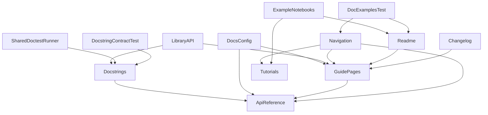
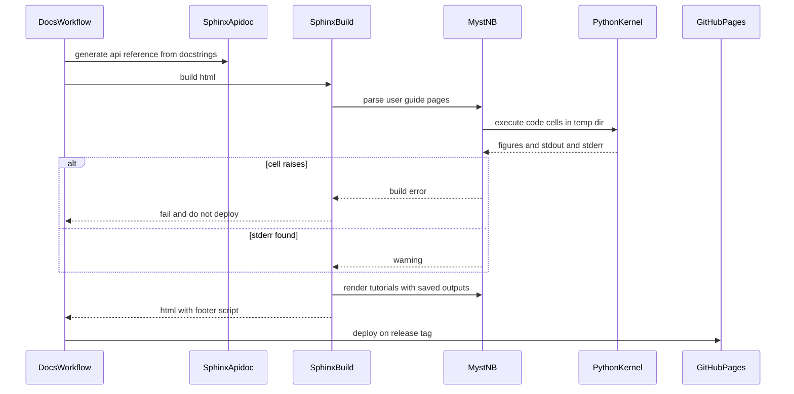

# Design Document: user-guide-docs

## Overview

**Purpose**: ternary-diagram を使う材料・化学系の研究者が、目的（最初の図を描く、見た目を整える、相図を描く、値の分布を示す、レイアウトとカラーバーを制御する、v4.0.0 に備える）から使い方をたどれるようにする。既存の公開 API の docstring の不足を埋めて書き方をそろえ、目的別の使い方ページ 5 つと v4.0.0 への移行ページを作り、トップページ・目次・README・チュートリアルを整える。

**Users**: 初めて使う研究者（はじめての三角図のページと README）、論文用に仕上げる利用者（見た目・相図・ヒートマップのページ）、v3.x から移行する既存の利用者（レイアウトとカラーバーのページ、移行ページ）、API を調べる利用者（API リファレンス）。

**Impact**: 使い方ページをテキスト形式の MyST Markdown ノートブック（`docs_src/user_guide/*.md`）として追加し、ビルド時に MyST-NB で実行して図を埋め込む。`docs_src/conf.py` に実行の設定と `autoclass_content = "both"` を足す。`_api.py` と `utils.py` では本 spec が担当する docstring だけを書き換え、コードは変えない。docstring の例は `plot-side-effects` が作る共通の doctest ランナー（`tests/test_doctests.py`）で実行し、本 spec は別のランナーを作らない。チュートリアルのノートブックを推奨の書き方に直して再実行し、README を短くする。テーマ、テンプレート（広告スクリプト）、公開の仕組みは変えない。

### Goals
- 担当する docstring のすべての項目に、意味・受け付ける値・既定値・使用例がそろい、API リファレンスに作成時の引数が表示される（1.1–1.10）
- 目的別の使い方ページと移行ページが、公開する版のライブラリで実行した図とともに表示される（2.1–8.7、9.3）
- ドキュメント・README・docstring・チュートリアルのコード例が、エラーと FutureWarning なしに動く（9.1、9.2、11.2、12.5）
- CI と同じ手順で警告 0 件のままビルドでき、広告スクリプトが全ページに残る（13.1–13.5）

### Non-Goals
- mpltern / python-ternary との使い分け表、日本語ドキュメント
- テーマ、テンプレート、ホスティング先、`.github/workflows/` の変更（PR でのドキュメントのビルドの追加を含む）
- 上流が担当する docstring の項目の執筆と書き換え（上流が `utils` に足す関数を含む）、共通の doctest ランナーの作成と変更
- ライブラリのコード・挙動・既定値（既定のカラーマップ `rainbow` を含む）の変更、v4.0.0 での既定値の切り替え
- 新しいチュートリアルのノートブックの追加

## Boundary Commitments

### This Spec Owns
- 使い方ページ 5 つと移行ページ（`docs_src/user_guide/`）の内容、ページの規約、URL
- ドキュメントのトップページ（`docs_src/index.md`）、使い方ページの一覧（`docs_src/user_guide/index.md`）、チュートリアルの一覧（`docs_src/tutorials/index.md`）とサイドバーの目次
- `docs_src/conf.py` のうち、ノートブックの実行に関する設定と `autoclass_content`
- `_api.py` と `utils.py` の docstring のうち、下の「docstring の担当表」で本 spec のものとした項目と節（`TernaryDiagram.__init__` の Examples 節は本 spec だけが持つ）、および docstring の規約
- 6 つの example ノートブックのコード・保存済みの出力・出力画像（データファイルは変えない）
- README の全体構成と内容
- `tests/test_docs_examples.py`（README とトップページの最小の例の一致と実行確認。docstring の例は扱わない）
- `tests/test_owned_docstrings.py`（担当表で本 spec のものとした項目と節に限った、例の有無と不備の静的な確認。上流が担当する項目は確認しない。例の実行は共通の doctest ランナーが行う）
- `tests/test_doctests.py` のうち、`TernaryDiagram.__init__` の例に付いた xfail の印を外す変更だけ（書き直した Examples 節がランナーで通った後）
- CHANGELOG の Unreleased のうち、ドキュメントの追加と README の刷新の項目
- `.gitignore` への API リファレンスの生成物（`docs_src/modules.rst`、`docs_src/ternary_diagram*.rst`）の追加

### Out of Boundary
- ライブラリのコード（`src/ternary_diagram/` の docstring 以外）、テスト fixture（`tests/conftest.py`）、既存のテストファイル
- 共通の doctest ランナー `tests/test_doctests.py`（`plot-side-effects` の所有。本 spec は使うだけで、`__init__` の xfail の印を外す以外は変更しない）
- 上流が担当する docstring（担当表の「上流が書く」列）: `tight_layout` の項目、`scatter` / `contour` の Parameters の `colorbar`・`flag_cbar` の項目（`plot-side-effects`）、`*_kw` の項目・`set_*` メソッド（`*_kw` の使用例を含む）・取り出し口のプロパティ・クラスの docstring の Notes 節（`diagram-customization`）、`annotate` / `scatter` / `get_label` に足される整形の切り替え引数の項目と規則の説明（`annotate-plain-text`）、`fill` / `text`（`region-plots`）、`tripcolor` / `heatmapf`（`heatmaps`）、上流が `utils` に足す公開関数（`check_optional_bool`・`check_bool`、`get_tick_values`・`get_edge_points`・`get_grid_segments`・`get_axis_label_position`・`get_tick_formatter`・`TickFormat`、`get_triangular_lattice`）
- 警告文の文面（`plot-side-effects` の `_deprecation.py` / `_post_draw.py`、`annotate-plain-text` が警告を出す場合はその文面）と CHANGELOG の上流の項目
- `docs_src/_templates/layout.html`、テーマとその設定（`html_theme`、`html_theme_options`）、`extensions` の構成、`.github/workflows/docs.yml`、`HOW_TO_RELEASE.md`
- `example/` の CSV ファイル、`jupytext.toml`
- v4.0.0 のリリース時の移行ページの更新（下流のリリース作業）

### Allowed Dependencies
- 上流 4 spec と `annotate-plain-text`（roadmap の Implementation Order で本 spec より先にマージされる直接実装）の公開 API と挙動（下の「上流 API の名前の一覧」）。ページとテストは `ternary_diagram` の公開名（`TernaryDiagram` とそのメソッド・プロパティ、`ternary_diagram.utils` の公開関数）と matplotlib・numpy・標準ライブラリだけを使い、`_api`・`_post_draw`・`_deprecation`・`_skeleton`・`_mesh` などのプライベートモジュールを import しない
- ドキュメントのビルド: `pyproject.toml` の `docs` extras（sphinx、myst-parser、myst-nb、sphinx-book-theme、jupyter-sphinx）と、myst-nb の依存に含まれる `ipykernel`。新しい依存は追加しない
- MyST-NB の公開設定（`nb_execution_*`、`nb_output_stderr`、セルのメタデータ `mystnb.image.alt`、タグ `hide-input`）と Sphinx autodoc の `autoclass_content`
- 共通の doctest ランナー `tests/test_doctests.py`（`plot-side-effects`、steering の tech.md「Docstring Examples」）。担当する docstring の例はこのランナーで実行する
- チュートリアルの再実行: 既存の conda 環境（pandas、Jupyter、`element_recognition` を含むもの）。パッケージはインストールしない。環境がなければ再実行は保留にする（ExampleNotebooks の Notebook Contract）
- 依存の向き: ライブラリの公開 API → docstring → API リファレンス（ビルド時に生成）。使い方ページ → ライブラリの公開 API と API リファレンスのアンカー。トップページ・README・CHANGELOG → 使い方ページの URL。逆向き（ライブラリがドキュメントに依存すること）はない

### Revalidation Triggers
- 上流 API の名前・引数・既定値・戻り値・重なり順の値の変更 → 該当ページと移行ページ（ビルド時の実行で名前の誤りは失敗として現れる）
- 警告文の文面（`format_default_change` / `format_renamed_parameter` の形式、`keep` / `adopt` の内容）または `FUTURE_VERSION` の変更 → 移行ページ（警告文はビルド時に実際の出力を表示するので自動で追従するが、説明文を見直す）
- v4.0.0 での決定表の切り替えと `flag_cbar` の削除 → 移行ページ、レイアウトとカラーバーのページ、チュートリアル
- annotate-plain-text による `annotate` / `scatter(annotations=...)` の整形の規則や切り替え引数、FutureWarning の有無の変更 → `annotate`・`scatter`・`get_label` の docstring、はじめてのページ、相図のページ、移行ページ
- 共通の doctest ランナーの対象や実行条件の変更（`plot-side-effects`） → 担当する docstring の例と `tests/test_owned_docstrings.py`
- docstring の担当表の変更（項目の追加・移動）、または steering の tech.md「Docstring Examples」の規約の変更 → Docstring Contract と `tests/test_owned_docstrings.py` の `OWNED_ENTRIES`
- 使い方ページの URL の変更 → README、CHANGELOG、リリースノート
- チュートリアルを `docs_src/tutorials/` 以外に置く、または使い方ページを `tutorials/` に置く → `nb_execution_excludepatterns`

## Architecture

### Existing Architecture Analysis
- ドキュメントは Sphinx + MyST-NB + sphinx-book-theme。`nb_execution_mode = "off"` で、ノートブックは保存済みの出力を表示する。`docs_src/tutorials/*.ipynb` は `example/` のノートブックへのシンボリックリンク
- API リファレンスは CI（正式版タグの `docs.yml`）で `sphinx-apidoc --module-first` が生成し、`modules.html`（目次）と `ternary_diagram.html`（`TernaryDiagram` と `utils`）になる。プライベートモジュールは含まれない
- `TernaryDiagram` にクラスの docstring がなく、既定の `autoclass_content = "class"` のため、`__init__` の docstring が表示されていない
- 今のビルドは警告 0 件で、`_templates/layout.html` の広告スクリプトが全ページに入る

### Architecture Pattern & Boundary Map



- `LibraryAPI` は上流 4 spec と annotate-plain-text を含む実装済みのライブラリ（境界外）。`SharedDoctestRunner`（`tests/test_doctests.py`）は `plot-side-effects` が所有する境界外のテストで、担当する docstring の例を実行する。`ApiReference` と `Tutorials` はビルド時に生成・表示されるページ
- **Selected pattern**: 「実行されるドキュメント」。使い方ページはビルド時に公開する版のライブラリで実行し、出力をそのまま埋め込む。例の失敗はビルドの失敗、FutureWarning は Sphinx の警告になる
- **Domain boundaries**: ページの内容（本 spec）、API の内容（docstring は項目単位で担当を分ける）、ライブラリの挙動（上流）を分ける。ページは公開 API だけを呼ぶ
- **Existing patterns preserved**: Sphinx + MyST-NB + sphinx-book-theme、チュートリアルの保存済みの出力とシンボリックリンク、ビルド時の API リファレンスの生成、ノートブックの先頭セルの H1、NumPy スタイルの英語の docstring
- **New components rationale**: 使い方ページ（目的からたどる入口）、移行ページ（v4.0.0 の下流が参照する固定の場所）、README とトップページの例の実行テスト（Sphinx で実行されないため。docstring の例は共通の doctest ランナーが実行する）、担当する項目と節に限った静的な確認テスト（例の有無と不備）
- **Steering compliance**: ランタイム依存を増やさない。テストはネットワークに依存しない。docstring は NumPy スタイルの英語。ラップしている matplotlib 関数の URL を書く

### Technology Stack

| Layer | Choice / Version | Role in Feature | Notes |
|-------|------------------|-----------------|-------|
| Docs build | Sphinx（`docs` extras、上限なし。確認は 9.1.0） | ビルドと API リファレンス | 変更なし。`autoclass_content = "both"` を追加 |
| Notebook execution | myst-nb（確認は 1.4.0）+ ipykernel（myst-nb の依存） | 使い方ページの実行と出力の埋め込み | `nb_execution_mode` を `"off"` から `"force"` に変え、チュートリアルを除外 |
| Theme | sphinx-book-theme（確認は 1.2.0） | 表示 | 変更なし |
| Library runtime | Python >= 3.9、numpy、matplotlib | ページとテストの実行 | pandas は使い方ページでは使わない |
| Test | pytest、標準ライブラリ `re`・`warnings` | README とトップページの例の実行確認、担当 docstring の静的な確認 | Agg バックエンド（既存の `conftest.py`）。docstring の例の実行は共通の doctest ランナー（`plot-side-effects`） |

## File Structure Plan

### Directory Structure
```
docs_src/
├── conf.py                       # 変更: ノートブックの実行設定、autoclass_content
├── index.md                      # 変更: トップページ（概要・インストール・最小の例・案内）と 3 区分の toctree
├── user_guide/                   # 新規: 使い方ページ（MyST Markdown ノートブック、ビルド時に実行）
│   ├── index.md                  #   使い方ページの一覧（各ページの 1 行の説明）と toctree
│   ├── getting_started.md        #   はじめての三角図
│   ├── customizing.md            #   見た目の変え方
│   ├── phase_diagrams.md         #   相図の描き方
│   ├── heatmaps_and_contours.md  #   ヒートマップと等高線の使い分け
│   ├── layout_and_colorbars.md   #   レイアウトとカラーバー
│   └── migration_v4.md           #   v4.0.0 への移行
└── tutorials/
    └── index.md                  # 変更: 各チュートリアルの 1 行の説明、使い方ページへの案内
src/ternary_diagram/
├── _api.py                       # 変更: 本 spec が担当する docstring のみ（コードは変えない）
└── utils.py                      # 変更: 既存 5 関数の docstring のみ（コードは変えない）
tests/
├── test_docs_examples.py         # 新規: README とトップページの最小の例の一致と実行確認（docstring は扱わない）
├── test_owned_docstrings.py      # 新規: 担当する項目と節の例の有無と不備の静的な確認（上流の項目は対象外。例の実行は共通ランナー）
└── test_doctests.py              # 変更（plot-side-effects の所有）: __init__ の例の xfail の印を外すだけ
example/
├── contour/example_contour.ipynb                 # 変更: colorbar=、推奨の図の作り方、再実行（.png を再生成）
├── example_on_readme/example_on_readme.ipynb     # 変更: README と同じコード、再実行（figure.png を再生成）
├── mono_scatter/example_mono_scatter.ipynb       # 変更: 推奨の図の作り方、fig.tight_layout() を削除、再実行
├── multiple_figure/multiple_figure.ipynb         # 変更: 推奨の図の作り方と説明文、再実行
└── scatter/
    ├── example_scatter.ipynb                     # 変更: 推奨の図の作り方、再実行
    └── example_scatter_with_annotations.ipynb    # 変更: 推奨の図の作り方、再実行
README.md                         # 変更: 全面的に書き直し
CHANGELOG.md                      # 変更: Unreleased にドキュメントの項目
.gitignore                        # 変更: API リファレンスの生成物を追加
```

### Modified Files
- `docs_src/conf.py` — 既存の `nb_execution_mode = "off"` を下の DocsConfig の値に置き換え、`autoclass_content` を足す。`extensions`、テーマ、テンプレートの設定は変えない
- `docs_src/index.md` — 今の「Installation」「Quick start」を残しつつ、案内の節と 3 区分の toctree にする
- `docs_src/tutorials/index.md` — toctree の並びと URL は変えず、各項目の説明を足す
- `src/ternary_diagram/_api.py`、`src/ternary_diagram/utils.py` — 担当表の本 spec の項目だけ
- `tests/test_doctests.py` — `TernaryDiagram.__init__` の例に付いた `xfail(strict=True)` の印を外すだけ
- `example/**/*.ipynb` と同じディレクトリの `.png` — ファイル名を変えずに更新
- `README.md`、`CHANGELOG.md`、`.gitignore`

## System Flows

### ドキュメントのビルドと公開



- ワークフロー（`docs.yml`）自体は変えない。変わるのは、ビルドの中で使い方ページが実行されることだけ
- stderr の警告はビルドを止めない（CI は `-W` を使わない）。警告 0 件は実装時とリリース前の手元のビルドで確認する（13.1）

## Requirements Traceability

| Requirement | Summary | Components | Interfaces | Flows |
|-------------|---------|------------|------------|-------|
| 1.1 | 担当項目の意味・型・既定値 | ApiDocstrings, DocstringContractTest | Docstring Contract、担当表、`test_owned_entries_have_descriptions`（担当する項目の有無と説明文） | — |
| 1.2 | `contour` の `fill` | ApiDocstrings | 担当表（`contour`） | — |
| 1.3 | 組成の並びと合計 | ApiDocstrings | 定型文 `VECTOR_TEXT` | — |
| 1.4 | 戻り値・URL・kwargs | ApiDocstrings | Docstring Contract | — |
| 1.5 | 実行できる使用例 | ApiDocstrings, DocstringContractTest | Examples の規約、共通の doctest ランナー `tests/test_doctests.py`（`plot-side-effects`。`__init__` の xfail の印を外す）、`test_owned_docstrings_have_examples` | — |
| 1.6 | 書式の統一 | ApiDocstrings | Docstring Contract | — |
| 1.7 | 不備を含めない | ApiDocstrings, DocstringContractTest | `test_owned_entries_have_descriptions`（担当表の本 spec の項目だけ） | — |
| 1.8 | 作成時の引数の表示 | DocsConfig | `autoclass_content = "both"` | ビルド |
| 1.9 | 上流の項目を書き換えない | ApiDocstrings | 担当表、`*_kw` と `set_*` の対応 | — |
| 1.10 | `utils` の既存関数の docstring | ApiDocstrings, DocstringContractTest | 担当表（`utils`）、Docstring Contract の `utils` の規約、共通の doctest ランナー、`test_owned_docstrings_have_examples`・`test_owned_entries_have_descriptions` | — |
| 2.1 | 目的別の 5 ページ | GuidePages, Navigation | ページの一覧 | — |
| 2.2 | 説明・コード・図 | GuidePages | Page Contract | ビルド |
| 2.3 | API へのリンク | GuidePages | `{py:meth}` / `{py:func}` | — |
| 2.4 | 英語 | GuidePages | Page Contract | — |
| 2.5 | 代替テキスト | GuidePages | `mystnb.image.alt` | ビルド |
| 3.1 | インストールと最初の図の保存 | GettingStartedPage | 節 Installation、Your first diagram | ビルド |
| 3.2 | 組成の渡し方 | GettingStartedPage | 節 Passing compositions | ビルド |
| 3.3 | 既存の Axes と複数の三角図 | GettingStartedPage | 節 Drawing on existing axes | ビルド |
| 3.4 | 化学式の整形と停止、設定の及ぶ範囲 | GettingStartedPage | 節 Chemical formula labels、上流 API の名前の一覧（`text`、annotate-plain-text） | ビルド |
| 3.5 | 描画メソッドの一覧と案内 | GettingStartedPage | 節 What's next | — |
| 4.1 | 5 部品の作成時と作成後の指定 | CustomizingPage | 節 Parts of the diagram | — |
| 4.2 | 間隔・書式・両端 | CustomizingPage | 節 Grid and tick spacing、Tick label format | ビルド |
| 4.3 | 軸タイトルと目盛りの規約 | CustomizingPage | 節 Axis titles | ビルド |
| 4.4 | 非表示と matplotlib のプロパティ | CustomizingPage | 節 Hiding parts and matplotlib properties | ビルド |
| 4.5 | 直前の設定の引き継ぎ | CustomizingPage | 節 Changes are merged | ビルド |
| 4.6 | artist の取り出し | CustomizingPage | 節 Accessing the artists | ビルド |
| 4.7 | 指定の使い回し | CustomizingPage | 節 Reusing a style | ビルド |
| 5.1 | 相領域の塗りと凡例 | PhaseDiagramsPage | 節 Filling phase regions | ビルド |
| 5.2 | 頂点の順序 | PhaseDiagramsPage | 節 Vertex order | ビルド |
| 5.3 | 文字の配置と整形の停止 | PhaseDiagramsPage | 節 Labeling regions | ビルド |
| 5.4 | 重なり順と透明度 | PhaseDiagramsPage | 節 Layering and transparency、上流 API の名前の一覧 | ビルド |
| 5.5 | 色だけに頼らない | PhaseDiagramsPage | 節 Not by color alone | — |
| 5.6 | `contour(fill=...)` と `fill()` | PhaseDiagramsPage | 節 `contour(fill=...)` vs `fill()` | — |
| 6.1 | 4 つの描画の比較 | HeatmapsPage | 節 Which plot should I use? | ビルド |
| 6.2 | flat と gouraud | HeatmapsPage | 節 Flat and Gouraud shading | ビルド |
| 6.3 | 関数のヒートマップ | HeatmapsPage | 節 Heatmaps of a function | ビルド |
| 6.4 | 値の範囲とカラーバーの共有 | HeatmapsPage | 節 Color range and colorbars | ビルド |
| 6.5 | 欠損値 | HeatmapsPage | 節 Missing values | ビルド |
| 6.6 | カラーマップの選び方 | HeatmapsPage | 節 Choosing a colormap | ビルド |
| 7.1 | レイアウト自動調整の 3 通り | LayoutPage | 節 Automatic layout | ビルド |
| 7.2 | レイアウトエンジン・複数パネル・subfigure | LayoutPage | 節 Recommended: layout engines | ビルド |
| 7.3 | カラーバーの自動追加の 3 通り | LayoutPage | 節 Automatic colorbars | ビルド |
| 7.4 | カラーバーを後から 1 本 | LayoutPage | 節 Adding a colorbar yourself | ビルド |
| 7.5 | 移行ページへのリンク | LayoutPage | 節 Migrating from v3.x | — |
| 8.1, 8.2, 8.4–8.6 | 移行ページの内容 | MigrationPage | ページの節 | — |
| 8.3 | 警告文の一致 | MigrationPage | 警告の捕捉セル | ビルド |
| 8.7 | 移行ページの場所 | MigrationPage, Navigation | URL 一覧 | — |
| 9.1 | 例がエラーなく動く | GuidePages, DocsConfig, DocExamplesTest, Readme, ApiDocstrings | `nb_execution_raise_on_error`、`test_quick_start_examples_match_and_run`、共通の doctest ランナー（docstring） | ビルド |
| 9.2 | FutureWarning を出さない | GuidePages, DocsConfig, DocExamplesTest, ApiDocstrings | 推奨の図の作り方、`nb_output_stderr = "warn"`、`test_quick_start_examples_match_and_run`、共通の doctest ランナー（docstring） | ビルド |
| 9.3 | 図は公開する版の結果 | DocsConfig, GuidePages | `nb_execution_mode = "force"` | ビルド |
| 9.4 | 失敗でビルドを止める | DocsConfig | `nb_execution_raise_on_error = True` | ビルド |
| 9.5 | ランタイム依存だけで実行 | GuidePages | Page Contract（合成データ） | — |
| 10.1 | トップページの内容 | Navigation | `docs_src/index.md` | — |
| 10.2 | 3 区分の目次 | Navigation | toctree の構成 | — |
| 10.3 | 既存の URL を保つ | Navigation | URL 一覧 | — |
| 10.4 | 一覧の 1 行の説明 | Navigation | `user_guide/index.md`、`tutorials/index.md` | — |
| 10.5 | トップと README の例が同じ | Navigation, Readme, DocExamplesTest | `test_quick_start_examples_match_and_run` | — |
| 11.1, 11.5 | チュートリアルのコードの更新 | ExampleNotebooks | Notebook Contract（コードの更新） | — |
| 11.2–11.4 | チュートリアルの再実行 | ExampleNotebooks | Notebook Contract（再実行。保留の条件） | — |
| 12.1–12.4, 12.6 | README の構成 | Readme | README Contract | — |
| 12.5 | README の例と画像 | Readme, ExampleNotebooks, DocExamplesTest | 最小の例の共有 | — |
| 13.1 | 警告 0 件 | DocsConfig, GuidePages, Navigation | ビルド検証 | ビルド |
| 13.2 | 広告スクリプト | DocsConfig（テンプレートを変えない） | ビルド検証 | ビルド |
| 13.3 | 公開の仕組みを保つ | DocsConfig | Out of Boundary | ビルド |
| 13.4 | 追加の依存なし | DocsConfig, GuidePages | Allowed Dependencies | ビルド |
| 13.5 | 生成物を含めない | DocsConfig | `.gitignore` | ビルド |
| 14.1 | CHANGELOG | Changelog | Unreleased の項目 | — |

## Components and Interfaces

| Component | Domain/Layer | Intent | Req Coverage | Key Dependencies (P0/P1) | Contracts |
|-----------|--------------|--------|--------------|--------------------------|-----------|
| DocsConfig | ビルド設定 | ページの実行・警告の検出・作成時の引数の表示 | 1.8, 9.1–9.4, 13.1–13.5 | myst-nb (P0), Sphinx autodoc (P0) | State |
| Navigation | ページ構成 | トップページ・一覧・目次と URL を固定する | 2.1, 8.7, 10.1–10.5 | GuidePages (P0) | Service |
| GuidePages（6 ページ） | 使い方 | 目的別の説明と実行される例 | 2.2–2.5, 3.1–8.7, 9.1–9.3, 9.5 | LibraryAPI (P0), DocsConfig (P0) | Service |
| ApiDocstrings（`_api.py`・`utils.py`） | API リファレンス | 担当する docstring を規約どおりに書く | 1.1–1.7, 1.9, 1.10, 9.1, 9.2 | 上流の docstring (P1)、共通の doctest ランナー (P0) | Service |
| DocExamplesTest | 検証 | README とトップページの最小の例を比べて実行する（docstring は扱わない） | 9.1, 9.2, 10.5, 12.5 | Readme (P0), Navigation (P0) | Service |
| DocstringContractTest | 検証 | 担当表で本 spec のものとした項目と節に限って、例の有無と不備を静的に確かめる（上流の項目は対象外。例の実行は共通の doctest ランナー） | 1.1, 1.5, 1.7, 1.10 | ApiDocstrings (P0)、docstring の担当表 (P0)、共通の doctest ランナー (P0、上流) | Service |
| ExampleNotebooks | チュートリアル | 非推奨の引数をなくし、警告なしの出力に更新する（再実行は環境がなければ保留にし、他の作業を止めない） | 11.1–11.5, 12.5 | LibraryAPI (P0)、既存の conda 環境 (P1) | Batch |
| Readme | 入口 | 概要・インストール・最小の例・リンク | 9.1, 9.2, 12.1–12.6 | ExampleNotebooks (P0), Navigation の URL (P0) | Service |
| Changelog | 変更履歴 | ドキュメントの追加を知らせる | 14.1 | Navigation の URL (P1) | — |

### 上流 API の名前の一覧（ドキュメントに書く名前）

実装の最初に、コードの公開 API がこの一覧と一致することを確かめる。食い違いは担当 spec の課題として記録し、ページはコードに合わせる。

| 上流 | 公開名 | ドキュメントで説明する要点 |
|---|---|---|
| 全体（roadmap の横断の取り決め） | `TernaryDiagram(materials, ax=None, auto_latex_notation=True, *, tight_layout=None, border_kw=None, grid_kw=None, tick_kw=None, axis_label_kw=None, vertex_label_kw=None)` | 作成時の引数の最終形。`tight_layout` は `plot-side-effects`、`*_kw` は `diagram-customization` が足す |
| plot-side-effects | `TernaryDiagram(..., *, tight_layout=None)` | `None`（v3.x はエンジンのない図で描画のたびに tight、三角図ごとに 1 回 FutureWarning）/ `True` / `False`。エンジンのある図と subfigure では調整しない。v4.0.0 の既定は `False` 相当 |
| plot-side-effects | `scatter(..., colorbar=None)`、`contour(..., colorbar=None)`（6 番目の位置引数） | `None`: まだなければ追加、すでにあれば追加して FutureWarning（v4.0.0 では追加しない）。`True` / `False`。「既存」は TernaryDiagram を通じて追加し削除されていないもの。重複の警告文は `z` に依存しない文面で確定: ``"`{func}` added another colorbar to this diagram, which already has one, because `colorbar` was not specified."``（`{func}` は呼んだメソッド名。`heatmapf` にも同じ形で出る）。移行ページはこの文面を書き写さず、捕捉セルで実際の出力を表示する |
| plot-side-effects | `flag_cbar`（非推奨の別名） | 改名の FutureWarning。`colorbar` と同時指定は `ValueError`。4.0.0 で削除予定。`scatter` / `contour` の docstring では Parameters の項目として `plot-side-effects` が書く |
| diagram-customization | `border_kw` / `grid_kw` / `tick_kw` / `axis_label_kw` / `vertex_label_kw`（キーワード専用） | 対応する `set_*` に同じ辞書を渡すのと同じ意味: `border_kw` → `set_border`、`grid_kw` → `set_grid`、`tick_kw` → `set_ticks`、`axis_label_kw` → `set_axis_labels`、`vertex_label_kw` → `set_vertex_labels` |
| diagram-customization | `set_border(visible=None, **kw)`、`set_grid(visible=None, *, step=None, **kw)`、`set_ticks(visible=None, *, step=None, fmt=None, endpoints=None, **kw)`、`set_axis_labels(labels=None, *, visible=None, pad=None, **kw)`、`set_vertex_labels(labels=None, *, visible=None, offsets=None, **kw)` | 名前付きの項目の `None` は直前の設定を引き継ぐ。`fmt` は `"percent"`（既定）/ `"fraction"` / 書式文字列 / 関数。戻り値は描いた artist のリスト |
| diagram-customization | `border_lines_` / `grid_lines_` / `tick_labels_` / `axis_labels_` / `vertex_labels_` | 読み取り専用、新しいリスト |
| diagram-customization | 目盛りの配置規約 | 成分 1 番目 → 右辺、2 番目 → 左辺、3 番目 → 底辺。値は反時計回りに増える |
| region-plots | `fill(vector, **kwargs) -> List[Polygon]` | 頂点は渡した順に結ぶ（凸包なし）、3 個以上、`label` で凡例、色の順番は matplotlib の既定、zorder 0.5 |
| annotate-plain-text（直接実装） | `annotate` と `scatter(annotations=...)` の整形の規則、切り替え引数（足された場合） | 化学式とみなす条件、または整形の有無を選ぶ引数。v3.x で表示を変える場合は FutureWarning。規則・引数の名前・警告の有無は 1.1 でマージ時点のコードから確かめる |
| region-plots | `text(text, vector, *, auto_latex_notation=None, **kwargs) -> Text` | 中央・中央に配置、`annotate` と同じ判定（`utils.get_label`）で整形、`None`（既定）は作成時の `auto_latex_notation` を引き継ぎ、`True` / `False` で呼び出しごとに上書き。zorder 4 |
| heatmaps | `tripcolor(vector, z, *, z_min=None, z_max=None, shading="flat", colorbar=None, **kwargs)` | flat は 3 頂点の平均、gouraud は線形。自動分割は凸包の内側だけ。NaN / inf の三角形は塗らない。`flag_cbar` は `TypeError` |
| heatmaps | `heatmapf(func, *, scale=50, z_min=None, z_max=None, shading="flat", colorbar=None, **kwargs)` | `func(a, b, c)` を 1 回、成分ごとの 1 次元配列で呼ぶ。flat は重心、gouraud は格子点で評価。NaN を返すと塗らない。`flag_cbar` は `TypeError` |
| heatmaps | `ternary_diagram.utils.get_triangular_lattice(scale)` | `(vertices, triangles)` を返す純粋関数 |
| 全体 | 重なり順の既定 | heatmap -1 < contour 0 < fill 0.5 < 外枠・グリッド 1 < plot 2 < scatter 3（annotate・土台の文字は matplotlib の既定 3）< text 4 |

### ビルド設定

#### DocsConfig（`docs_src/conf.py`、`.gitignore`）

| Field | Detail |
|-------|--------|
| Intent | 使い方ページだけをビルド時に実行し、失敗と警告を検出し、作成時の引数を API リファレンスに表示する |
| Requirements | 1.8, 9.1, 9.2, 9.3, 9.4, 13.1, 13.2, 13.3, 13.4, 13.5 |

**Responsibilities & Constraints**
- 設定値（既存の `nb_execution_mode = "off"` を置き換える）

  | 設定 | 値 | 目的 |
  |---|---|---|
  | `nb_execution_mode` | `"force"` | 実行できるページ（出力を持たない MyST Markdown ノートブック）を毎回実行する（9.3） |
  | `nb_execution_excludepatterns` | `["tutorials/*"]` | チュートリアルは保存済みの出力を表示する |
  | `nb_execution_raise_on_error` | `True` | セルの例外でビルドを失敗させる（9.4） |
  | `nb_execution_in_temp` | `True` | 実行時の作業ディレクトリを一時ディレクトリにし、`savefig` などがリポジトリにファイルを作らない |
  | `nb_output_stderr` | `"warn"` | stderr（FutureWarning を含む）を Sphinx の警告にする（9.2、13.1） |
  | `autoclass_content` | `"both"` | クラスの docstring に続けて `__init__` の docstring を表示する（1.8） |

- `nb_execution_timeout` は既定（30 秒）のまま。キャッシュ（`nb_execution_cache_path`）は使わない（出力先に `.jupyter_cache` を作らない）
- `extensions`、`html_theme`、`html_theme_options`、`templates_path`、`myst_enable_extensions` は変えない（13.2、13.3）
- `.gitignore` に `docs_src/modules.rst` と `docs_src/ternary_diagram*.rst` を足し、生成物を誤ってコミットしない（13.5）

**Contracts**: State [x]

**Implementation Notes**
- Integration: CI は `pip install ".[docs]"` でライブラリとカーネルが入るので、ワークフローは変えない。手元では `PYTHONPATH=src` を付けるとカーネルにも引き継がれる
- Validation: 「Testing Strategy」のビルド検証
- Risks: CI の新しい環境で matplotlib のフォントキャッシュの作成メッセージが stderr に出ると警告になる。`conf.py` が `ternary_diagram` を import する時点（カーネルの起動前）にキャッシュが作られるので出ない見込み。出た場合も `nb_output_stderr` を `remove` に変えるなど FutureWarning の検出を弱める対処はせず、原因を記録して対処を決める

### ページ構成

#### Navigation（`docs_src/index.md`、`docs_src/user_guide/index.md`、`docs_src/tutorials/index.md`）

| Field | Detail |
|-------|--------|
| Intent | 目的のページへ 1〜2 回の移動でたどれる目次と、固定の URL を提供する |
| Requirements | 2.1, 8.7, 10.1, 10.2, 10.3, 10.4, 10.5 |

**Contracts**: Service [x]

##### URL とサイドバーの構成
| 区分（toctree の caption） | ページ | ソース | 公開 URL（`https://yu9824.github.io/ternary-diagram/` からの相対） |
|---|---|---|---|
| User guide | User guide（一覧） | `user_guide/index.md` | `user_guide/index.html` |
| | Getting started | `user_guide/getting_started.md` | `user_guide/getting_started.html` |
| | Customizing the diagram | `user_guide/customizing.md` | `user_guide/customizing.html` |
| | Drawing phase diagrams | `user_guide/phase_diagrams.md` | `user_guide/phase_diagrams.html` |
| | Heatmaps and contour maps | `user_guide/heatmaps_and_contours.md` | `user_guide/heatmaps_and_contours.html` |
| | Layout and colorbars | `user_guide/layout_and_colorbars.md` | `user_guide/layout_and_colorbars.html` |
| | Migrating to v4.0.0 | `user_guide/migration_v4.md` | `user_guide/migration_v4.html` |
| Tutorials | 既存の 6 ページ | `tutorials/index.md` ほか | 変更なし（`tutorials/*.html`） |
| API Reference | 既存 | `modules`（生成） | 変更なし（`modules.html`、`ternary_diagram.html`） |

- トップページ（`index.md`）: H1、1 段落の概要（何ができるか、ランタイム依存が numpy と matplotlib だけ）、既存の画像、「Installation」（pip と conda-forge）、「Quick start」（README と同じ最小の例。静的なコードブロック）、「Where to go next」（使い方ページ 6 つ・チュートリアル・API リファレンスへのリンク。移行ページを含む）、3 つの toctree（`:caption: User guide` → `user_guide/index`、`:caption: Tutorials` → `tutorials/index`、`:caption: API Reference` → `modules`）
- `user_guide/index.md`: 6 ページそれぞれのリンクと 1 行の説明、`:maxdepth: 1` の toctree
- `tutorials/index.md`: 既存の toctree（並びと名前）を保ち、各ノートブックの 1 行の説明と「目的別の説明は User guide を参照」の案内を足す
- すべてのページをいずれかの toctree に含め、「どの toctree にも含まれない」警告を出さない（10.2、13.1）
- 移行ページは、トップページの「Where to go next」と、レイアウトとカラーバーのページから直接リンクする（8.7）

### 使い方

#### GuidePages（Page Contract、6 ページ共通）

| Field | Detail |
|-------|--------|
| Intent | 目的ごとに、説明・実行されるコード例・その結果の図を示す |
| Requirements | 2.2, 2.3, 2.4, 2.5, 9.1, 9.2, 9.3, 9.5 |

**Responsibilities & Constraints**（すべてのページが守る規約）
- ファイル形式: テキスト形式の MyST Markdown ノートブック。先頭に jupytext の MyST 形式のヘッダー（`jupytext.text_representation.format_name: myst`）と `kernelspec`（`name: python3`）を置く。コード例は `{code-cell} ipython3` で書き、ビルド時に実行される
- 構成: H1 のタイトル（英語）→ そのページで何ができるかの 1 段落 → 目的ごとの H2 節（説明、コード例、図）→ 関連ページへのリンク。見出しの階層を飛ばさない（MyST の警告を出さない）
- 本文とコードは英語（2.4）
- 図の作り方: 図を描くセルは `fig, ax = plt.subplots(layout="constrained")`（複数パネルは `plt.subplots(nrows, ncols, layout="constrained")`）で始め、`TernaryDiagram(..., ax=ax)` に渡す。レイアウトのページと移行ページで、他の書き方を説明する場合を除く
- データ: numpy の乱数（`np.random.default_rng(<固定の seed>)`）や式で作った合成データだけを使う。ファイルの読み込み、ネットワーク、pandas、外部パッケージは使わない（9.5）。相図などの例は「架空の例」であることを本文に書き、実在の系の測定値として示さない
- 代替テキスト: 図を出力するセルには、セルのメタデータ `mystnb` → `image` → `alt` に図の内容を表す英文を付ける（2.5）
- API へのリンク: 初出のメソッドに `` {py:meth}`~ternary_diagram.TernaryDiagram.<method>` ``、関数に `` {py:func}`~ternary_diagram.utils.get_triangular_lattice` `` を使う（2.3）
- 1 つの図は 1 つのセルで完結させる（インラインのバックエンドはセルの終わりに図を表示して閉じるため）。図を返すメソッドの戻り値は変数に代入し、セルの最後の式で不要な repr を表示しない
- プライベートモジュールを import しない。FutureWarning を出すコードは、移行ページの捕捉セル以外に書かない（9.2）
- 静的なコードブロック（実行しない ```` ```bash ```` など）は、インストールのコマンドと、移行ページの「移行前」のコードと警告をエラーにする実行方法に限る

**Contracts**: Service [x]

##### ページごとの節（Service Interface）
各ページは次の節を持つ。節の見出しは英語で、下の表は内容の契約である。

**GettingStartedPage**（`getting_started.md`、3.1–3.5）
| 節 | 内容 | 使う API |
|---|---|---|
| Installation | pip と conda-forge のコマンド（静的） | — |
| Your first diagram | 3 成分の三角図に散布図と線を描き、`fig.savefig` で保存する | `TernaryDiagram`、`scatter`、`plot` |
| Passing compositions | 列の並びが `materials`（上 → 左下 → 右下）と一致すること、合計が 1 でなくてよいこと（同じ比率の 2 通りの書き方が同じ点になる例）。表形式のデータ（pandas の DataFrame など、3 列）もそのまま渡せることを文章で説明する | `scatter` |
| Drawing on existing axes | 既存の Axes に描く方法と、`plt.subplots(1, 2, layout="constrained")` に 2 つの三角図を並べる例 | `TernaryDiagram(ax=...)` |
| Chemical formula labels | 作成時の `auto_latex_notation` が頂点ラベルの整形を決めること（`Li2O` が下付きになる例と、`False` で止める例）。`text` は `auto_latex_notation=None`（既定）でこの設定を引き継ぎ、呼び出しごとに `True` / `False` で上書きできること。`annotate` と `scatter(annotations=...)` の整形は annotate-plain-text の規則に従うこと（作成時の設定を引き継ぐかどうか、切り替え引数の有無を含め、1.1 で確かめたマージ時点の挙動を書く） | `TernaryDiagram(auto_latex_notation=...)`、`text`、`annotate` |
| What's next | 描画メソッドの一覧表（`scatter`・`plot`・`annotate`・`contour`・`tripcolor`・`heatmapf`・`fill`・`text`）と、詳しいページへのリンク | — |

**CustomizingPage**（`customizing.md`、4.1–4.7）
| 節 | 内容 | 使う API |
|---|---|---|
| Parts of the diagram | 5 つの部品の名前と、作成時の `*_kw` と作成後の `set_*` の対応表 | — |
| Grid and tick spacing | `set_grid(step=0.05)` と `set_ticks(step=0.2)` が独立であること | `set_grid`、`set_ticks` |
| Tick label format | `"percent"`、`"fraction"`、書式文字列、関数の例と、`endpoints=True` | `set_ticks` |
| Axis titles | `set_axis_labels` で 3 辺にタイトルを付け、どの辺がどの成分で、値がどちら向きに増えるかを図と文章で示す | `set_axis_labels`、`set_ticks` |
| Hiding parts and matplotlib properties | `visible=False` と、`color`・`linewidth`・`fontsize` などの指定 | `set_border`、`set_vertex_labels` ほか |
| Changes are merged | `set_grid(step=0.05)` の後の `set_grid(color="red")` で間隔が保たれる例 | `set_grid` |
| Accessing the artists | `grid_lines_` などを取り出して直接変更する例 | 取り出し口 |
| Reusing a style | 同じ `*_kw` の辞書を 2 つの三角図に渡す例 | `TernaryDiagram(grid_kw=..., tick_kw=...)` |

**PhaseDiagramsPage**（`phase_diagrams.md`、5.1–5.6）
| 節 | 内容 | 使う API |
|---|---|---|
| Filling phase regions | 架空の 2〜3 領域を `fill(..., label=...)` で塗り、`td.ax.legend()` で凡例を出す | `fill` |
| Vertex order | 頂点は渡した順に結ばれ、並べ替えや凸包の計算はしないこと（順番を変えると形が変わる例） | `fill` |
| Labeling regions | 領域の中に `text` で相の名前を置き、化学式の整形と、`auto_latex_notation` の `None`（既定。作成時の設定を引き継ぐ）と `False`（整形を止める）を示す | `text` |
| Layering and transparency | 既定の重なり順の表（上流 API の一覧の値）と、`alpha`・`zorder` で変える例 | `fill`、`text`、`scatter` |
| Not by color alone | 例が凡例と文字のラベルの両方で領域を示していることを本文で説明する | — |
| `contour(fill=...)` vs `fill()` | 等高線図の引数と相領域のメソッドが別物であることの注記（admonition） | — |

**HeatmapsPage**（`heatmaps_and_contours.md`、6.1–6.6）
| 節 | 内容 | 使う API |
|---|---|---|
| Which plot should I use? | 色付きの散布図・等高線図・`tripcolor`・`heatmapf` を、入力（測定点か関数か）、補間の有無、向いている場面で比べる表と、同じ合成データを 4 通りで描いた 2×2 の図 | `scatter`、`contour`、`tripcolor`、`heatmapf` |
| Flat and Gouraud shading | `tripcolor` の `shading="flat"` と `"gouraud"` を並べた図と違いの説明 | `tripcolor` |
| Heatmaps of a function | `func(a, b, c)` が成分ごとの 1 次元配列で 1 回だけ呼ばれること、`scale` の変え方、NaN を返して塗らない領域を作る例、格子を `get_triangular_lattice` で得られること | `heatmapf`、`get_triangular_lattice` |
| Color range and colorbars | `z_min` / `z_max` と `cmap` の指定、`colorbar=False` で描いて `td.colorbar` で 1 本だけ付けて範囲を共有する例 | `tripcolor`、`scatter`、`colorbar` |
| Missing values | `z` に NaN を含むデータを `tripcolor` で描いた結果（その点に接する三角形が塗られない） | `tripcolor` |
| Choosing a colormap | 既定は `rainbow` であること、大小の値には明るさが単調なカラーマップ（`viridis` など）、正負の値には中央が無彩色の発散型カラーマップ（例: `RdBu_r` と `norm`）が読み取りやすいこと | `heatmapf(cmap=..., norm=...)` |

**LayoutPage**（`layout_and_colorbars.md`、7.1–7.5）
| 節 | 内容 | 使う API |
|---|---|---|
| Automatic layout | `tight_layout` の `None` / `True` / `False` と、それぞれの v3.x・v4.0.0 の挙動の表。エンジンのある図と subfigure では調整しないこと | `TernaryDiagram(tight_layout=...)` |
| Recommended: layout engines | `layout="constrained"` の図、複数パネル、subfigure に描く例 | `TernaryDiagram(ax=...)` |
| Automatic colorbars | `colorbar` の `None` / `True` / `False` と、すでにカラーバーがある三角図での扱い（「既存」の範囲） | `scatter`、`contour`、`tripcolor`、`heatmapf` |
| Adding a colorbar yourself | `colorbar=False` で描き、`td.colorbar(mappable, label=...)` で 1 本だけ付ける例 | `colorbar` |
| Migrating from v3.x | 移行ページへのリンク | — |

**MigrationPage**（`migration_v4.md`、8.1–8.7）
| 節 | 内容 |
|---|---|
| Summary of changes | 表: 項目（レイアウト自動調整、カラーバーの自動追加、`flag_cbar`、annotate-plain-text が警告を出す場合は注釈の整形）× v3.x の既定 × v4.0.0 の既定 × 今の挙動を保つ書き方 × 先取りする書き方（8.1） |
| Layout warning | どの呼び出しで出るか（`tight_layout` 未指定で、エンジンのない図に描画）、実際の警告文、保つ書き方（`tight_layout=True`）と先取りする書き方（`tight_layout=False` と `fig.tight_layout()`、または `layout="constrained"`）（8.2、8.3） |
| Duplicate colorbar warning | どの呼び出しで出るか（`colorbar` 未指定で、すでにカラーバーがある三角図に値で色付けした描画。`scatter`・`contour`・`tripcolor`・`heatmapf` に共通）、実際の警告文、`colorbar=True` / `colorbar=False`（8.2、8.3） |
| `flag_cbar` is renamed to `colorbar` | 移行前後のコード、実際の警告文、同時指定は `ValueError`、新しいメソッド（`tripcolor`・`heatmapf`）は `flag_cbar` を `TypeError` にすること（8.3、8.4、8.6） |
| Annotation formatting warning（条件付き） | annotate-plain-text が注釈の整形の変更を FutureWarning で予告する場合だけ置く。どの呼び出しで出るか、実際の警告文、保つ書き方と先取りする書き方（8.1、8.2、8.3）。警告を出さない場合はこの節と表の行を置かない |
| Finding affected code | `python -W error::FutureWarning your_script.py`、`warnings.simplefilter("error", FutureWarning)`、`pytest -W error::FutureWarning`（静的なコードブロック）（8.5） |
| See also | CHANGELOG とレイアウトとカラーバーのページへのリンク |

- 警告文の捕捉セル（8.3）: 「移行前」のコードは静的なコードブロックで示し、その直後に同じコードを実行するセルを置く。セルは `hide-input` タグを付け、`warnings.catch_warnings(record=True)` と `warnings.simplefilter("always")` の中でコードを実行し、捕まえた警告を `f"{w.category.__name__}: {w.message}"` で標準出力に表示する。stderr に出さないので警告にならず、表示される文面は公開する版の実際の文面になる。静的なコードと捕捉セルのコードは同じにする。文面をページの本文に書き写さないので、上流が文面を変えても（カラーバー重複の警告文を `z` に依存しない文面にする変更など）ビルド時に追従する
- 「保つ」「先取り」のコードは通常のセルとして実行し、FutureWarning を出さない

**Implementation Notes**
- Integration: ページはビルド時に実行されるので、上流 API の名前の誤りはビルドの失敗として見つかる。`{py:meth}` のリンク先は sphinx-apidoc が生成したページなので、手元でも `sphinx-apidoc` を先に実行する
- Validation: 「Testing Strategy」のビルド検証と、ページごとの節の有無のレビュー
- Risks: 1 ページの実行時間は数秒（`heatmapf` の既定 `scale=50` は 2,500 三角形）。セルの既定のタイムアウト 30 秒に収まる

### API リファレンス

#### ApiDocstrings（`src/ternary_diagram/_api.py` と `src/ternary_diagram/utils.py` の docstring）

| Field | Detail |
|-------|--------|
| Intent | 本 spec が担当する docstring の項目を、1 つの規約で書きそろえる |
| Requirements | 1.1, 1.2, 1.3, 1.4, 1.5, 1.6, 1.7, 1.9, 1.10, 9.1, 9.2 |

**Responsibilities & Constraints**
- docstring だけを変え、シグネチャ・型ヒント・本体のコードは変えない
- 上流の項目は書き換えない。同じ節に上流の段落がある場合は、本 spec の段落を前後に追記する（1.9）
- `Parameters` の項目の書き方と例の書き方は、steering の tech.md「Docstring Examples」のプロジェクト全体の規約（各項目に意味を書く文を置き、既定値は `, by default X` と添える。`, by default None` だけの項目を書かない。例は自分の import の行から始める）に従う。上流 spec も自分の項目でこの規約に従う。上流が担当する項目の規約違反は、本 spec では書き換えず、本 spec のテストの対象にもせず、担当 spec の不具合として記録する
- 担当する docstring の例は、共通の doctest ランナー（`tests/test_doctests.py`、`plot-side-effects` の所有）で FutureWarning をエラーとして実行されて通るように書く。本 spec は例を実行する独自のテストを持たない（9.1、9.2）
- ランナーは、今の `__init__` の Examples（repr を表示し、`ax=` を渡さず、`savefig` を呼ぶ）を `xfail(strict=True)` にしている。本 spec が Examples 節を書き直してランナーで通るようになったら、ランナーの `__init__` の xfail の印だけを外す（strict なので、外さないと XPASS でランナーが失敗する）。ランナーの他の部分は変えない

##### docstring の担当表
roadmap の「横断の取り決め」に従う。「上流が書く」列の項目は、それを足す spec（または直接実装）だけが書き、本 spec は書き換えない（1.9）。「本 spec が書く」列は、DocstringContractTest の `OWNED_EXAMPLES`・`OWNED_ENTRIES`（静的な確認の範囲）の元になる。

| docstring | 本 spec が書く | 上流が書く（本 spec は書き換えない） |
|---|---|---|
| クラス `TernaryDiagram` | 要約と説明（何を描くクラスか、`ax` に描くこと、主なメソッドの案内） | Notes 節（目盛りの配置規約、merge、両端の目盛り、重なり順）: `diagram-customization` |
| `TernaryDiagram.__init__` | 要約、`materials`・`ax`・`auto_latex_notation` の項目、Attributes 節（`x_`・`y_`）、Examples 節（本 spec だけが持つ） | Parameters の `tight_layout` の項目: `plot-side-effects`。Parameters の `border_kw`・`grid_kw`・`tick_kw`・`axis_label_kw`・`vertex_label_kw` の項目: `diagram-customization`。上流は `__init__` に Parameters の項目だけを書き、Examples 節には書かない |
| `scatter` | 要約、`vector`・`z`・`z_min`・`z_max`・`annotations`・`**kwargs` の項目、Returns、See Also、Notes の本 spec の段落（既定の zorder 3 とカラーマップ）、Examples | Parameters の `colorbar`・`flag_cbar` の項目: `plot-side-effects`。注釈の整形の切り替え引数の項目（足された場合）: `annotate-plain-text` |
| `contour` | 要約、`vector`・`z`・`z_min`・`z_max`・`fill`・`**kwargs`（`levels`）の項目、Returns、See Also、Notes の本 spec の段落（自動の 101 段階、zorder 0）、Examples | Parameters の `colorbar`・`flag_cbar` の項目: `plot-side-effects` |
| `plot` | すべて | — |
| `annotate` | 整形の切り替え引数の項目を除くすべて | 整形の切り替え引数の項目（足された場合）: `annotate-plain-text` |
| `TernaryDiagram.colorbar()`（カラーバーを追加するメソッド） | すべて | — |
| プロパティ `ax`、`fig` | すべて | — |
| `set_border`・`set_grid`・`set_ticks`・`set_axis_labels`・`set_vertex_labels`（`*_kw` の使用例を含む）、取り出し口のプロパティ | なし | `diagram-customization` |
| `fill`・`text` | なし | `region-plots` |
| `tripcolor`・`heatmapf` | なし | `heatmaps` |
| `utils` の既存の公開関数 `check_ax`・`check_2d_vector`・`check_1d_vector`・`three2two`・`get_label` | すべて（要約、Parameters、Returns、Raises、Examples） | `get_label` に足される判定の規則の説明や引数の項目（足された場合）: `annotate-plain-text` |
| `utils` に上流が足す公開関数 | なし | `check_optional_bool`・`check_bool`: `plot-side-effects`。`get_tick_values`・`get_edge_points`・`get_grid_segments`・`get_axis_label_position`・`get_tick_formatter`・型別名 `TickFormat`: `diagram-customization`。`get_triangular_lattice`: `heatmaps` |

- `*_kw` と `set_*` の対応: `border_kw` → `set_border`、`grid_kw` → `set_grid`、`tick_kw` → `set_ticks`、`axis_label_kw` → `set_axis_labels`、`vertex_label_kw` → `set_vertex_labels`。`*_kw` の使用例は対応する `set_*` の docstring（`diagram-customization`）にあるので、本 spec の `__init__` の Examples 節には `*_kw` の例を書かない（1.9）
- `__init__` の Examples 節は、本 spec が担当する引数（`materials`・`ax`・`auto_latex_notation`）を使う例で、本 spec が単独で書く。今ある例（ランナーで xfail の印が付いているもの）は本 spec が書き直す対象。1.1 で、上流が `__init__` に例を足していないことを確かめ、足していれば取り決め違反として担当 spec の課題に記録する

##### Docstring Contract（担当する docstring の規約）
- 節の順序: 要約（1 行、命令形）→ 説明（ラップしている関数を `This is a wrapper of ``matplotlib.pyplot.<name>``.` で示し、`https://matplotlib.org/stable/api/_as_gen/matplotlib.pyplot.<name>.html` を書く。`region-plots`・`heatmaps` の docstring と同じ書き方）→ Parameters → Returns → Raises（送出する例外がある場合）→ See Also → Notes → Examples（1.6）
- 引数の型の行: `name : type, optional` の形。配列は `array-like of shape (n, 3)` / `array-like of shape (n,)` / `array-like of shape (3,)`、数値は `float`、真偽値は `bool`、`None` を受け付ける場合は説明に書く（1.1、1.6）
- 既定値: steering の tech.md「Docstring Examples」に従い、各項目に意味を書く文を必ず置き、既定値はその文の後に `, by default X` と添える。既定値のときの挙動が値だけでわからない場合（`None` のときに別の値を使うなど）は、その挙動を説明文に書く（例: 「Axes to draw on. If None, the current Axes (``plt.gca()``) is used, by default None」）。説明文のない `, by default X` だけの項目を書かない（1.1、1.7）
- 組成の定型文 `VECTOR_TEXT`（1.3）: 「Compositions to plot. Each row gives the amounts of the three components in the same order as ``materials`` (top, bottom-left, bottom-right; counterclockwise from the top vertex). Rows are normalized, so the sum does not have to be 1.」を基本に、1 点だけを受ける `annotate` では shape `(3,)` に合わせる
- `**kwargs`: 項目名は `**kwargs`（今の `kwargs : parameter of ...` の行は書き直す）。渡し先の matplotlib の関数名と URL、ライブラリが既定値を入れるもの（`zorder`、`cmap` など）は利用者の指定が優先されることを書く（1.4）
- Returns: 型と内容（1.4）。`plot` はリスト、`contour` は `TriContourSet`
- Examples: steering の tech.md「Docstring Examples」に従う。`>>>` 形式で、例ごとに必要な import の行（`>>> import matplotlib.pyplot as plt`、`>>> from ternary_diagram import TernaryDiagram` など）から始め、その docstring だけで実行できるようにする（ランナーの名前空間は docstring が定義されたモジュールの globals なので、モジュールが import している名前に頼らない）。描画する例は import の行に続けて `fig, ax = plt.subplots(layout="constrained")` で図を作り、`ax=ax` を渡す。戻り値は変数に代入し、repr の出力行を書かない。ファイルへの保存を含めない。FutureWarning を出さない（共通の doctest ランナーがエラーにする）（1.5、9.1、9.2）
- URL の行が 79 文字を超える場合は、既存と同じく docstring の閉じの行に `# noqa: E501` を付ける
- `utils` の既存関数（1.10）: 節の順序は 要約 → Parameters → Returns → Raises → Examples（今の `check_1d_vector`・`three2two`・`get_label` は Examples が Returns や Raises より前にあるので並べ直す）。matplotlib のラッパーではないので URL は書かない。型の行と既定値の書き方は上と同じ。Examples は doctest 形式で期待出力を書く（純粋関数のため）。例は自分の import の行（`>>> from ternary_diagram.utils import three2two` など）から始める。numpy のバージョンで repr が変わる値（numpy のスカラーなど）は出力に書かない。図を使う例（`check_ax`）は import の行に続けて `fig, ax = plt.subplots(layout="constrained")` で図を作り、純粋関数の例では図を作らない

##### 担当する項目の内容（要点）
| 対象 | 書く内容 |
|---|---|
| `materials` | 3 つの成分の名前（上 → 左下 → 右下、反時計回り）。4 つ以上なら先頭 3 つ、3 つ未満は `ValueError`（diagram-customization の挙動）。`auto_latex_notation` による整形 |
| `ax` | 描画先の Axes。`None`（既定）なら `plt.gca()`。Axes 以外は `TypeError` |
| `auto_latex_notation` | `True`（既定）で頂点ラベルの数字を下付きに整形（`Li2O` → `Li$_{2}$O`）、`False` でそのまま表示。この値を引き継ぐメソッド（`text` の `auto_latex_notation=None`、annotate-plain-text の規則で引き継ぐ場合は `annotate`）は名前を挙げるだけにし、詳細はそのメソッドの docstring に任せる（1.9） |
| `x_`・`y_` | 描画メソッドの名前（`"scatter"` など）ごとに、描いた点の 2 次元座標の配列を描画の順に記録した辞書 |
| `ax`・`fig` | 読み取り専用。`fig` は `ax` を含む図（subfigure の Axes では subfigure） |
| `scatter` の `z`・`z_min`・`z_max` | `z` で点を色付けし `c` と併用できないこと、範囲の既定は `z` の最小・最大で `vmin` / `vmax` は別名（同時指定は `ValueError`）、既定のカラーマップは `rainbow` |
| `scatter` の `annotations` | 点の数と同じ長さの文字列のリスト。各点の右上に表示（fontsize 8）。整形は `annotate` と同じ annotate-plain-text の規則（マージ時点の挙動を書き、切り替え引数の項目は書かない）。長さが違うと `ValueError` |
| `contour` の `z`・`z_min`・`z_max`・`fill` | `z` は必須（`None` で `ValueError`）。`z_min` / `z_max` は自動の 101 段階の範囲。`levels` を kwargs で渡すと自動の段階の代わりに使い、`z_min` / `z_max` と同時指定は `ValueError`。`fill=True`（既定）で塗りつぶし（`tricontourf`）、`False` で線（`tricontour`） |
| `plot` | 行を渡した順に結ぶ折れ線（タイライン）。既定の zorder 2 |
| `annotate` | 1 点の組成に注釈を付ける。文字列の整形は annotate-plain-text がマージした時点の規則（化学式とみなす条件、切り替え引数の有無）どおりに書き、切り替え引数の項目は書かない。既定の `xytext` は点から右上へ 0.02、fontsize 8 |
| `colorbar()` | `mappable`（値で色付けした描画の戻り値）、`shrink`・`format`・`label`・`orientation`・`location` の意味と既定値、kwargs は `Figure.colorbar` へ。作ったカラーバーは、カラーバーの自動追加の判定で「既存のカラーバー」に数えられること（`scatter` / `contour` の `colorbar` 引数の説明は `plot-side-effects` の項目なので重複させない） |
| `utils.check_ax` | `ax` が `None` なら `plt.gca()`、Axes ならそのまま返し、それ以外は `TypeError` |
| `utils.check_2d_vector`・`utils.check_1d_vector` | shape `(n, 3)` / 長さ 3 の検証（違えば `ValueError`）、`scale=True`（既定）で各行を合計 1 に正規化、戻り値は shape `(n, 3)` / `(1, 3)` の `numpy.ndarray` |
| `utils.three2two` | 正規化済みの組成（shape `(n, 3)`）を三角図の 2 次元座標 `(x, y)` の 2 つの配列に変換する。1 番目の成分が上 `(0.5, √3/2)`、2 番目が左下 `(0, 0)`、3 番目が右下 `(1, 0)` の頂点に対応する |
| `utils.get_label` | 化学式の数字を LaTeX の下付きに変換する（`Li2O` → `Li$_{2}$O`）。文字列以外は `ValueError`。判定の規則は annotate-plain-text がマージした時点の挙動を書き、annotate-plain-text が足した項目は書き換えない |

**Contracts**: Service [x]

**Implementation Notes**
- Integration: 上流 4 spec と annotate-plain-text のマージ後に、`_api.py` と `utils.py` の最新の docstring を読んでから担当の項目だけを書き換える
- Validation: 共通の doctest ランナー（担当する docstring の例の実行）、DocstringContractTest（担当する項目と節の例の有無と不備）、API リファレンスの目視（担当表の項目がすべて表示されること）
- Risks: annotate-plain-text が `annotate` / `annotations` / `get_label` の整形を変えた場合は、その時点の挙動に合わせる（Revalidation Triggers）。annotate-plain-text が FutureWarning を出す場合、`annotate`・`scatter` の例は警告を出さない書き方（切り替え引数の明示など）にする。上流の docstring の例が共通の doctest ランナーで失敗した場合や、上流の項目が tech.md の規約に反している場合は、本 spec では書き換えず、担当 spec の不具合として記録する

### 検証

docstring の例の実行は、`plot-side-effects` が作る共通の doctest ランナー（`tests/test_doctests.py`）が受け持つ（steering の tech.md「Docstring Examples」）。ランナーは公開 API（`TernaryDiagram` とその公開メソッド、`utils` の公開関数）の例を一時ディレクトリで、FutureWarning をエラーとして実行するので、本 spec が担当する docstring の例もそこで実行される。本 spec はランナーを作らず、`__init__` の例に付いた `xfail(strict=True)` の印を、書き直した例が通った後に外す以外は変更しない。本 spec のテストは、ランナーが扱わない README・トップページの例（DocExamplesTest）と、担当表で本 spec のものとした項目と節の静的な確認（DocstringContractTest）だけを持つ。

#### DocExamplesTest（`tests/test_docs_examples.py`）

| Field | Detail |
|-------|--------|
| Intent | Sphinx でも共通の doctest ランナーでも実行されない README とトップページの最小の例が、一致していて、エラーと FutureWarning なしに動くことを CI で確かめる。docstring は扱わない |
| Requirements | 9.1, 9.2, 10.5, 12.5 |

**Contracts**: Service [x]

##### Service Interface
```python
def _first_python_block(markdown_path: pathlib.Path) -> str:
    """Return the first ```python fenced code block of a Markdown file."""

def test_quick_start_examples_match_and_run(tmp_path, monkeypatch) -> None:
    """README.md and docs_src/index.md share the same quick start, which runs."""
```
- `test_quick_start_examples_match_and_run` は 2 つのファイルの最初の Python のコードブロックが文字列として一致し（10.5）、作業ディレクトリを `tmp_path` にして `warnings.simplefilter("error", FutureWarning)` の下でエラーなく実行できる（9.1、9.2、12.5）ことを確かめる
- 使い方ページと移行ページの実行されるコード例はビルド時に MyST-NB が実行するので、このテストの対象にしない。移行ページの静的なコードブロック（移行前の書き方、コマンド）も対象にしない
- Agg バックエンドと図の後始末は既存の `tests/conftest.py`（autouse の `close_figures`）に任せる。ネットワークは使わない

**Implementation Notes**
- Integration: リポジトリのルートは `Path(__file__).resolve().parent.parent` で求める（`conftest.py` と同じ方法）
- Risks: README だけを変える PR では CI のテストが走らない（paths-filter に README.md がない）。README を変えたら手元でこのテストを実行する

#### DocstringContractTest（`tests/test_owned_docstrings.py`）

| Field | Detail |
|-------|--------|
| Intent | 担当表で本 spec のものとした Examples 節と Parameters・Attributes の項目に限って、例が 1 つ以上あり、既知の不備がないことを静的に確かめる。上流が担当する項目と節は確かめない。例は実行しない（共通の doctest ランナーが実行する） |
| Requirements | 1.1, 1.5, 1.7, 1.10 |

**Contracts**: Service [x]

##### Service Interface
```python
# Examples sections owned by this spec (the ownership table).
OWNED_EXAMPLES: tuple[str, ...] = (
    "TernaryDiagram.__init__", "TernaryDiagram.scatter",
    "TernaryDiagram.contour", "TernaryDiagram.plot",
    "TernaryDiagram.annotate", "TernaryDiagram.colorbar",
    "utils.check_ax", "utils.check_2d_vector", "utils.check_1d_vector",
    "utils.three2two", "utils.get_label",
)

# Parameters / Attributes entries owned by this spec (the ownership table).
# Entries owned by upstream specs are deliberately absent.
OWNED_ENTRIES: dict[str, tuple[str, ...]] = {
    "TernaryDiagram.__init__": (
        "materials", "ax", "auto_latex_notation", "x_", "y_"),
    "TernaryDiagram.scatter": (
        "vector", "z", "z_min", "z_max", "annotations", "**kwargs"),
    "TernaryDiagram.contour": (
        "vector", "z", "z_min", "z_max", "fill", "**kwargs"),
    "TernaryDiagram.plot": ("vector", "**kwargs"),
    "TernaryDiagram.annotate": ("text", "vector", "**kwargs"),
    "TernaryDiagram.colorbar": (
        "mappable", "shrink", "format", "label", "orientation",
        "location", "**kwargs"),
    "utils.check_ax": ("ax",),
    "utils.check_2d_vector": ("vector", "scale"),
    "utils.check_1d_vector": ("vector", "scale"),
    "utils.three2two": ("vector",),
    "utils.get_label": ("compound_name",),
}

def _docstring(target: str) -> str:
    """Return the docstring of a public name under ternary_diagram."""

def _entry(docstring: str, name: str) -> str:
    """Return one Parameters/Attributes entry: its header line and the
    more-indented description lines that follow it."""

def test_owned_docstrings_have_examples(target: str) -> None:
    """Each owned Examples section has at least one `>>>` example."""

def test_owned_entries_have_descriptions(target: str, name: str) -> None:
    """Each owned entry exists, has a sentence besides ', by default X',
    and does not contain 'semi-clockwise'."""
```
- `test_owned_docstrings_have_examples` は `OWNED_EXAMPLES` の `target` で、`test_owned_entries_have_descriptions` は `OWNED_ENTRIES` の `(target, name)` の組でパラメータ化する。公開名（`ternary_diagram.TernaryDiagram`、`ternary_diagram.utils`）だけを使い、プライベートモジュールを import しない
- 確かめる範囲は担当表の本 spec の列だけ: 既存のメソッドで本 spec が仕上げる項目（`__init__` の `materials`・`ax`・`auto_latex_notation` と Attributes の `x_`・`y_`、`scatter` / `contour` の担当の項目）、`TernaryDiagram.colorbar()`、`__init__` ほか担当する Examples 節、`utils` の既存 5 関数。`OWNED_ENTRIES` は担当表と同じ内容にし、上流が担当する項目（`tight_layout`・`*_kw`、`colorbar`・`flag_cbar`、annotate-plain-text の切り替え引数や `get_label` に足される項目）とクラスの Notes 節は含めない
- 項目の判定: `_entry` は Parameters または Attributes の節で、前後の空白を除くと `name` と等しいか `name :` で始まる行を項目の見出しとし、続く字下げの深い行を説明とする。項目が見つからなければ失敗する。説明を 1 つの文字列にまとめ、末尾の `, by default X` を除いても文字が残ること（意味を書く文があること）と、`semi-clockwise` を含まないことを確かめる
- 例の実行と期待出力の比較は行わない（共通の doctest ランナーの役割と重ねない）
- 上流が担当する項目と節は、steering の tech.md「Docstring Examples」のプロジェクト全体の規約（各項目に意味を書く文を置き、既定値は `, by default X` と添える。例は自分の import の行から始める）に担当 spec が自分で従う。上流の項目の規約違反は本 spec のテストの対象外で、見つけた場合は本 spec では書き換えず、担当 spec の不具合として記録する。このため、テストの結果は上流の項目の内容によって変わらない

### チュートリアル

#### ExampleNotebooks（`example/*/*.ipynb` と出力画像）

| Field | Detail |
|-------|--------|
| Intent | チュートリアルを非推奨の引数と FutureWarning のないコードに直し、出力と画像を更新する |
| Requirements | 11.1, 11.2, 11.3, 11.4, 11.5, 12.5 |

**Contracts**: Batch [x]

##### Batch / Job Contract（Notebook Contract）
コードの更新（環境を要さない）と再実行（既存の環境を要する）を別の作業に分け、再実行の環境がなくても他の作業を止めない。

**コードの更新**（11.1、11.5、12.5 の最小の例）
- Trigger: 上流 4 spec と annotate-plain-text のマージ後、本 spec の実装時に 1 回
- Input / validation: 6 つのノートブックのコードを次のとおり直す
  | ノートブック | 変更 |
  |---|---|
  | `contour/example_contour.ipynb` | `flag_cbar=False` を `colorbar=False` に（2 か所）。図を `plt.subplots(layout="constrained")` で作り `ax=` を渡す |
  | `example_on_readme/example_on_readme.ipynb` | README とトップページの最小の例と同じコードにする |
  | `mono_scatter/example_mono_scatter.ipynb` | 図を `layout="constrained"` で作り、利用者側の `fig.tight_layout()` を削除する |
  | `multiple_figure/multiple_figure.ipynb` | `plt.subplots(1, 2, ..., layout="constrained")` にし、「figsize を大きくすると崩れが直るかもしれない」旨の説明文を、constrained layout の説明に直す |
  | `scatter/example_scatter.ipynb` | 図を `layout="constrained"` で作る |
  | `scatter/example_scatter_with_annotations.ipynb` | 図を `layout="constrained"` で作る |
- コードと説明文のセルだけを変え、保存済みの出力、PNG、CSV は変えない。先頭のセルの H1 は変えない（11.5）

**再実行**（11.2、11.3、11.4、12.5 の画像）
- Trigger: コードの更新の後。他の作業（docstring、使い方ページ、トップページ、README、CHANGELOG、ビルドの検証）はこの作業を待たない
- 前提: 1.1 で確かめた既存の環境（Jupyter、pandas、`element_recognition`）。パッケージはインストールしない
- 実行: 既存の conda 環境で `PYTHONPATH=<repo>/src` を付け、各ノートブックのディレクトリを作業ディレクトリにして先頭から実行し、出力をノートブックに保存する（例: `jupyter nbconvert --to notebook --execute --inplace`）。`element_recognition` が要るノートブックは、それが入った既存の環境で実行する
- Output / destination: 同じファイル名のノートブックと、ノートブックが `savefig` する同じファイル名の PNG。CSV は変えない（11.4）
- Idempotency & recovery: 再実行しても同じ構成の出力になる。実行の結果に stderr の出力（警告）やエラーの出力がないことを確かめる（11.2）
- 保留（blocked）の条件: 使える既存の環境がない、またはパッケージのインストールの承認が得られない場合は、再実行を保留として記録し、本 spec の他のタスクは完了にしてよい。`element_recognition` だけがない場合は `example_scatter_with_annotations.ipynb` だけを保留にし、残りの 5 つは再実行する。保留の間は、ノートブックのコードと保存済みの出力・PNG（README の画像を含む）が食い違うので、11.2・11.3 と 12.5 の画像の一致を未達として報告し、次の正式版のリリース前に再実行を完了させる

### 入口

#### Readme（`README.md`）

| Field | Detail |
|-------|--------|
| Intent | GitHub と PyPI で、概要・インストール・最小の例・ドキュメントへの入口を短く示す |
| Requirements | 9.1, 9.2, 12.1, 12.2, 12.3, 12.4, 12.5, 12.6 |

**Contracts**: Service [x]

##### README Contract（節の順序）
1. H1 とバッジ（既存の 10 個をそのまま残す。12.6）
2. 概要の 1 段落（何ができるか、pymatgen 不要で numpy と matplotlib だけで動くこと）と、既存の画像 `example/contour/example_contour.png`（raw URL）
3. Features: 主な機能の箇条書き（等高線・散布図・タイライン・注釈、化学式の自動整形、土台の見た目の変更、相図（`fill` / `text`）、ヒートマップ（`tripcolor` / `heatmapf`）、レイアウトとカラーバーの制御、任意の Axes に描けること）（12.3）
4. Installation: pip と conda-forge
5. Quick start: 最小の例 1 つ（トップページと同じコード、`fig, ax = plt.subplots(layout="constrained")` を使い `figure.png` に保存する）と、その出力画像 `example/example_on_readme/figure.png`（raw URL）（12.2、12.5）
6. Documentation: User guide、Tutorials、API reference、Migrating to v4.0.0 への絶対 URL
7. Changelog と License へのリンク

- すべての画像とリンクは `https://` で始まる絶対 URL にする（12.4）。比較表は載せない
- 最小の例のコードは `example_on_readme.ipynb` のコードと同じにし、画像はそのノートブックの出力にする（12.5）

### 変更履歴

#### Changelog（`CHANGELOG.md`）
- Unreleased の「Other changes」に、使い方ページ（5 つ）と移行ページの追加、README の刷新、チュートリアルの更新を英語の箇条書きで書き、移行ページの絶対 URL を含める（14.1）。上流の項目は変えない

## Data Models
本機能は永続的なデータを持たない。ページの URL（Navigation の表）と、docstring の担当表が、他の成果物から参照される契約である。

## Error Handling

### Error Strategy
- 使い方ページの例が失敗したら、ビルドを失敗させて公開しない（`nb_execution_raise_on_error`）。失敗を握りつぶすセル（`raises-exception` タグ、`try/except` で例外を隠すコード）を書かない
- 例が FutureWarning などを stderr に出したら Sphinx の警告にし、実装時の「警告 0 件」の確認で検出する
- 上流の API や警告文がドキュメントと食い違ったら、ページをコードに合わせ、食い違いを担当 spec の課題として記録する（上流の docstring やコードは直さない）

### Error Categories and Responses
| 状況 | 現れ方 | 対応 |
|---|---|---|
| 使い方ページのセルが例外を出す | ビルドの失敗（終了コード 2） | 例または上流の実装を確認する |
| セルが FutureWarning などを出す | `WARNING: stderr was found in the cell outputs` | 推奨の書き方に直す |
| ページがどの toctree にもない、見出しの階層が飛ぶ | Sphinx / MyST の警告 | Navigation と Page Contract に合わせる |
| docstring の例が失敗する、FutureWarning を出す | 共通の doctest ランナー（`tests/test_doctests.py`）の失敗 | 担当分は直す。上流の docstring の例は書き換えず、担当 spec の不具合として記録する |
| `__init__` の例が通るのに xfail の印が残っている | ランナーの XPASS（strict）による失敗 | ランナーの `__init__` の xfail の印を外す |
| 担当する Examples 節に例がない、担当する項目がない・説明文がない・誤った頂点の順序を書いている | `tests/test_owned_docstrings.py` の失敗（テストは担当表の本 spec の項目と節だけを見るので、失敗は本 spec の担当分） | 担当する docstring を直す |
| 上流が担当する項目が tech.md の規約に反している（説明文のない `, by default X` だけの項目など） | 本 spec のテストでは検出しない（1.1 の確認やレビューで気づく） | 書き換えず、担当 spec の不具合として記録する |
| README とトップページの例が違う | `test_quick_start_examples_match_and_run` の失敗 | 同じコードにする |
| チュートリアルの再実行の環境がない | 1.1 の環境の確認 | 再実行を保留として記録し、他の作業は進める（Notebook Contract） |

## Testing Strategy

### Automated Tests（CI の pytest で実行）
- 共通の doctest ランナー `tests/test_doctests.py`（`plot-side-effects` の所有。本 spec の変更は `__init__` の xfail の印を外すことだけ）: 担当する docstring（`TernaryDiagram.__init__`・`scatter`・`contour`・`plot`・`annotate`・`colorbar`、`utils` の既存 5 関数）の例が、一時ディレクトリで FutureWarning をエラーとして扱っても通る（1.5、1.10、9.1、9.2）。`__init__` の例は xfail の印を外した状態で通る。実装時に、担当する docstring がランナーの対象に含まれていることを確かめる。上流の docstring の例による失敗は、担当 spec の不具合として記録する
- `tests/test_owned_docstrings.py`: 担当する 11 の Examples 節それぞれに例が 1 つ以上あり、`OWNED_ENTRIES` の担当する項目がそれぞれ存在して、`, by default X` のほかに意味を書く文を持ち、`semi-clockwise` を含まない（1.1、1.5、1.7、1.10）。上流が担当する項目と節は確かめず、テストは本 spec の担当範囲だけで通る
- `tests/test_docs_examples.py`: README とトップページの最初の Python のコードブロックが一致し、一時ディレクトリで FutureWarning をエラーとして扱っても実行できる（10.5、9.1、9.2、12.5）。docstring は扱わない
- 既存のテスト一式が変更なしで通る（docstring の変更がコードを変えていないこと）

### Docs Build Verification（実装時とリリース前、CI と同じ手順を手元で実行）
- `sphinx-apidoc -f -o ./docs_src ./src/ternary_diagram --module-first` → `sphinx-build -b html ./docs_src <一時ディレクトリ>` が終了コード 0 で、出力に `WARNING` が 0 件（13.1、9.2）
- 生成された HTML の全ページに `adsbygoogle` のスクリプトがある（13.2）
- `user_guide/` の 7 ページが生成され、5 つの使い方ページと移行ページに `alt` が空でない `` が 1 つ以上ある（2.2、2.5、9.3）
- `ternary_diagram.html` に `materials`・`ax`・`auto_latex_notation`・`tight_layout`・`grid_kw` の説明が表示される（1.8）
- `tutorials/*.html` と `modules.html`・`ternary_diagram.html` の URL が残っている（10.3）
- 出力先に `.jupyter_cache` がなく、`docs_src/` に実行による新しいファイルがない。生成された `docs_src/modules.rst` と `docs_src/ternary_diagram.rst` は確認後に削除する（13.5）
- 一度だけの否定の確認: 使い方ページの 1 セルに一時的に `raise RuntimeError` を入れるとビルドが失敗し、`warnings.warn("x", FutureWarning)` を入れると警告になることを確かめ、元に戻す（9.4、9.2）
- 移行ページの捕捉セルの出力に、レイアウト・カラーバー重複・改名の 3 種類の警告文（annotate-plain-text が警告を出す場合は 4 種類）が表示される（8.3）

### Example Notebooks Verification
- コードの更新後: 6 つのノートブックに `flag_cbar` が残っていない（11.1）。`example_on_readme.ipynb` のコードが README の最小の例と同じ（12.5）
- 再実行後（保留でない場合）: 保存済みの出力に `stream` の `stderr` とエラーの出力がなく、`figure.png` が最小の例の出力になっている（11.2、11.3、12.5）
- CSV と PNG のファイル名と場所が変わっていない。`tests/` の example を読むテストが通る（11.4）
- 再実行を保留にした場合は、保留にしたノートブックと未達の要件（11.2、11.3、12.5 の画像）が記録されている

### Review Checks
- 各ページが Page Contract の節をすべて持つ（3.1–8.7）
- 担当表の項目がすべて規約どおり（担当する例が自分の import の行から始まることを含む）で、上流の項目が書き換わっていない（`git diff` で確認。1.6、1.9）
- README が README Contract の節だけを持ち、リンクと画像がすべて絶対 URL（12.1–12.4、12.6）
- ruff の lint と format の確認が通る

## Open Questions / Risks
- **上流の未決事項の影響**: v4.0.0 のカラーバーの既定（`plot-side-effects` は「まだなければ追加」を選択）と `flag_cbar` の削除時期（4.0.0 予定）が変われば、移行ページとレイアウトのページを直す
- **annotate-plain-text**: `annotate` / `scatter(annotations=...)` の整形の規則、切り替え引数の名前、FutureWarning の有無は、本 spec の design の時点では未確定。roadmap の Implementation Order で本 spec より先にマージされるので、1.1 でマージ時点のコードから確かめて書く。`text` は `auto_latex_notation=None` で作成時の設定を引き継ぐ（roadmap で確定）
- **クラスの Notes の表示位置**: `autoclass_content = "both"` では、クラスの docstring の Notes 節が `__init__` の Parameters より前に表示される。気になる場合の対処（Notes を `__init__` に移すなど）は `diagram-customization` の担当範囲なので、本 spec では行わない
- **チュートリアルの再実行の保留**: 既存の環境がなければ再実行を保留にする。保留のまま公開すると、チュートリアルと README の画像が古い出力のままになる
- **README のリンクの有効化**: 新しいページの URL は、次の正式版のタグでドキュメントがデプロイされるまで 404 になる
- **PR でのドキュメントのビルド**: 例の失敗はタグのデプロイ時まで CI で見つからない。CI の変更は範囲外なので、実装時とリリース前の手元のビルドで補う
