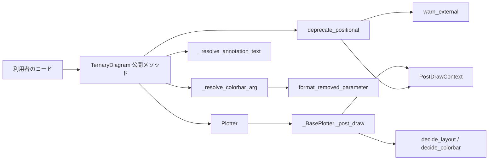
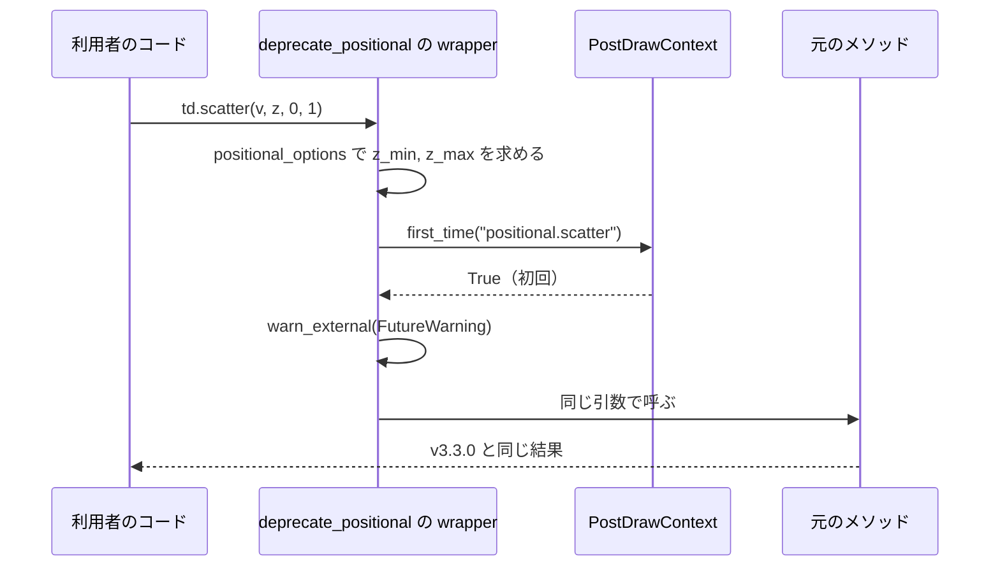
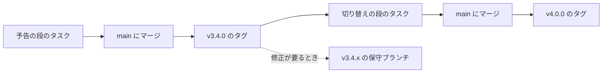

# Design Document

## Overview

本 spec は、v4.0.0 の破壊的変更を 2 段のリリースで行う。予告の段（v3.4.0）は図の結果を変えずに、v4.0.0 で動かなくなる書き方（オプションの位置引数）に FutureWarning を出し、見た目が変わる点（縦横比の固定）を文書で予告する。切り替えの段（v4.0.0）は、v3.2.1 から予告している 3 つの既定値を切り替え、`flag_cbar` を削除し、オプションをキーワード専用にし、カラーバーの有無の判定を直し、縦横比の固定を `adjustable="box"` に変える。

利用者は matplotlib で三角図を描く研究者である。v3.4.0 では警告を手がかりに自分のコードを直し、v4.0.0 では移行ページに従って新しい既定に移るか、v3.x の挙動を明示して保つ。

既存の構造（決定表の純粋な判定 `_post_draw.py`、副作用の入口 `_BasePlotter._post_draw`、利用者向けの警告の入口 `_deprecation.warn_external`）はそのまま使う。新しく足すのは、位置引数の予告のデコレータと、削除した引数の文面を作る関数だけである。

### Goals
- v3.4.0 で、キーワード専用にする 15 の引数を位置引数で渡したときに、図を変えずに FutureWarning を出す（1.1〜1.7）
- v4.0.0 で、予告どおりに既定値を切り替え、`flag_cbar` を削除し、オプションをキーワード専用にする（2.x、3.x、4.x、6.x）
- v4.0.0 で、カラーバーの有無の判定を直し、縦横比の固定を `adjustable="box"` に変える（5.x、7.1〜7.3）
- 両方の段で、CHANGELOG・移行ページ・使い方ページ・docstring を、その版の挙動に合わせる（9.x）

### Non-Goals
- Python 3.9 のサポート終了
- 縦横比の固定方法を選ぶ新しい引数
- 最初からキーワード専用の引数しか持たないメソッド（`tripcolor`・`heatmapf`・`set_*`・`annotate`・`text`・`plot`・`fill`）の変更
- ここに挙げた以外の既定値の変更、新しい描画機能

## Boundary Commitments

### This Spec Owns
- `TernaryDiagram.__init__`・`scatter`・`contour`・`colorbar` のシグネチャ（どの引数を位置引数で受けるか）と、その予告の警告
- 描画後の決定表のうち「未指定」の行（`decide_layout`、`decide_colorbar`）と、注釈の整形の未指定の分岐
- `flag_cbar` の扱い（v3.4.0 は既存の非推奨のまま、v4.0.0 は理由付きの `TypeError`）
- `PostDrawContext.has_colorbar` の判定
- `TernaryDiagram.__init__` が設定する縦横比の固定方法
- 上の変更に関わる CHANGELOG、`docs_src/user_guide/` の該当ページ、README とトップページのリンクの説明、docstring、チュートリアルと README の図の再生成

### Out of Boundary
- `_post_draw.py` の決定表のうち、指定ありの行（`tight_layout=True/False`、`colorbar=True/False`）とレイアウト状態の判定（`get_layout_state`）
- 土台の部品（`_skeleton.py`）の設定・描き直しの手順
- `tripcolor` / `heatmapf`（`_mesh.py`）の検証と描画。v4.0.0 の既定のカラーバーの扱いは決定表を通じて受けるだけ
- v3.4.0 に一緒に入る `colorbar` の向きの変更（入り済み）と、docs の Notes 節の並びの修正
- conda-forge の配布の更新

### Allowed Dependencies
- `_api.py` → `_deprecation.py`（`deprecate_positional`、`format_removed_parameter`、既存の `warn_external` など）
- `_api.py` → `_post_draw.py`（既存の `decide_*`、`PostDrawContext`）
- `_deprecation.py` は標準ライブラリ（`functools`、`inspect`、`warnings`）だけに依存し、パッケージ内を import しない（今の制約を保つ）
- `_post_draw.py` は `_deprecation.py` と matplotlib だけに依存する（今の制約を保つ）
- matplotlib の公開 API（`Axes.set_aspect`、`Colorbar.ax`、`Figure.axes`）。private API には依存しない

### Revalidation Triggers
- 決定表の行や `ColorbarAction` / `LayoutAction` の列挙値を変えたとき（`tests/test_post_draw.py` と使い方ページの表）
- `deprecate_positional` の引数の数え方を変えたとき（4 つの公開メソッドの予告）
- `TernaryDiagram.__init__` の縦横比の設定を変えたとき（土台の autoscale と、移行ページの「戻す方法」）
- matplotlib の `Colorbar.remove()` の挙動が変わったとき（`has_colorbar`）

## Architecture

### Existing Architecture Analysis
- 公開ファサード `TernaryDiagram` が Plotter を作り、Plotter は描画の後に `_BasePlotter._post_draw` をちょうど 1 回呼ぶ。`_post_draw` は `decide_colorbar` / `decide_layout`（純粋な判定）の結果に従って、カラーバーの追加、`tight_layout()`、FutureWarning を行う
- 三角図ごとの状態（カラーバーの登録、出した警告のキー）は `PostDrawContext` が持つ
- 利用者向けの警告はすべて `_deprecation.warn_external` から出る。発生位置は、パッケージの外で最初の呼び出し元（利用者の行）になる
- 縦横比は `TernaryDiagram.__init__` で 1 回だけ `ax.set_aspect("equal", adjustable="datalim")` を呼んで決める

### Architecture Pattern & Boundary Map



- 依存の向き: `_deprecation.py` ← `_post_draw.py` ← `_api.py`。逆向きの import はしない
- 予告の段で増えるのは `DP` の経路だけで、ほかの経路は変わらない。切り替えの段では `DP` を外し、`DT` の未指定の行・`RA` の未指定の分岐・`RC`・`CTX.has_colorbar` を変える

### Technology Stack

| Layer | Choice / Version | Role in Feature | Notes |
|-------|------------------|-----------------|-------|
| Library | Python 3.9+、`functools.wraps`、`inspect.signature` | 位置引数の予告のデコレータ | 新しい依存なし |
| Library | matplotlib（上限なし、CI は各 Python の最新） | `Axes.set_aspect(adjustable="box")`、`Colorbar.ax`、`Figure.axes` | 公開 API だけを使う |
| Docs | Sphinx + MyST-NB | 使い方ページと移行ページの更新 | 既存の実行規約（警告 0 件）に従う |

## File Structure Plan

### Modified Files

予告の段（v3.4.0）:
- `src/ternary_diagram/_deprecation.py` — `positional_options`、`format_positional_deprecation`、`deprecate_positional` を足す
- `src/ternary_diagram/_api.py` — `TernaryDiagram.__init__`・`scatter`・`contour`・`colorbar` に `deprecate_positional` を付ける。1 回化のための private なメソッド `_first_time` を足す。4 つの docstring と、クラスの docstring の縦横比の説明に予告を書く
- `tests/test_deprecation.py` — 3 つの関数の単体テスト
- `tests/test_keyword_arguments.py`（新規） — 4 つの公開メソッドの位置引数の扱いの結合テスト（予告の段は警告、切り替えの段は `TypeError`）
- `tests/test_side_effects.py` — 6 番目の位置引数のテストで、位置引数の予告の警告を `pytest.warns` で受ける
- `tests/test_ternary_diagram.py` — 作成後に縦横比の固定方法を変えた設定が、描画と `set_*` で保たれることのテスト
- `CHANGELOG.md` — Unreleased の Deprecations に、位置引数の非推奨と縦横比の変更の予告を書く
- `docs_src/user_guide/migration_v4.md` — 位置引数と縦横比の節を足し、概要の表と「影響を受けるコードの探し方」に加える

切り替えの段（v4.0.0）:
- `src/ternary_diagram/_deprecation.py` — `format_removed_parameter` を足す
- `src/ternary_diagram/_post_draw.py` — 決定表の未指定の行を変え、`*_AND_WARN`・警告のキー・文面の関数を消す。`has_colorbar` の判定を直す
- `src/ternary_diagram/_api.py` — 4 つのシグネチャに `*` を足し、`deprecate_positional` と `_first_time` を外す。`_resolve_colorbar_arg` で `flag_cbar` を `TypeError` にする。`_resolve_annotation_text` の未指定の分岐を v4 の規則にする。`_post_draw` から警告の分岐を消す。`set_aspect` を `adjustable="box"` にする。docstring を v4.0.0 の挙動に書き直す
- `tests/test_post_draw.py`、`tests/test_side_effects.py`、`tests/test_latex_notation.py`、`tests/test_scatter.py`、`tests/test_contour.py`、`tests/test_deprecation.py`、`tests/test_keyword_arguments.py`、`tests/test_ternary_diagram.py` — v4.0.0 の挙動に合わせて書き換える（下の Testing Strategy）
- `CHANGELOG.md` — 破壊的変更の節
- `docs_src/user_guide/migration_v4.md` — 「v4.0.0 で変わった」こととして書き直し、v3.x の挙動に戻す書き方を示す
- `docs_src/user_guide/layout_and_colorbars.md`、`docs_src/user_guide/getting_started.md`、`docs_src/user_guide/heatmaps_and_contours.md` — v3.x / v4.0.0 の比較表と FutureWarning の説明を、v4.0.0 の挙動の説明に書き直す
- `README.md`、`docs_src/index.md` — 移行ページへのリンクの説明（最小の例のコードは変えない）
- `example/*/*.ipynb` と PNG — 再実行して保存し直す（縦横比の変更で見た目が変わるため）
- `.kiro/steering/tech.md`、`.kiro/steering/structure.md` — 位置引数の規則と v4.0.0 の既定を反映する

### Directory Structure
新しいディレクトリは作らない。新規ファイルは `tests/test_keyword_arguments.py` だけ。

## System Flows

予告の段で、オプションを位置引数で渡したときの流れ:



- 2 回目以降は `first_time` が False を返し、警告せずに元のメソッドを呼ぶ
- `TernaryDiagram(...)` は `once` を持たないので、作るたびに判定する

## Requirements Traceability

| Requirement | Summary | Components | Interfaces | Flows |
|-------------|---------|------------|------------|-------|
| 1.1 | 対象の 15 引数 | TernaryDiagram シグネチャ、deprecate_positional | `deprecate_positional(func_name, n_data)` の `n_data` | 予告の流れ |
| 1.2 | 値の意味を保って警告 | deprecate_positional | wrapper が元の関数を同じ引数で呼ぶ | 予告の流れ |
| 1.3 | 文面 | format_positional_deprecation | 戻り値の文字列 | — |
| 1.4 | 発生位置 | warn_external | 既存 | — |
| 1.5 | 1 回化 | deprecate_positional、TernaryDiagram._first_time、PostDrawContext | `once(self, key)` | 予告の流れ |
| 1.6 | キーワードなら警告なし | positional_options | 戻り値が空 | — |
| 1.7 | データの引数は警告なし | positional_options | `n_data` | — |
| 2.1 | 位置引数で `TypeError` | TernaryDiagram シグネチャ（`*`） | Python の引数の束縛 | — |
| 2.2 | キーワードは同じ意味 | TernaryDiagram シグネチャ | — | — |
| 2.3 | データは位置引数でも可 | TernaryDiagram シグネチャ | — | — |
| 2.4 | 予告の警告は出ない | TernaryDiagram（デコレータを外す） | — | — |
| 3.1 | 未指定で調整しない | decide_layout | `decide_layout(None, NO_ENGINE) -> SKIP` | — |
| 3.2 | True で調整 | decide_layout（変更なし） | — | — |
| 3.3 | False で調整しない | decide_layout（変更なし） | — | — |
| 3.4 | エンジンあり・subfigure | decide_layout（変更なし） | — | — |
| 4.1 | 既存なしで追加 | decide_colorbar | `(None, existing=False) -> ADD` | — |
| 4.2 | 既存ありで追加しない | decide_colorbar | `(None, existing=True) -> SKIP` | — |
| 4.3 | True で追加 | decide_colorbar（変更なし） | — | — |
| 4.4 | False で追加しない | decide_colorbar（変更なし） | — | — |
| 4.5 | 直接付けたものは数えない | PostDrawContext | 登録したものだけを見る（変更なし） | — |
| 5.1 | 別のカラーバーを足しても残る | PostDrawContext.has_colorbar | Axes が図に残っているか | — |
| 5.2 | `remove()` でなくなる | PostDrawContext.has_colorbar | 同上 | — |
| 5.3 | 1 本でも残れば真 | PostDrawContext.has_colorbar | `any(...)` | — |
| 6.1 | 注釈の既定の整形 | _resolve_annotation_text | 未指定の分岐 | — |
| 6.2 | 明示は従来どおり | _resolve_annotation_text（変更なし） | — | — |
| 6.3 | `flag_cbar` で `TypeError` | _resolve_colorbar_arg、format_removed_parameter | 戻り値の文字列 | — |
| 6.4 | v3.4.0 は非推奨のまま | _resolve_colorbar_arg（予告の段は変更なし） | — | — |
| 7.1 | `adjustable="box"` | TernaryDiagram.__init__ | `ax.set_aspect` | — |
| 7.2 | ラベルが図の内側 | TernaryDiagram.__init__ | — | — |
| 7.3 | 利用者の設定を戻さない（v4.0.0） | TernaryDiagram、_skeleton（変更なし） | — | — |
| 7.4 | v3.4.0 は datalim のまま | TernaryDiagram.__init__（予告の段は変更なし） | — | — |
| 7.5 | 利用者の設定を戻さない（v3.4.0） | TernaryDiagram、_skeleton（変更なし） | — | — |
| 8.1 | v3.4.0 で図を変えない | deprecate_positional | 元の関数を同じ引数で呼ぶ | — |
| 8.2 | 既存の予告を同じ条件で出す | _post_draw（予告の段は変更なし） | — | — |
| 8.3 | テストとページが警告なし | テスト一式、使い方ページ | — | — |
| 9.1 | v3.4.0 の CHANGELOG | CHANGELOG.md | — | — |
| 9.2 | v3.4.0 の移行ページ | migration_v4.md | — | — |
| 9.3 | v4.0.0 の CHANGELOG | CHANGELOG.md | — | — |
| 9.4 | v4.0.0 の移行ページ | migration_v4.md | — | — |
| 9.5 | docstring | _api.py の docstring | — | — |

## Components and Interfaces

| Component | Domain | Intent | Requirements | Key Dependencies | Contracts |
|-----------|--------|--------|--------------|------------------|-----------|
| deprecate_positional ほか | `_deprecation.py` | 位置引数の予告と、削除した引数の文面 | 1.2〜1.7, 6.3, 8.1 | warn_external (P0) | Service |
| TernaryDiagram の 4 メソッド | `_api.py` | どの引数を位置引数で受けるか | 1.1, 2.1〜2.4, 9.5 | deprecate_positional (P0) | Service |
| 描画後の決定表 | `_post_draw.py` | 未指定の行の切り替え | 3.1〜3.4, 4.1〜4.4 | なし | State |
| PostDrawContext.has_colorbar | `_post_draw.py` | 登録済みのカラーバーの有無 | 4.5, 5.1〜5.3 | matplotlib (P0) | State |
| 注釈と `flag_cbar` の解決 | `_api.py` | 未指定の整形、削除した引数の拒否 | 6.1〜6.4 | format_removed_parameter (P1) | Service |
| 縦横比の設定 | `_api.py` | Axes の縦横比の固定方法 | 7.1〜7.5 | matplotlib (P0) | — |
| 利用者向けの文書 | docs、CHANGELOG | 予告と移行の案内 | 9.1〜9.4, 8.3 | — | — |

### `_deprecation.py`

#### deprecate_positional ほか

| Field | Detail |
|-------|--------|
| Intent | 位置引数で渡されたオプションを見つけて予告し、削除した引数の文面を作る |
| Requirements | 1.2, 1.3, 1.4, 1.5, 1.6, 1.7, 6.3, 8.1 |

**Responsibilities & Constraints**
- `positional_options` と `format_*` は図を使わない純粋な関数にする
- `deprecate_positional` が包んだ関数は、警告の有無にかかわらず元の関数を受け取った引数そのままで呼ぶ（値の意味と結果を変えない）
- `functools.wraps` で包み、`inspect.signature`・`__doc__`・`__wrapped__` を元の関数のものにする
- パッケージ内を import しない

##### Service Interface

```python
def positional_options(
    parameters: Sequence[str], n_data: int, n_positional: int
) -> tuple[str, ...]:
    """Names of the options passed by position.

    parameters: names of the parameters after ``self``, in order.
    n_data: how many leading parameters may be passed by position.
    n_positional: how many arguments after ``self`` were passed by position.
    Returns parameters[n_data:n_positional], or () when n_positional <= n_data.
    """


def format_positional_deprecation(func: str, names: Sequence[str]) -> str:
    """Message: the names passed by position, that they must be passed by
    keyword in FUTURE_VERSION, and an example such as
    ``scatter(..., z_min=..., z_max=...)``."""


def deprecate_positional(
    func_name: str,
    n_data: int,
    *,
    once: Callable[[Any, str], bool] | None = None,
) -> Callable[[F], F]:
    """Decorate a method whose first parameter is ``self``.

    When options are passed by position, warn with warn_external unless
    ``once(self, f"positional.{func_name}")`` returns False, then call the
    method with the same arguments. Without ``once``, warn every time.
    """


def format_removed_parameter(func: str, old: str, new: str) -> str:
    """Message: `old` of `func` was removed in FUTURE_VERSION; use `new`."""
```

- 前提条件: `deprecate_positional` を付ける関数の第 1 引数は `self` で、`n_data` 個のデータの引数がその後に続く
- 事後条件: 包んだ関数の戻り値と例外は、元の関数のものと同じ
- `F` は `TypeVar("F", bound=Callable[..., Any])`

**Implementation Notes**
- 引数の名前の並びは、デコレートするときに `inspect.signature` から 1 回だけ求める
- 位置引数の数が引数の数を超えるとき（呼び出しの誤り）は警告せず、元の関数に Python の `TypeError` を出させる
- リスク: 包んだメソッドが doctest のランナーや docstring の静的テストから見えなくなること。予告の段の最初のタスクで確かめる

### `_api.py`

#### TernaryDiagram の 4 メソッド（シグネチャ）

| Field | Detail |
|-------|--------|
| Intent | データの引数だけを位置引数で受け、オプションはキーワードで受ける |
| Requirements | 1.1, 2.1, 2.2, 2.3, 2.4, 9.5 |

**Contracts**

| メソッド | 位置引数でも受ける（`n_data`） | 予告の段でデコレータ | 切り替えの段のシグネチャ |
|---|---|---|---|
| `__init__` | `materials`（1） | `deprecate_positional("TernaryDiagram", 1)` | `(self, materials, *, ax=None, auto_latex_notation=True, tight_layout=None, ...)` |
| `scatter` | `vector`, `z`（2） | `deprecate_positional("scatter", 2, once=_first_time)` | `(self, vector, z=None, *, z_min=None, z_max=None, annotations=None, colorbar=None, auto_latex_notation=None, **kwargs)` |
| `contour` | `vector`, `z`（2） | `deprecate_positional("contour", 2, once=_first_time)` | `(self, vector, z=None, *, z_min=None, z_max=None, fill=True, colorbar=None, **kwargs)` |
| `colorbar` | `mappable`（1） | `deprecate_positional("colorbar", 1, once=_first_time)` | `(self, mappable, *, shrink=0.8, format="%.1f", label="", orientation=None, location="right", **kwargs)` |

- `_first_time(self, key: str) -> bool` は `self.__post_draw_context.first_time(key)` を返す private なメソッドで、クラス本体でデコレータより前に定義する。切り替えの段で消す
- 引数の型と既定値は変えない（`tight_layout: bool | None = None` も保つ）

**Implementation Notes**
- docstring（9.5）: 予告の段では、各メソッドの説明に「データの後の引数を位置引数で渡すのは 3.4.0 から非推奨で、4.0.0 でキーワード専用になる」旨を、`__init__` は `ax`・`auto_latex_notation` の項目に書く。クラスの docstring の縦横比の説明に、4.0.0 で Axes の枠を三角形に合わせて縮める方法に変わることを書く。切り替えの段では、予告の文を消し、v4.0.0 の既定（`tight_layout=None` は調整しない、など）を書く
- 予告の段でも切り替えの段でも、docstring の例はキーワードで渡す書き方のままで、共通の doctest のランナーで FutureWarning を出さずに通る

#### 注釈と `flag_cbar` の解決

| Field | Detail |
|-------|--------|
| Intent | 注釈の未指定の整形と、削除した引数の拒否 |
| Requirements | 6.1, 6.2, 6.3, 6.4 |

- `_resolve_annotation_text`（切り替えの段）: `auto_latex_notation is None` のとき、`str` で `$` を含まないものは `_format_text(text, default)` を返し、警告しない。`LATEX_NOTATION_WARNING_KEY` と `_latex_notation_warning_message` を消す
- `_resolve_colorbar_arg`（切り替えの段）: `"flag_cbar" in kwargs` なら `TypeError(format_removed_parameter(func, "flag_cbar", "colorbar"))` を送出する。呼び出し元の `scatter` / `contour` は Plotter を作る前にこれを呼んでいるので、何も描かない。予告の段は変えない（6.4）

#### 縦横比の設定

| Field | Detail |
|-------|--------|
| Intent | Axes の縦横比を 1:1 に固定する方法 |
| Requirements | 7.1, 7.2, 7.3, 7.4, 7.5 |

- 切り替えの段で、`TernaryDiagram.__init__` の `self.ax.set_aspect("equal", adjustable="datalim")` を `adjustable="box"` にする。ほかに `set_aspect` を呼ぶ箇所は作らない（7.3、7.5）
- 予告の段は変えない（7.4）

### `_post_draw.py`

#### 描画後の決定表

| Field | Detail |
|-------|--------|
| Intent | 未指定の行を v4.0.0 の値にする |
| Requirements | 3.1, 3.2, 3.3, 3.4, 4.1, 4.2, 4.3, 4.4 |

##### State Management

| 関数 | 入力 | v3.x | v4.0.0 |
|---|---|---|---|
| `decide_layout` | `setting=None`, `NO_ENGINE` | `APPLY_AND_WARN` | `SKIP` |
| `decide_layout` | ほかのすべての組み合わせ | 変更なし | 変更なし |
| `decide_colorbar` | `requested=None`, mappable あり, 既存あり | `ADD_AND_WARN` | `SKIP` |
| `decide_colorbar` | ほかのすべての組み合わせ | 変更なし | 変更なし |

- 切り替えの段で、到達しなくなる `LayoutAction.APPLY_AND_WARN`・`ColorbarAction.ADD_AND_WARN`・`LAYOUT_WARNING_KEY`・`COLORBAR_WARNING_KEY`・`layout_warning_message`・`colorbar_warning_message` を消し、`__all__` から外す。`_BasePlotter._post_draw` から警告の分岐を消す

#### PostDrawContext.has_colorbar

| Field | Detail |
|-------|--------|
| Intent | 三角図が付けたカラーバーが 1 本でも残っているか |
| Requirements | 4.5, 5.1, 5.2, 5.3 |

- 判定（切り替えの段）: 登録したカラーバー `cb` のうち、`cb.ax.figure is not None and cb.ax in cb.ax.figure.axes` を満たすものが 1 本でもあれば真
- `Colorbar.remove()` の後の `cb.ax.figure` は、matplotlib 3.10 では `None`、3.11 では元の図のまま。どちらも偽になる
- 登録するのは自動追加と `TernaryDiagram.colorbar` のものだけ（4.5、変更なし）

### 利用者向けの文書

| 段 | ファイル | 内容 |
|---|---|---|
| 予告 | `CHANGELOG.md` | Unreleased の Deprecations に、位置引数の非推奨（対象の引数の一覧）と、4.0.0 での縦横比の変更（影響: 凡例の `loc`、自動のカラーバーの長さ）（9.1） |
| 予告 | `migration_v4.md` | 位置引数の節と縦横比の節（影響のある書き方、新しい書き方、v3.x で試す方法 `td.ax.set_aspect("equal", adjustable="box")`）。概要の表と「影響を受けるコードの探し方」に足す（9.2） |
| 切り替え | `CHANGELOG.md` | 破壊的変更の節に本 spec のすべての変更（9.3） |
| 切り替え | `migration_v4.md` | 各変更を「v4.0.0 で変わった」こととして書き直し、v3.x に戻す書き方（`tight_layout=True`、`colorbar=True`、`auto_latex_notation` の明示、`set_aspect(..., adjustable="datalim")`）を示す（9.4） |
| 切り替え | `layout_and_colorbars.md`、`getting_started.md`、`heatmaps_and_contours.md` | v3.x / v4.0.0 の比較表と FutureWarning の説明を、v4.0.0 の挙動の説明にする（8.3） |
| 切り替え | `README.md`、`docs_src/index.md` | 移行ページへのリンクの説明を「v4.0.0 で変わった点」にする。最小の例のコードは変えない |
| 切り替え | `example/*/*.ipynb`、PNG | 再実行して保存し直す |

## Error Handling

### Error Categories and Responses

| 状況 | 段 | 応答 |
|---|---|---|
| オプションを位置引数で渡した | 予告 | FutureWarning（三角図ごと・メソッドごとに 1 回、`__init__` は毎回）。結果は変えない |
| オプションを位置引数で渡した | 切り替え | Python の `TypeError`（「takes N positional arguments but M were given」）。何も描かない |
| `flag_cbar` を渡した | 予告 | 既存の FutureWarning（改名の予告）。`colorbar` と同時なら既存の `ValueError` |
| `flag_cbar` を渡した | 切り替え | `TypeError`（`flag_cbar` は 4.0.0 で削除、`colorbar` を使う）。何も描かない |

- 警告の文面は、何が・いつ・どう書くかを含める（steering の既存の規則）

## Testing Strategy

テストは画像比較をせず、artist の状態と警告を確かめる（steering）。テスト一式は両方の段で `-W error::FutureWarning` でも通る（8.3）。

### 予告の段（v3.4.0）
- **単体（`tests/test_deprecation.py`）**
  - `positional_options`: 位置引数がデータの数以下なら空、超えた分の名前を順に返す（1.6、1.7）
  - `format_positional_deprecation`: 文面に引数の名前、`4.0.0`、キーワードの例が入る（1.3）
  - `deprecate_positional`: 元の関数を同じ引数で呼び、戻り値を返す（1.2）。`once` が False なら警告しない（1.5）。`inspect.signature` と `__doc__` が元の関数と同じ
- **結合（`tests/test_keyword_arguments.py`、4 メソッドでパラメータ化）**
  - オプションを位置引数で渡すと、FutureWarning の `match=` で引数の名前を確かめ、`filename` がテストファイルであることを確かめる（1.2〜1.4）
  - 位置引数で渡した結果が、同じ値をキーワードで渡した結果と同じ（座標・色・levels・カラーバーの有無）（1.2、8.1）
  - 同じ三角図で 2 回呼んでも警告は 1 回、別の三角図ではまた出る（1.5）
  - キーワードだけ、データだけを位置引数で渡したときは警告しない（1.6、1.7）
- **既存のテストの調整**: `tests/test_side_effects.py` の 6 番目の位置引数のテストで、位置引数の予告を `pytest.warns` で受ける（8.3）
- **縦横比（`tests/test_ternary_diagram.py`）**: 既定は `adjustable="datalim"`（7.4）。作成後に `set_aspect("equal", adjustable="box")` にした設定が、`scatter`・`contour`・`set_grid` の後も保たれる（7.5）
- **ドキュメント**: 共通の doctest のランナーと docstring の静的テストが 4 つのメソッドを今までどおり集めて通る。ドキュメントのビルドが警告 0 件

### 切り替えの段（v4.0.0）
- **決定表（`tests/test_post_draw.py`）**: 変えた 2 行と、変えない行の両方（3.1〜3.4、4.1〜4.4）
- **結合（`tests/test_side_effects.py`）**: 既定（引数を省略）で、エンジンのない図のレイアウトが変わらず警告もない（3.1）、2 回目の値で色付けした描画でカラーバーが増えない（4.2）。`tight_layout=True` と `colorbar=True` で v3.x と同じ（3.2、4.3）
- **カラーバーの判定**: 三角図が付けたカラーバーと同じ描画に `fig.colorbar` で 1 本足しても、続く既定の描画でカラーバーが増えない（5.1）。`remove()` の後は増える（5.2）。2 本のうち 1 本を外しても真（5.3）。matplotlib で直接付けたものは数えない（4.5）
- **注釈（`tests/test_latex_notation.py`）**: 未指定で `"Sample 1"` はそのまま、`"Li2O"` は整形、三角図の `auto_latex_notation=False` なら整形しない、警告なし（6.1）
- **`flag_cbar`（`tests/test_scatter.py`、`tests/test_contour.py`）**: `TypeError` の `match=` で `flag_cbar` と `colorbar` を確かめ、Axes に何も足されていない（6.3）
- **キーワード専用（`tests/test_keyword_arguments.py`）**: 位置引数で渡すと `TypeError`、何も描かない（2.1）。キーワードとデータの位置引数は通る（2.2、2.3）。警告は出ない（2.4）
- **縦横比（`tests/test_ternary_diagram.py`）**: 既定が `adjustable="box"`（7.1）。`layout="constrained"` でカラーバーの付く図で、3 つの頂点ラベルの描画範囲が図の範囲に収まる（7.2）。作成後に `datalim` に戻した設定が描画と `set_*` で保たれる（7.3）
- **ドキュメント**: ビルドが警告 0 件。使い方ページの実行で FutureWarning が出ない

## Migration Strategy



- 予告の段のタスクだけで v3.4.0 を出せる状態にする（8.1、8.2）。v3.4.0 には本 spec 外の 2 件（`colorbar` の向き、Notes 節の並び）も入る
- 切り替えの段のタスクは v3.4.0 のタグの後に main に入れる。以後の main は 4.0.0 の開発版になる。v3.4.x の修正が要るときは、タグ `v3.4.0` から保守用のブランチを切る
- 切り替えの段の前に、v3.4.0 から移行の期間を置く（時期はリリースの判断で決め、本 spec では固定しない）
