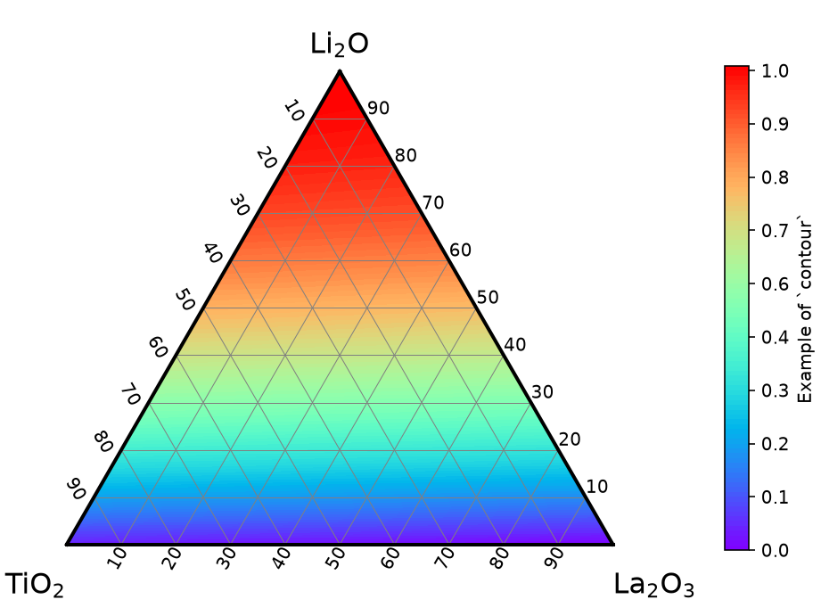
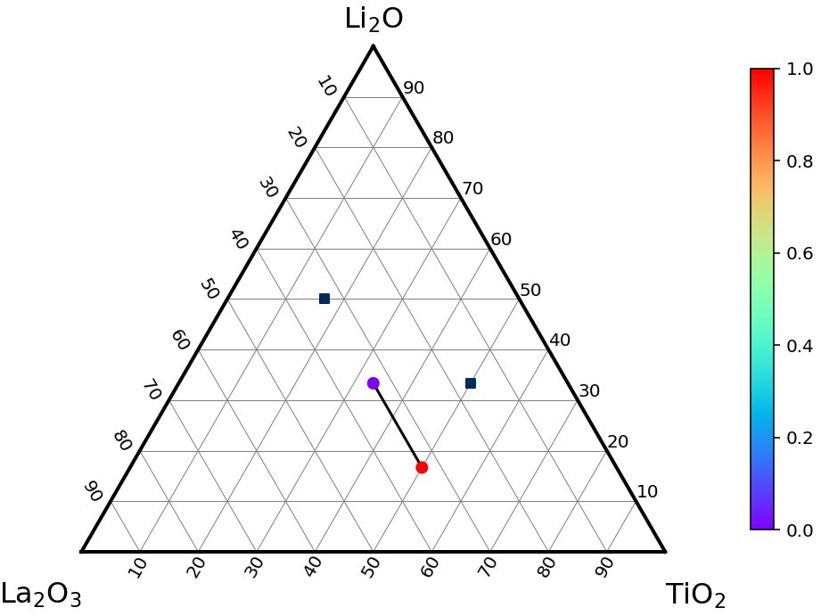

# Ternary Diagram

[](https://pypi.org/project/ternary-diagram/)
[](https://pypi.org/project/ternary-diagram/)
[](https://pypi.org/project/ternary-diagram/)
[](https://pepy.tech/project/ternary-diagram)

[](https://github.com/yu9824/ternary-diagram/actions/workflows/CI.yml)
[](https://github.com/yu9824/ternary-diagram/actions/workflows/docs.yml)
[](https://github.com/astral-sh/ruff)
[](https://anaconda.org/conda-forge/ternary-diagram)
[](https://anaconda.org/conda-forge/ternary-diagram)

`ternary-diagram` draws ternary diagrams of three-component compositions on matplotlib, **without** [pymatgen](https://pymatgen.org).
It only requires `numpy>=1.20` and `matplotlib`, and draws on any matplotlib `Axes`.



## Features

- Contour maps, scatter plots, tie lines and annotations of compositions
- Automatic formatting of chemical formulas with subscripts (`Li2O` becomes Li<sub>2</sub>O)
- Customizable diagram parts: border, grid, tick labels, axis titles and vertex labels
- Phase diagrams: filled regions (`fill`) and labels placed at compositions (`text`)
- Heatmaps: of scattered data (`tripcolor`) and of a function of the composition (`heatmapf`)
- Control over the automatic layout adjustment and colorbars, respecting the figure's layout engine
- Keyword arguments are passed through to matplotlib, and matplotlib objects are returned

## Installation

```bash
pip install ternary-diagram
```

or, from [conda-forge](https://anaconda.org/conda-forge/ternary-diagram):

```bash
conda install -c conda-forge ternary-diagram
```

## Quick start

```python
import matplotlib.pyplot as plt

from ternary_diagram import TernaryDiagram

fig, ax = plt.subplots(layout="constrained")
td = TernaryDiagram(["Li2O", "La2O3", "TiO2"], ax=ax)

# scatter plot colored by values
td.scatter(vector=[[1, 1, 1], [1, 2, 3]], z=[0, 1])
# keyword arguments are passed to `Axes.scatter`
td.scatter(vector=[[2, 1, 3], [3, 2, 1]], marker="s", c="#022c5e", s=30)

# line plot; keyword arguments are passed to `Axes.plot`
td.plot([[1, 1, 1], [1, 2, 3]], color="black")

fig.savefig("figure.png", dpi=144)
```



## Documentation

The documentation is at <https://yu9824.github.io/ternary-diagram/>.

- [User guide](https://yu9824.github.io/ternary-diagram/user_guide/index.html): getting started, customizing the diagram, phase diagrams, heatmaps and contour maps, layout and colorbars
- [Tutorials](https://yu9824.github.io/ternary-diagram/tutorials/index.html): example notebooks
- [API reference](https://yu9824.github.io/ternary-diagram/modules.html)
- [Migrating to v4.0.0](https://yu9824.github.io/ternary-diagram/user_guide/migration_v4.html): changes of the defaults planned for v4.0.0 and how to prepare for them

## Changelog

See [CHANGELOG.md](https://github.com/yu9824/ternary-diagram/blob/main/CHANGELOG.md) and [GitHub Releases](https://github.com/yu9824/ternary-diagram/releases).

## License

MIT License. See [LICENSE](https://github.com/yu9824/ternary-diagram/blob/main/LICENSE).

Copyright (c) 2021 yu9824
