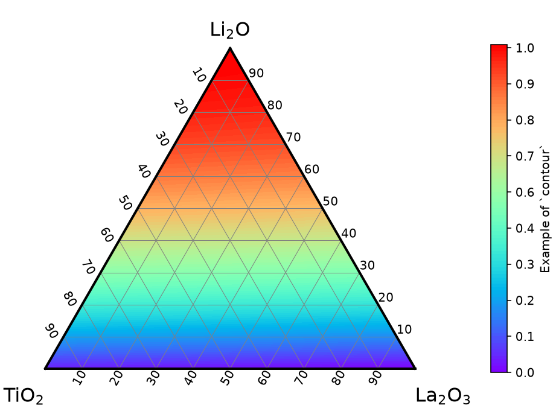
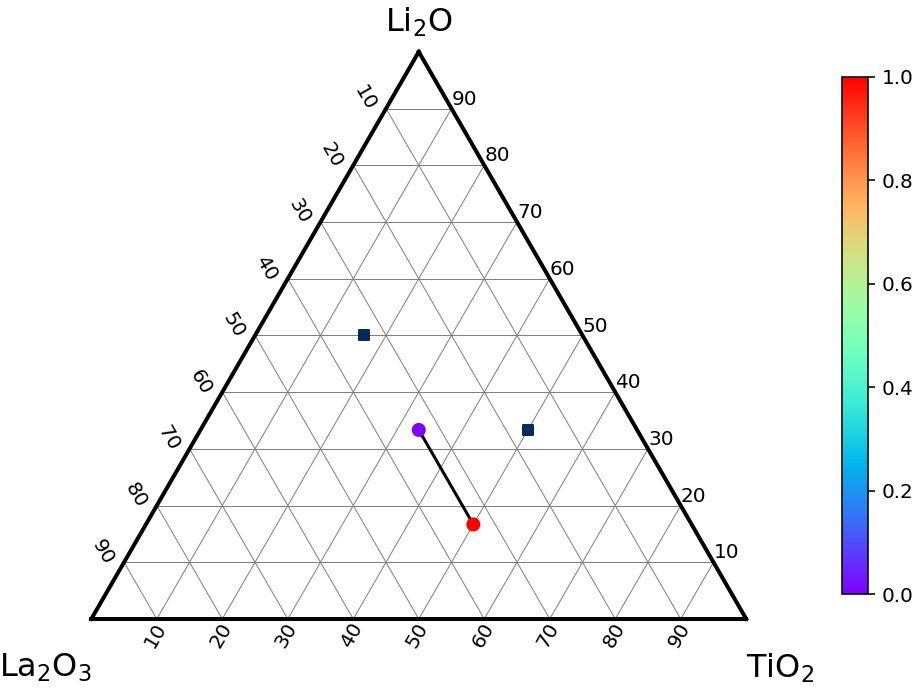

# `ternary-diagram`

`ternary-diagram` draws ternary diagrams of three-component compositions on matplotlib, **without** [pymatgen](https://pymatgen.org): scatter plots, contour maps, heatmaps, phase regions and labels, on any matplotlib `Axes`.
It only requires `numpy` and `matplotlib` at runtime.



## Installation

```bash
pip install ternary-diagram
```

or, from [conda-forge](https://anaconda.org/conda-forge/ternary-diagram):

```bash
conda install -c conda-forge ternary-diagram
```

## Quick start

```python
import matplotlib.pyplot as plt

from ternary_diagram import TernaryDiagram

fig, ax = plt.subplots(layout="constrained")
td = TernaryDiagram(["Li2O", "La2O3", "TiO2"], ax=ax)

# scatter plot colored by values
td.scatter(vector=[[1, 1, 1], [1, 2, 3]], z=[0, 1])
# keyword arguments are passed to `Axes.scatter`
td.scatter(vector=[[2, 1, 3], [3, 2, 1]], marker="s", c="#022c5e", s=30)

# line plot; keyword arguments are passed to `Axes.plot`
td.plot([[1, 1, 1], [1, 2, 3]], color="black")

fig.savefig("figure.png", dpi=144)
```



## Where to go next

- [Getting started](user_guide/getting_started.md): install the package, draw and save a first diagram, and pass compositions.
- [Customizing the diagram](user_guide/customizing.md): change the border, grid, tick labels, axis titles and vertex labels.
- [Drawing phase diagrams](user_guide/phase_diagrams.md): shade phase regions, label them and control how they overlap.
- [Heatmaps and contour maps](user_guide/heatmaps_and_contours.md): choose between colored scatter plots, contour maps and heatmaps.
- [Layout and colorbars](user_guide/layout_and_colorbars.md): control the automatic layout adjustment and colorbars.
- [Migrating to v4.0.0](user_guide/migration_v4.md): update code for the defaults that change in 4.0.0.
- [Tutorials](tutorials/index.md): example notebooks with real data.
- [API reference](modules.rst): every class, method and function.

```{toctree}
:maxdepth: 2
:caption: User guide

user_guide/index
```

```{toctree}
:maxdepth: 2
:caption: Tutorials

tutorials/index
```

```{toctree}
:maxdepth: 2
:caption: API Reference

modules
```
