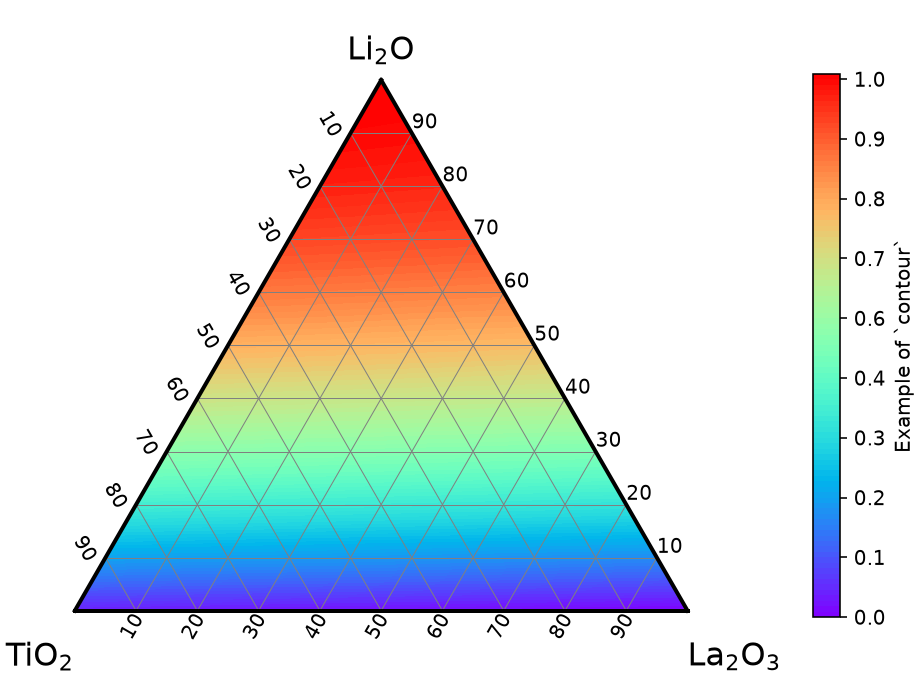

# `ternary-diagram`

Draw beautiful ternary diagrams with matplotlib, **without** [pymatgen](https://pymatgen.org).
Only `numpy` and `matplotlib` are required.



## Installation

```bash
pip install ternary-diagram
```

or

```bash
conda install -c conda-forge ternary-diagram
```

## Quick start

```python
from ternary_diagram import TernaryDiagram

td = TernaryDiagram(["Li2O", "La2O3", "TiO2"])
td.scatter(vector=[[1, 1, 1], [1, 2, 3]], z=[0, 1])
td.plot([[1, 1, 1], [1, 2, 3]], color="black")
td.fig.savefig("figure.png", dpi=144)
```

```{toctree}
:maxdepth: 2
:caption: Tutorials

tutorials/index
```

```{toctree}
:maxdepth: 2
:caption: API Reference

modules
```
